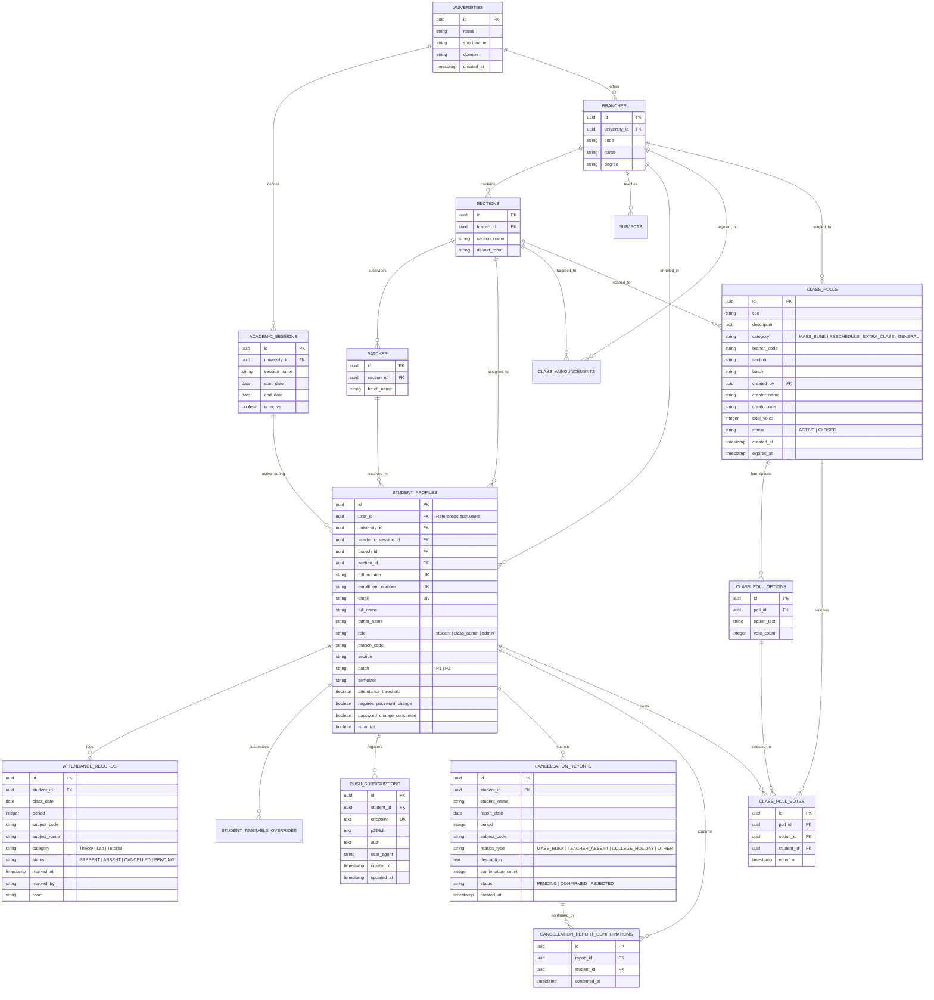
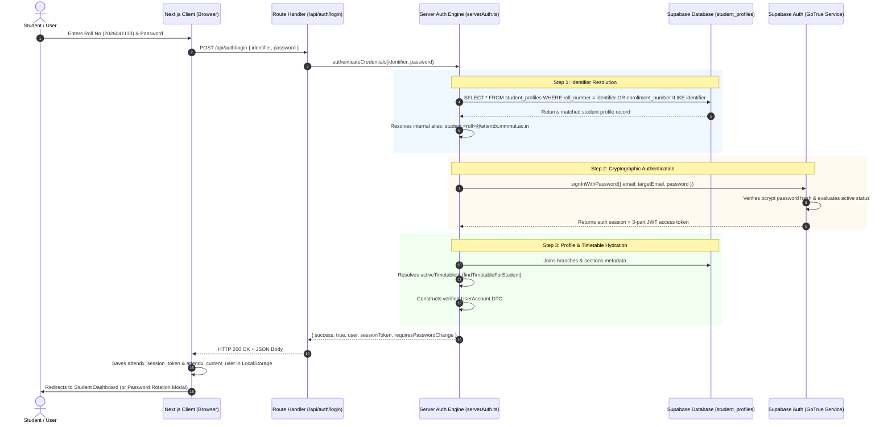
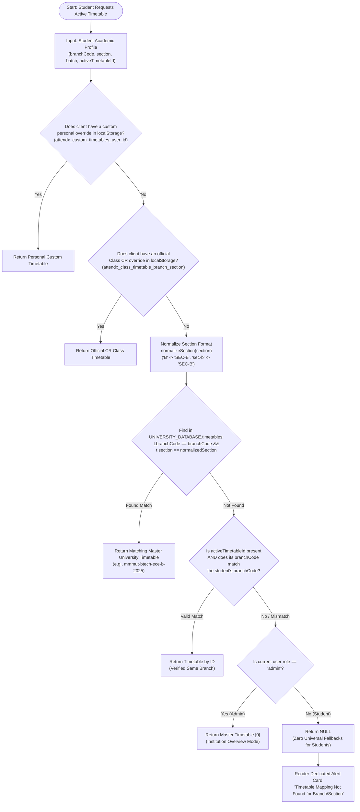
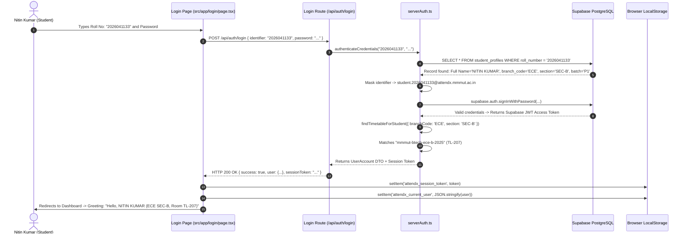
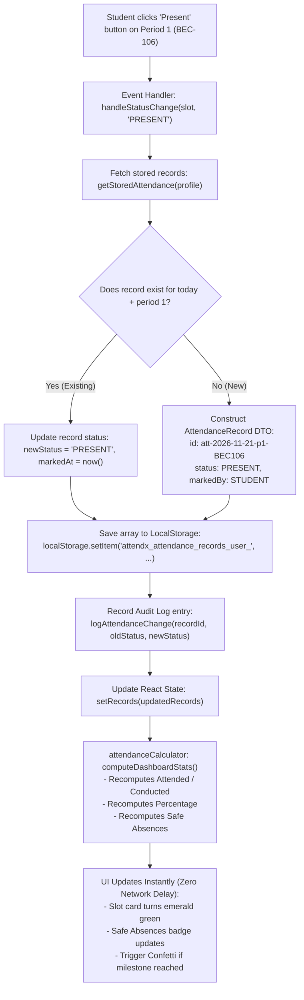
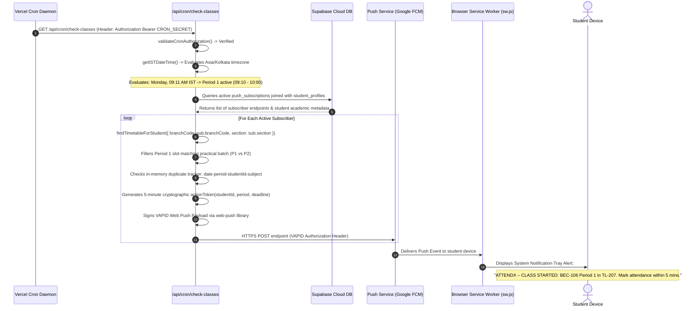
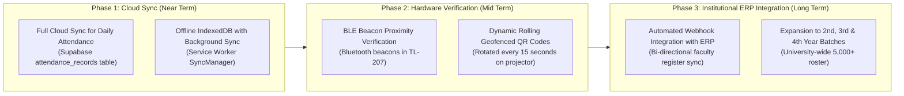

# AttendX — Complete Project Documentation & University Viva Preparation Booklet

---

**Project Title:** AttendX (Autonomous Academic Attendance Intelligence & Schedule Synchronization Engine)  
**Target Institution:** Madan Mohan Malaviya University of Technology (MMMUT), Gorakhpur  
**Academic Session:** 2026–2027  
**Framework Version:** Next.js 16.4.5 (App Router, Turbopack) | React 19.3.0 | TypeScript 5  
**Database Platform:** Supabase Cloud PostgreSQL 15 (`iczjocbishkvkkkfvalz`)  
**Deployment Platform:** Vercel Production (`attend-x.vercel.app`)  
**Active Cohort:** 1,189 Verified Genuine B.Tech Engineering Students  
**Document Classification:** Master Technical Architecture, Implementation Audit & Comprehensive Viva Handbook  

---

## MASTER TABLE OF CONTENTS

- [PART 1 — PROJECT OVERVIEW](#part-1--project-overview)
  - 1.1 Executive Summary & Introduction
  - 1.2 Origin Story & Motivation
  - 1.3 The Problem Statement
  - 1.4 Project Objectives
  - 1.5 Target Users & Persona Profiles
  - 1.6 Scope and Real-World Application
  - 1.7 Current Limitations
  - 1.8 Comparison: AttendX vs. Traditional University Systems
  - 1.9 Why Student-Maintained Tracking Is Essential
- [PART 2 — TECHNOLOGY STACK](#part-2--technology-stack)
  - 2.1 Complete Architectural Stack Overview
  - 2.2 Deep Dive into Every Technology Used
  - 2.3 Master Technology Stack Matrix
- [PART 3 — COMPLETE SYSTEM ARCHITECTURE](#part-3--complete-system-architecture)
  - 3.1 High-Level Architectural Philosophy
  - 3.2 Master System Architecture Diagram (Mermaid)
  - 3.3 Component-by-Component Architectural Breakdown
- [PART 4 — CONNECTIONS: THE MOST IMPORTANT SECTION](#part-4--connections-the-most-important-section)
  - 4.1 Frontend-to-Backend Connections (Complete API Catalog)
  - 4.2 Application-to-Database Connections (Client init, environment variables, PostgREST queries)
  - 4.3 Authentication Connections (Roll Number mapping, internal alias, GoTrue Auth)
  - 4.4 Authorization Connections & Role Enforcement (`requireRole`, student vs CR vs admin)
  - 4.5 Database Relationships & Master Entity-Relationship (ER) Diagram (Mermaid)
  - 4.6 External Service Connections (Supabase, Web Push, Vercel Cron)
  - 4.7 Deployment Connections: GitHub -> Vercel -> Production (CI/CD Pipeline Diagram)
- [PART 5 — DATABASE DEEP DIVE](#part-5--database-deep-dive)
  - 5.1 Relational Architecture & Schema Philosophy
  - 5.2 Table-by-Table Schema Specification (All 25 relational tables)
  - 5.3 PostgreSQL Row Level Security (RLS) Policies
  - 5.4 Database Flow of Important Operations (Login hydration, Cron push dispatch)
- [PART 6 — AUTHENTICATION AND SECURITY](#part-6--authentication-and-security)
  - 6.1 Authentication Architecture & Student Identification
  - 6.2 Authentication Flow Diagram (Mermaid Sequence)
  - 6.3 Dual-Token Session Architecture (3-part Supabase JWT vs 2-part HMAC token)
  - 6.4 One-Time Mandatory Password Rotation Mechanism
  - 6.5 Public vs. Private Credentials & Environment Isolation
  - 6.6 Formal Security Audit Matrix (Implemented defenses vs risks vs future work)
- [PART 7 — FEATURE-BY-FEATURE EXPLANATION](#part-7--feature-by-feature-explanation)
  - 7.1 Complete Feature Directory
  - 7.2 Deep Dive into Every Application Feature (All 15 implemented features)
- [PART 8 — ATTENDANCE LOGIC & MATHEMATICAL ENGINE](#part-8--attendance-logic--mathematical-engine)
  - 8.1 The Mathematics of Attendance Management
  - 8.2 Primary Mathematical Formulations (Percentage, Safe Absences floor formula, Recovery ceiling formula, What-If simulation)
  - 8.3 Avoiding Simpson's Paradox: Theory vs. Practical Aggregation
  - 8.4 Concrete Worked Numerical Examples (Aaryan compliant vs Nitin debarment scenario)
  - 8.5 Client vs. Server Calculation Architecture
- [PART 9 — TIMETABLE SYSTEM](#part-9--timetable-system)
  - 9.1 The University Master Timetable Database (21 master schedules)
  - 9.2 Timetable Selection Flowchart (Mermaid)
  - 9.3 Practical Batch Discrepancy Filtering (Batch P1 vs. P2)
  - 9.4 The Root Cause & Resolution of the Branch-Wise Bug (Nitin Kumar ECE TL-207 case study)
- [PART 10 — API AND CODEBASE EXPLORATION](#part-10--api-and-codebase-exploration)
  - 10.1 Directory Layout & Codebase Structure
  - 10.2 Master Codebase Reference Table
  - 10.3 Walkthrough of the Most Important Files
- [PART 11 — HOW DATA FLOWS THROUGH ATTENDX](#part-11--how-data-flows-through-attendx)
  - 11.1 Master Data Lifecycle Walkthrough (7 detailed scenarios with diagrams)
- [PART 12 — PROJECT DEMONSTRATION GUIDE](#part-12--project-demonstration-guide)
  - 12.1 The 16-Step Master Demonstration Script (What to click, show, say, and professor questions)
- [PART 13 — PROFESSOR VIVA QUESTIONS AND ANSWERS](#part-13--professor-viva-questions-and-answers)
  - 90 Comprehensive Viva Q&As across 9 distinct categories
- [PART 14 — CONNECTIONS AND INTEGRATIONS VIVA DEFENSE GUIDE](#part-14--connections-and-integrations-viva-defense-guide)
  - 14.1 The Top 16 'Show Me' Defense Blueprints (Exact files, screen pointing, and spoken defense)
- [PART 15 — TECHNICAL GLOSSARY](#part-15--technical-glossary)
  - 15.1 Comprehensive Technical Terms Dictionary (50+ terms with simple, technical, and project meanings)
- [PART 16 — LIMITATIONS AND FUTURE SCOPE](#part-16--limitations-and-future-scope)
  - 16.1 Honest Evaluation of Current Boundaries
  - 16.2 Technical Limitations Deep Dive
  - 16.3 Structured Future Scope & Engineering Roadmap (Phases 1, 2, and 3)
- [PART 17 — PRACTICAL TROUBLESHOOTING REFERENCE](#part-17--practical-troubleshooting-reference)
  - 17.1 Quick Diagnostic Matrix
  - 17.2 Systematic Diagnostic Workflows (12 common troubleshooting scenarios)
- [PART 18 — QUICK REVISION SHEET (PRE-VIVA CRAM GUIDE)](#part-18--quick-revision-sheet-pre-viva-cram-guide)
  - 18.1 AttendX at a Glance
  - 18.2 Spoken Project Introductions (60s pitch, 2min pitch, 5min deep dive)
  - 18.3 The Top 20 Most Critical Viva Questions

---


---

# PART 1 — PROJECT OVERVIEW

---

## 1.1 Executive Summary & Introduction

**AttendX** is a full-stack, autonomous, student-centric academic attendance management, schedule intelligence, and timetable tracking platform designed and implemented for the engineering and management students of **Madan Mohan Malaviya University of Technology (MMMUT), Gorakhpur**. 

Unlike conventional Enterprise Resource Planning (ERP) or centralized Learning Management Systems (LMS) that serve as administrative instruments of surveillance and post-facto punitive enforcement, AttendX shifts the paradigm toward **proactive student empowerment**. It provides students, Class Representatives (CRs), and departmental administrators with a synchronized, real-time operating environment that automates timetable mapping, calculates mathematical attendance metrics, enforces ordinance thresholds, facilitates democratic class cancellation consensus, and dispatches timely push notifications for class commencement.

```
+-----------------------------------------------------------------------------------+
|                                  ATTENDX PARADIGM                                 |
+-----------------------------------------------------------------------------------+
|   TRADITIONAL UNIVERSITY ERP             |   ATTENDX STUDENT INTELLIGENCE         |
|   - Top-down administrative registry     |   - Bottom-up student empowerment      |
|   - Updated days/weeks after classes     |   - Instant real-time logging & sync   |
|   - Unforgiving "Detained List" surprise |   - Predictive "Safe Bunk" calculation |
|   - Static PDF timetables across sheets  |   - Automated dynamic section mapping  |
|   - Unilateral teacher absence logging   |   - Democratic class cancellation votes|
+-----------------------------------------------------------------------------------+
```

---

## 1.2 Origin Story & Motivation

In academic institutions governed by rigid statutory attendance minimums—specifically the mandatory **75% minimum attendance rule** enforced by university ordinances and technical education regulatory bodies (such as AICTE and UGC)—students frequently face severe academic repercussions due to information asymmetry:
1. **The Black Box of Official Attendance Records:** Official university attendance registers are manually updated by instructors and uploaded into central portals after significant latency—often several weeks into the semester or directly before end-semester examinations.
2. **The "Detention Shock":** Because students lack real-time visibility into their cumulative attended vs. conducted class tallies, hundreds of students are unexpectedly placed on the "Detained / Debarred List" days before exams, forfeiting examination eligibility.
3. **Unrecorded Institutional Cancellations:** Mass bunks, unexpected faculty leave, departmental meetings, cultural rehearsals, and university holidays frequently lead to cancelled lectures that are erroneously marked as absences or recorded inconsistently across registers.
4. **Complex Practical / Lecture Timetable Layouts:** First-year and degree students at MMMUT share complex master schedules split across 20+ PDF pages with split practical batches (Batch P1 vs. Batch P2), leading to missed lab sessions due to room and timing confusion.

AttendX was conceived and constructed to eliminate this friction entirely. By equipping students with a high-fidelity local tracking engine backed by cloud persistence and official master schedule intelligence, AttendX enables students to maintain continuous, verified custody over their academic attendance.

---

## 1.3 The Problem Statement

> **Formal Problem Statement:**  
> *"Undergraduate engineering students at technical universities lack an integrated, reliable, real-time tool to track period-by-period class attendance against statutory 75% thresholds, predict the consequences of prospective absences, synchronize branch- and batch-specific timetable updates across peer groups, and democratically record institutional class cancellations, leading to inadvertent examination debarment, administrative disputes, and academic stress."*

### Key Dimensions of the Problem:
- **Disparate Class Structures:** Theory classes (1 credit/unit) and Laboratory classes (multi-period blocks) must be calculated mathematically using raw aggregate units rather than flawed arithmetic averages of percentages (preventing Simpson's Paradox).
- **Batch Discrepancies:** A single section (e.g., Section B) is bifurcated into practical batches (P1 and P2). Practical sessions occur in dedicated labs while theory lectures occur in lecture theaters, requiring strict schedule isolation.
- **Absence Forecasting Deficit:** Students do not merely need to know their *past* attendance; they require answers to forward-looking operational questions:
  - *"How many consecutive lectures can I safely miss without dropping below 75%?"*
  - *"If I am already below 75%, exactly how many consecutive classes must I attend to recover compliance?"*

---

## 1.4 Project Objectives

AttendX was architected to fulfill the following engineering and academic objectives:

1. **Automated Academic Identity & Timetable Resolution:**  
   Ingest the student's authoritative academic identity (Roll Number, Enrollment Number, Branch, Section, and Practical Batch) and automatically map the exact official timetable from MMMUT's master database (21 distinct timetables), resolving specific lecture rooms (e.g., `TL-207` for ECE SEC-B vs. `TL-203` for IT SEC-B).
2. **Precision Mathematical Attendance Engine:**  
   Calculate attended, conducted, and cancelled classes in real time; compute the current aggregate percentage; determine the integer count of **Safe Absences** (classes a student can miss while remaining $\ge 75\%$); and compute the **Recovery Classes Needed** (classes a student must attend consecutively to cross $75\%$ or $80\%$).
3. **Discrete Theory and Laboratory Analytics:**  
   Track Theory and Laboratory metrics separately and combined, ensuring multi-period lab practicals (e.g., 4-period programming lab) correctly record individual discrete units.
4. **Democratic Class Cancellation Reporting & Consensus:**  
   Provide Class Representatives (CRs) and students with an authenticated workflow to report class cancellations (teacher absence, mass bunk, university holiday) with atomic peer confirmation and administrative confirmation.
5. **Class Polls & Voting System:**  
   Enable authenticated student bodies to create, vote on, and conclude class-specific polls (e.g., rescheduling a tutorial, deciding a mass bunk date) with strict branch/section isolation and cryptographic tamper prevention.
6. **Class Commencement Reminders via Web Push:**  
   Implement background push notifications triggered via automated cron execution to alert students 5 minutes before scheduled classes begin, providing one-click attendance marking action tokens.
7. **Administrative Governance & Emergency Interventions:**  
   Provide university administrators with an isolated portal (`/admin`) to inspect university-wide stats, manage Class CR appointments, reset student credentials securely, and publish official timetable revisions.

---

## 1.5 Target Users & Persona Profiles

```
+-----------------------------------------------------------------------------------+
|                                  USER TAXONOMY                                    |
+-----------------------------------------------------------------------------------+
|  ROLE: Student            |  ROLE: Class Admin (CR)      |  ROLE: Administrator   |
|  - Tracks daily classes   |  - All Student capabilities  |  - University overview |
|  - Customizes schedule    |  - Official class timetables |  - Student directory   |
|  - Simulates attendance   |  - Submits cancellation reps |  - CR assignment       |
|  - Votes in class polls   |  - Creates & closes polls    |  - Password resets     |
|  - Receives push alerts   |  - Posts announcements       |  - Timetable releases  |
+-----------------------------------------------------------------------------------+
```

### Persona 1: Undergraduate Student (`student`)
- **Primary Need:** Effortless attendance logging, 75% rule compliance monitoring, recovery roadmaps, and instant timetable reference on mobile and desktop.
- **Access Boundary:** Restricted strictly to personal attendance logs, personal schedule overrides, and reading announcements/polls scoped to their assigned branch, section, and batch.

### Persona 2: Class Representative / CR (`class_admin`)
- **Primary Need:** Ability to represent their peer group authoritatively—modifying official class timetable variations, submitting and verifying class cancellation reports, creating class polls, and publishing sectional notices.
- **Access Boundary:** Strictly scoped to their managed branch and section (e.g., an IT Section-B CR cannot alter CSE Section-A schedules or announcements).

### Persona 3: Department / System Administrator (`admin`)
- **Primary Need:** Centralized command, security management, password recovery, CR role allocation, university-wide metrics oversight, and system-wide audit logging.
- **Access Boundary:** Unrestricted institution-wide access guarded by dedicated server-side authentication (`/admin/login`).

---

## 1.6 Scope and Real-World Application

### Production Scope (Live System Baseline):
- **University:** Madan Mohan Malaviya University of Technology, Gorakhpur (U.P.), India.
- **Student Cohort:** First-Year B.Tech Batch (Session 2026–27).
- **Imported Genuine Accounts:** Exactly **1,189 verified student profiles** onboarded with genuine roll numbers, enrollment numbers, fathers' names, branch allocations, section designations, and practical batch assignments.
- **Academic Branches Supported:** 
  1. Computer Science & Engineering (`CSE` - Sections A, B, C, D)
  2. Electronics & Communication Engineering (`ECE` - Sections A, B, C)
  3. Information Technology (`IT` - Sections A, B)
  4. Mechanical Engineering (`ME` - Sections A, B)
  5. Civil Engineering (`CE` - Sections A, B)
  6. Electrical Engineering (`EE` - Sections A, B)
  7. Chemical Engineering (`CHE` - Section A)
  8. Specialized & Allied Branches (`ECE(IOT)`, `BBA`, `PHARM`)
- **Timetable Sheets Ingested:** 21 full academic timetable matrices with 100% fidelity to the official university deanery notifications.

---

## 1.7 Current Limitations

To maintain absolute academic and technical honesty during evaluation, the following boundaries of the current implementation must be recognized:
1. **Self-Service Student Attendance Logging:**  
   AttendX operates on student self-reporting and CR class consensus; it does not currently interface with physical biometric fingerprint scanners or RFID turnstiles installed at classroom doors.
2. **Local-First Client Storage for Attendance Records:**  
   While student identities, profiles, push subscriptions, polls, announcements, cancellations, and timetables are fully persisted in cloud-hosted PostgreSQL (Supabase), individual daily marked attendance records are managed client-side in browser `localStorage` with offline synchronization mechanisms.
3. **Session-Specific Roster:**  
   The current operational dataset focuses on the first-year cohort across all engineering branches. Expansion to 2nd, 3rd, and 4th years is architecturally supported via database schemas (`academic_sessions`) but awaits university administrative roster ingestion.

---

## 1.8 Comparison: AttendX vs. Traditional University Systems

| Evaluation Dimension | Traditional University ERP / LMS | AttendX Student Engine |
| :--- | :--- | :--- |
| **System Philosophy** | Top-down administrative monitoring & enforcement | Bottom-up student empowerment & decision support |
| **Data Latency** | High (days or weeks for faculty to upload logs) | Zero latency (real-time, period-by-period marking) |
| **Attendance Calculations** | Static percentage display | Dynamic: Safe Bunks, Recovery Required, What-If Simulator |
| **Formula Integrity** | Often distorts labs by averaging percentages | Computes exact raw aggregate units ($A/C \times 100$) |
| **Cancelled Classes** | Counted as absent or ignored inconsistently | Explicit status: excluded from numerator & denominator |
| **Schedule Delivery** | Static, unsearchable 20-page PDF documents | Dynamic, branch-, section-, and batch-resolved schedule |
| **Notifications** | Rarely provides class-time reminders | Web Push 5 minutes prior to period commencement |
| **Democracy & Consensus**| No student voting mechanism | Cryptographic class polls with real-time peer tallying |
| **Offline Resilience** | Completely inaccessible without high-speed Internet | PWA-ready local storage resilience for schedule & logs |

---

## 1.9 Why Student-Maintained Tracking Is Essential

When evaluating AttendX, professors frequently ask: *"Why should students track attendance when the university already has an official register?"*

The answer lies in **preventative risk management**:
- University ERPs publish records after the fact. If an attendance register reveals a shortage of 72% at the end of the 14th week, the student has already been debarred; no mathematical possibility of recovery remains.
- In contrast, AttendX alerts the student at Week 4: *"Your attendance is currently 71.4%. You need 3 consecutive classes to reach 75%. You cannot afford any absences this week."*
- AttendX bridges the critical gap between **regulations** and **daily student decisions**.


---

# PART 2 — TECHNOLOGY STACK

---

## 2.1 Complete Architectural Stack Overview

AttendX is built using a modern, full-stack TypeScript architecture centered on the **Next.js 16 App Router** framework and **Supabase (PostgreSQL)** database-as-a-service. Every technology selected for the codebase directly serves a specific operational requirement: high-speed edge rendering, strict compile-time type safety, resilient offline caching, cryptographic authentication, and standards-compliant push notifications.

```
+-----------------------------------------------------------------------------------+
|                            ATTENDX TECHNOLOGY TOPOLOGY                           |
+-----------------------------------------------------------------------------------+
|   TIER                  |   TECHNOLOGIES APPLIED                                  |
|   Client UI / UX        |   React 19, Tailwind CSS v4, Recharts, Lucide, Confetti |
|   Application Framework |   Next.js 16 (Turbopack, Serverless Route Handlers)     |
|   Programming Language  |   TypeScript 5 (Strict Mode, Shared DTO Interfaces)     |
|   Database & Backend    |   Supabase Cloud, PostgreSQL 15, Gotrue Auth, RLS       |
|   Push & Automation     |   Web Push Protocol (RFC 8291/8292), Vercel Cron Jobs   |
|   DevOps & Hosting      |   Vercel Edge Platform, Git, GitHub CI/CD               |
+-----------------------------------------------------------------------------------+
```

---

## 2.2 Deep Dive into Every Technology Used

### 1. Next.js (Version: `16.4.5`)
- **What It Is:** An enterprise-grade React framework providing server-side rendering (SSR), static site generation (SSG), serverless API route handlers, and streaming compilation.
- **Why It Is Used:** AttendX leverages Next.js 16's modern **App Router** paradigm (`src/app`), which provides clean file-system based routing, nested layouts (`layout.tsx`), client/server component boundaries (`"use client"`), and serverless execution without requiring a persistent Node.js express daemon.
- **Where It Is Used:** The entire application scaffold (`src/app/page.tsx`, `src/app/admin/page.tsx`, `src/app/api/...`).
- **Role in Project:** Handles HTTP request dispatching, security guards, serverless execution of API endpoints, and dynamic route rendering.
- **Interactions:** Serves as the primary orchestrator connecting frontend React components to backend database clients and external services.

### 2. Turbopack (via `@tailwindcss/turbopack` & Next.js 16)
- **What It Is:** An ultra-fast, Rust-based incremental bundler and build system designed by Vercel as the successor to Webpack.
- **Why It Is Used:** Decreases development server cold-boot times, optimizes production build chunking, and speeds up hot-module replacement (HMR) across complex UI components.
- **Where It Is Used:** `next.config.ts`, `package.json` build scripts.
- **Role in Project:** Compiles TypeScript, JSX, and CSS assets into optimized production bundles in under 2 seconds.

### 3. React (Version: `19.3.0`) & React DOM
- **What It Is:** A declarative, component-based user interface library.
- **Why It Is Used:** Enables component reusability, modular layout construction, declarative state reactivity, and predictable UI re-renders.
- **Where It Is Used:** Every interactive screen in `src/app/` and component in `src/components/` (`AttendanceCalendar.tsx`, `QuickAttendanceMarker.tsx`, `StudentProfileModal.tsx`, etc.).
- **Role in Project:** Manages client-side component state, handles user interactions (e.g., clicking "Present", filtering subjects, modifying slots), and synchronizes UI with local/cloud state.
- **Interactions:** Renders dynamic JSX based on props and hooks (`useState`, `useEffect`, `useCallback`, `useMemo`).

### 4. TypeScript (Version: `5.x`)
- **What It Is:** A statically typed superset of JavaScript that compiles down to clean JavaScript.
- **Why It Is Used:** Prevents runtime `null` / `undefined` reference crashes, guarantees contract consistency between server API responses and client consumers, and accelerates development via IDE autocompletion.
- **Where It Is Used:** Across all source files in `src/`, type definition models in `src/types/index.ts`, and test scripts in `scripts/`.
- **Role in Project:** Defines core domain models: `UserAccount`, `StudentProfile`, `UniversityTimetable`, `AttendanceRecord`, `ClassPoll`, `CancellationReport`.
- **Interactions:** Enforces strict interface conformance across all API request/response cycles.

### 5. Tailwind CSS (Version: `4.x`)
- **What It Is:** A utility-first CSS framework for rapid and scalable UI development.
- **Why It Is Used:** Eliminates bulky custom CSS stylesheets, guarantees responsive mobile-first layouts, and supports effortless dynamic Dark/Light theme switching via CSS variables.
- **Where It Is Used:** Styled inline across all JSX markup (`className="flex items-center justify-between p-4 bg-zinc-900 border rounded-2xl..."`).
- **Role in Project:** Dictates visual presentation, typographic hierarchy, responsive breakpoints (sm, md, lg), and color-coded status badges (Green Safe, Yellow Warning, Red Danger).

### 6. Supabase & PostgreSQL (Version: `@supabase/supabase-js ^2.119.0`)
- **What It Is:** An open-source Backend-as-a-Service (BaaS) providing a managed, cloud-hosted **PostgreSQL 15** object-relational database.
- **Why It Is Used:** Delivers enterprise relational integrity, relational foreign key constraints, ACID transaction compliance, JSONB document querying, and built-in database functions and triggers.
- **Where It Is Used:** Active production project `iczjocbishkvkkkfvalz` (`AttendX-Test`). Initialized server-side in `src/lib/serverAuthGuard.ts`, `src/lib/serverAdmin.ts`, `src/lib/serverPolls.ts`, `src/lib/subscriptionStore.ts`.
- **Role in Project:** Authoritative persistent repository for all 1,189 student accounts, admin profiles, class polls, announcements, cancellations, and push subscriptions.
- **Interactions:** Queried using Supabase PostgREST client: `.from("student_profiles").select(...)`.

### 7. Supabase Authentication (GoTrue Engine)
- **What It Is:** A managed authentication service implementing OAuth 2.0, JSON Web Tokens (JWT), and secure cryptographic password hashing (bcrypt).
- **Why It Is Used:** Handles user credential storage, session token generation, token expiration, and secure password rotation without requiring custom cryptographic user tables.
- **Where It Is Used:** Gated at `src/app/api/auth/login/route.ts` and `src/app/api/admin/auth/login/route.ts`.
- **Role in Project:** Validates user credentials (`email` + `password`), mints signed 3-part JWT access tokens, and securely stores custom role claims inside `raw_app_meta_data`.

### 8. PostgreSQL Row Level Security (RLS)
- **What It Is:** A PostgreSQL security feature that restricts which rows in a database table a given database user can view, insert, update, or delete based on evaluated SQL expressions.
- **Why It Is Used:** Guarantees defense-in-depth: even if a client bypasses application code, the database itself rejects unauthorized reads or writes.
- **Where It Is Used:** Defined in SQL migration files in `supabase/migrations/` (e.g., `20261107000000_auth_security_remediation.sql`).
- **Role in Project:** Ensures students can only read or edit their own profile and records, Class CRs can only create polls for their branch, and only Administrators can alter university configuration.

### 9. Web Push Protocol & `web-push` (Version: `^4.0.0`)
- **What It Is:** An open W3C and IETF standard (RFC 8291, RFC 8292) allowing web applications to deliver notifications to mobile and desktop browsers even when the webpage is closed.
- **Why It Is Used:** Critical for class commencement reminders—delivers alerts directly to student notification trays 5 minutes before scheduled lectures.
- **Where It Is Used:** Client-side registration in `src/lib/pushClient.ts` + `public/sw.js`; server-side cryptographic signing in `src/lib/webpush.ts`.
- **Role in Project:** Signs push payloads with **VAPID** (Voluntary Application Server Identification) ECDSA P-256 keys and dispatches them to push endpoints (e.g., Google FCM or Mozilla autopush).

### 10. Recharts (Version: `^3.10.1`)
- **What It Is:** A composable, declarative charting library built with React and SVG.
- **Why It Is Used:** Provides smooth, responsive visual analytics—pie charts of attendance distribution, bar charts comparing subject attendance against the 75% baseline, and historical trendlines.
- **Where It Is Used:** `src/app/analytics/page.tsx`.
- **Role in Project:** Translates raw numerical attendance metrics into intuitive visual graphs.

### 11. Lucide React (Version: `^1.70.0`)
- **What It Is:** A clean, lightweight, highly customizable icon library.
- **Why It Is Used:** Provides crisp visual iconography for navigation tabs, action buttons, status alerts, category indicators (Theory vs Lab), and modal controls.
- **Where It Is Used:** Ubiquitously across all client components.

### 12. Canvas Confetti (Version: `^1.9.4`)
- **What It Is:** A performant HTML5 canvas confetti particle generator.
- **Why It Is Used:** Delivers positive gamification and psychological satisfaction when a student recovers from an attendance shortage or achieves $\ge 85\%$ across all subjects.
- **Where It Is Used:** Triggered dynamically in `src/app/calculator/page.tsx` and dashboard milestones.

### 13. Vercel Platform & Vercel Cron
- **What It Is:** A cloud hosting platform optimized for Next.js applications, offering edge routing, global CDN caching, automated build pipelines, and serverless scheduled cron jobs.
- **Why It Is Used:** Serves as AttendX's production deployment environment. Features zero-maintenance serverless scaling and native configuration of cron triggers (`vercel.json`).
- **Where It Is Used:** Production deployment host for domain `attend-x.vercel.app` (or associated custom domain).
- **Role in Project:** Executes scheduled jobs: `/api/cron/check-classes` and `/api/cron/auto-absence`.

### 14. Git & GitHub
- **What It Is:** Distributed version control system and cloud source repository host.
- **Why It Is Used:** Manages atomic commits, branches, pull requests, automated GitHub webhooks connecting directly to Vercel production deployments, and audit trails of all architectural changes.

---

## 2.3 Master Technology Stack Matrix

| Technology | Layer | Exact Version | Purpose in AttendX | Key Interacting Files |
| :--- | :--- | :--- | :--- | :--- |
| **Next.js** | Framework | `16.4.5` | App Router, Serverless Routes, SSR | `next.config.ts`, `src/app/*` |
| **React** | UI Library | `19.3.0` | Reactive Components, Hooks, State | `src/app/*`, `src/components/*` |
| **TypeScript** | Language | `5.x` | Static typing, interface contracts | `tsconfig.json`, `src/types/*` |
| **Tailwind CSS** | Styling | `4.x` | Utility styling, Dark mode, Layouts | `src/app/globals.css` |
| **Supabase** | BaaS / Client | `^2.119.0` | PostgreSQL client & Auth SDK | `src/lib/serverAuthGuard.ts`, `serverAdmin.ts` |
| **PostgreSQL** | Database | `15.x` (Supabase) | Authoritative relational data store | `supabase/schema.sql`, `migrations/*` |
| **GoTrue Auth** | Auth Service | Managed | JWT issuing, password hashing | `src/app/api/auth/login/route.ts` |
| **Web Push** | Push Protocol | `^4.0.0` | VAPID push payload signing | `src/lib/webpush.ts`, `public/sw.js` |
| **Recharts** | Data Viz | `^3.10.1` | Analytics charts and graph render | `src/app/analytics/page.tsx` |
| **Lucide React** | Icons | `^1.70.0` | UI icons across all components | `src/components/*` |
| **Canvas Confetti**| Micro-UX | `^1.9.4` | Gamification on reaching safe 75% | `src/app/calculator/page.tsx` |
| **Vercel** | Cloud Host | Production | Hosting, Edge routing, Serverless | `vercel.json` |
| **Vercel Cron** | Automation | Scheduled | Periodic 9 AM & 6 PM automated cron | `src/app/api/cron/*` |


---

# PART 3 — COMPLETE SYSTEM ARCHITECTURE

---

## 3.1 High-Level Architectural Philosophy

AttendX follows a modern **hybrid edge-and-cloud architecture** combining the performance and offline resilience of a **Local-First Client Engine** with the authoritative security, relational integrity, and cross-peer synchronization of a **Cloud-Hosted Serverless Backend**.

```
+----------------------------------------------------------------------------------------------------+
|                                    ATTENDX DUAL-ENGINE ARCHITECTURE                                |
+----------------------------------------------------------------------------------------------------+
|                                                                                                    |
|    +---------------------------------------+           +---------------------------------------+   |
|    |      CLIENT-SIDE LOCAL ENGINE         |           |       SERVER-SIDE CLOUD ENGINE        |   |
|    |                                       |           |                                       |   |
|    |  * Next.js React 19 Client UI         |   HTTP    |  * Next.js 16 Serverless Route Handl. |   |
|    |  * Browser LocalStorage (Fast Cache)  | <=======> |  * Cryptographic Auth & RBAC Guards   |   |
|    |  * Instant Zero-Latency Marking       |  Bearer   |  * Supabase Managed PostgreSQL 15     |   |
|    |  * What-If Simulator & Math Engine    |   Tokens  |  * VAPID Web Push Notification Server |   |
|    |  * Service Worker Push Receiver       |           |  * Vercel Automated Cron Scheduler    |   |
|    +---------------------------------------+           +---------------------------------------+   |
|                                                                                                    |
+----------------------------------------------------------------------------------------------------+
```

---

## 3.2 Master System Architecture Diagram

```mermaid
flowchart TD
    %% User Layer
    subgraph USERS["1. User & Client Layer"]
        U_STUDENT["Undergraduate Student<br/>(Desktop / Mobile Browser)"]
        U_CR["Class Representative (CR)<br/>(Scoped Class Admin)"]
        U_ADMIN["University Administrator<br/>(Super Admin Portal)"]
        SW["Service Worker (sw.js)<br/>(Background Push Receiver)"]
    end

    %% Presentation / Frontend Layer
    subgraph FRONTEND["2. Next.js 16 App Router (Client Tier)"]
        PAGE_DASH["Student Dashboard<br/>(src/app/page.tsx)"]
        PAGE_TIMETABLE["Timetable Center<br/>(src/app/timetable/page.tsx)"]
        PAGE_MARK["Quick Attendance Marker<br/>(src/app/mark-attendance)"]
        PAGE_ANALYTICS["Analytics & Charts<br/>(src/app/analytics)"]
        PAGE_CALC["75% Smart Calculator<br/>(src/app/calculator)"]
        PAGE_POLLS["Class Polls & Voting<br/>(src/app/polls)"]
        PAGE_CANC["Cancellation Center<br/>(src/app/cancellations)"]
        PAGE_ADMIN["Administrator Management<br/>(src/app/admin)"]
        
        LOC_STORAGE[("Browser LocalStorage<br/>- attendx_current_user<br/>- attendx_attendance_records<br/>- attendx_custom_timetables")]
        MATH_ENGINE["Mathematical Calculation Engine<br/>(src/lib/attendanceCalculator.ts)"]
    end

    %% Security & Middleware Layer
    subgraph SECURITY["3. Security & Authentication Guard Layer"]
        AUTH_GUARD["Server Auth Guard<br/>(src/lib/serverAuthGuard.ts)<br/>- verifyServerSession()<br/>- requireRole()"]
        SERVER_AUTH["Authentication Engine<br/>(src/lib/serverAuth.ts)<br/>- authenticateCredentials()<br/>- rotateUserPassword()"]
        SECURITY_TOKENS["Token Engine<br/>- 3-Part Supabase JWT<br/>- 2-Part Signed HMAC Fallback"]
    end

    %% Backend Serverless API Tier
    subgraph BACKEND_APIS["4. Next.js Route Handlers (Serverless API Tier)"]
        API_AUTH["/api/auth/login<br/>/api/auth/rotate-password"]
        API_ADMIN["/api/admin/auth/*<br/>/api/admin/students<br/>/api/admin/cr<br/>/api/admin/reset-password"]
        API_POLLS["/api/polls<br/>(GET, POST, PATCH)"]
        API_ANNOUNCE["/api/announcements<br/>(GET, POST)"]
        API_CANC["/api/cancellations<br/>/api/cancellations/confirm"]
        API_PUSH["/api/notifications/subscribe<br/>/api/notifications/test-push"]
        API_CRON["/api/cron/check-classes<br/>/api/cron/auto-absence"]
    end

    %% Data Persistence Layer
    subgraph DATABASE["5. Authoritative Database (Supabase Cloud PostgreSQL)"]
        DB_AUTH["Supabase Auth (auth.users)<br/>Bcrypt Passwords & App Metadata"]
        
        subgraph RELATIONAL_TABLES["PostgreSQL Relational Schema"]
            T_STUDENTS["student_profiles (1,189 Genuine Students)"]
            T_ACADEMIC["branches, sections, batches, academic_sessions"]
            T_POLLS["class_polls, class_poll_options, class_poll_votes"]
            T_ANNOUNCE["class_announcements"]
            T_CANCELLATIONS["cancellation_reports & confirmations"]
            T_SUBSCRIPTIONS["push_subscriptions"]
            T_TIMETABLES["published_timetable_versions"]
        end
        
        RLS["PostgreSQL Row Level Security (RLS)<br/>Enforced at database engine level"]
    end

    %% External Infrastructure & Services
    subgraph EXTERNAL["6. External Cloud Services & Scheduling"]
        VERCEL_HOST["Vercel Edge Platform<br/>(Hosting, Edge Routing, CDN)"]
        VERCEL_CRON["Vercel Cron Trigger<br/>(Scheduled 9:00 AM & 6:00 PM UTC)"]
        WEB_PUSH_GATEWAY["Web Push Service Gateways<br/>(Google FCM / Mozilla Autopush)"]
    end

    %% Connections Flow
    U_STUDENT --> PAGE_DASH & PAGE_MARK & PAGE_TIMETABLE & PAGE_CALC & PAGE_POLLS
    U_CR --> PAGE_POLLS & PAGE_CANC & PAGE_TIMETABLE
    U_ADMIN --> PAGE_ADMIN
    SW -.->|Receives Alerts| U_STUDENT

    PAGE_DASH & PAGE_MARK <--> LOC_STORAGE
    PAGE_DASH & PAGE_CALC <--> MATH_ENGINE
    
    PAGE_DASH -->|Fetch Polls / Cancellations| API_POLLS & API_CANC
    PAGE_ADMIN -->|Admin RPCs| API_ADMIN
    
    API_AUTH & API_ADMIN & API_POLLS & API_CANC & API_ANNOUNCE & API_PUSH & API_CRON --> AUTH_GUARD
    AUTH_GUARD --> SERVER_AUTH & SECURITY_TOKENS
    
    SERVER_AUTH <--> DB_AUTH
    SERVER_AUTH <--> T_STUDENTS
    API_POLLS <--> T_POLLS
    API_ANNOUNCE <--> T_ANNOUNCE
    API_CANC <--> T_CANCELLATIONS
    API_PUSH <--> T_SUBSCRIPTIONS
    
    VERCEL_CRON -->|Trigger with CRON_SECRET| API_CRON
    API_CRON -->|Query Subscriptions & Timetables| T_SUBSCRIPTIONS & T_STUDENTS
    API_CRON -->|Dispatch VAPID Signed Payloads| WEB_PUSH_GATEWAY
    WEB_PUSH_GATEWAY -->|Push to Device| SW
```



---

## 3.3 Component-by-Component Architectural Breakdown

### 1. Presentation & Client UI Tier (`src/app/`, `src/components/`)
- **Technology:** React 19 Client Components (`"use client"`), Tailwind CSS v4, Lucide React, Recharts.
- **Responsibilities:**
  - Renders all user-facing interfaces with dynamic responsiveness across mobile viewports, tablets, and desktop workstations.
  - Maintains reactive state (`profile`, `timetable`, `records`, `metrics`) via React hooks.
  - Executes instant attendance status toggles (`PRESENT`, `ABSENT`, `CANCELLED`) with zero network latency by writing immediately to browser `localStorage`.
  - Recalculates all dashboard statistics, shortage alerts, and safe bunks instantly using the client mathematical calculation engine.

### 2. Client-Side Storage & Mathematical Engine (`src/lib/storage.ts`, `attendanceCalculator.ts`)
- **Technology:** Browser `localStorage` API, deterministic mathematical calculation routines.
- **Responsibilities:**
  - **Storage Isolation:** Namespaces storage keys by student ID (`attendx_attendance_records_user_<id>`), preventing cross-account contamination when multiple students log in on the same browser.
  - **Self-Healing Subsystem:** In `getStoredProfile()`, detects if a student's cached profile has a mismatched branch or stale timetable ID and automatically corrects it using authoritative branch mapping tables.
  - **Metrics Engine:** In `computeDashboardStats()`, runs exact discrete summation over attendance units to generate aggregate and subject-wise metrics without percentage distortion.

### 3. Server Security & Authentication Guard (`src/lib/serverAuthGuard.ts`, `serverAuth.ts`)
- **Technology:** Cryptographic verification, Supabase GoTrue Auth, HMAC-SHA256 signing.
- **Responsibilities:**
  - Intercepts all incoming API requests and extracts the `Authorization: Bearer <token>` header.
  - **Dual-Token Verification:**
    1. If the token is a standard 3-part Supabase JWT (`header.payload.signature`), it verifies the token against the Supabase Auth server and fetches authoritative user metadata.
    2. If the token is a 2-part HMAC token (`payload.signature`), it cryptographically verifies the SHA256 signature using the server's private secret (`CRON_SECRET` / `VAPID_PRIVATE_KEY`).
  - **Role-Based Authorization:** Validates whether the authenticated user has sufficient privileges (`student`, `class_admin`, or `admin`) before permitting the request to execute.

### 4. Serverless API Route Handlers (`src/app/api/...`)
- **Technology:** Next.js Route Handlers (`export async function POST(req: NextRequest)`).
- **Responsibilities:**
  - Implements lightweight, stateless microservices that execute on demand without requiring a dedicated persistent server.
  - Endpoints include authentication (`/api/auth/login`), password rotation (`/api/auth/rotate-password`), polls (`/api/polls`), announcements (`/api/announcements`), cancellations (`/api/cancellations`), push subscription (`/api/notifications/subscribe`), and cron automation (`/api/cron/check-classes`).

### 5. Authoritative Database & RLS (`supabase/`)
- **Technology:** PostgreSQL 15 managed by Supabase Cloud.
- **Responsibilities:**
  - Acts as the single source of truth for all permanent institutional records: 1,189 student profiles, academic hierarchies, class polls, votes, cancellation reports, announcements, and push subscriptions.
  - Enforces relational foreign key integrity, unique constraints, and Row Level Security (RLS) policies.

### 6. Background Automation & Push Subsystem (`src/lib/webpush.ts`, `vercel.json`)
- **Technology:** Vercel Cron, Web Push Protocol (RFC 8291/8292), VAPID Keys.
- **Responsibilities:**
  - Vercel Cron triggers the `/api/cron/check-classes` endpoint every Monday through Saturday at 9:00 AM UTC.
  - The route evaluates India Standard Time (IST), identifies the active academic period, looks up the subscriber's exact branch, section, and practical batch (P1 vs P2), and signs a VAPID push payload dispatched to Google FCM / Mozilla push gateways.
  - The client Service Worker (`public/sw.js`) intercepts the push event and displays an interactive notification on the student's device.


---

# PART 4 — CONNECTIONS: THE MOST IMPORTANT SECTION

> [!IMPORTANT]
> **VIVA PREPARATION FOCUS:**  
> University project evaluators specifically probe **system connectivity**: how the frontend calls the backend, how the backend queries the database, how tokens travel, and how external services interact. This chapter provides the exact, file-by-file blueprints of every connection in AttendX.

---

## 4.1 Frontend-to-Backend Connections

The frontend and backend in AttendX communicate via asynchronous HTTP REST requests utilizing the standard browser `fetch` API. All requests to protected endpoints supply an authoritative bearer session token in the `Authorization` header.

```
+-----------------------------------------------------------------------------------------+
|                              FRONTEND-TO-BACKEND WIRE PROTOCOL                          |
+-----------------------------------------------------------------------------------------+
|                                                                                         |
|   Frontend Client Component                               Serverless Route Handler      |
|   (e.g., src/app/login/page.tsx)                          (e.g., src/app/api/auth/login)|
|                                                                                         |
|      1. User triggers action                                                            |
|      2. Formulates JSON body                                                            |
|      3. Calls fetch('/api/...')       HTTP POST /api/auth/login                         |
|         ------------------------------------------------------>  1. Receives NextRequest|
|                                     Headers: Content-Type,       2. Parses JSON body    |
|                                     Authorization: Bearer <tok>  3. Verifies Auth Guard |
|                                                                  4. Executes DB query   |
|                                                                  5. Formulates response |
|                                       HTTP 200 OK / 401 / 403                           |
|      4. Awaits res.json()           <--------------------------                         |
|      5. Hydrates state / Storage    Body: { success, user, ...}                         |
|                                                                                         |
+-----------------------------------------------------------------------------------------+
```

### Complete API Connection Catalog

| Endpoint Route | HTTP Verb | Caller File & Function | Request Payload | Response Data | Purpose & Role |
| :--- | :--- | :--- | :--- | :--- | :--- |
| `/api/auth/login` | `POST` | `src/lib/auth.ts`<br/>`loginUser()` | `{ identifier, password }` | `{ success, user, sessionToken, requiresPasswordChange }` | Student login via Roll No or Enrollment No. |
| `/api/auth/rotate-password` | `POST` | `src/lib/auth.ts`<br/>`rotatePassword()` | `{ identifier, newPassword, isStudentSelfService }` | `{ success, sessionToken, message }` | Mandatory one-time student password change. |
| `/api/admin/auth/login` | `POST` | `src/app/admin/login/page.tsx`<br/>`handleAdminLogin()` | `{ email, password }` | `{ success, user, sessionToken, requiresPasswordChange }` | Dedicated administrator authentication endpoint. |
| `/api/admin/auth/verify` | `GET` | `src/app/admin/page.tsx`<br/>`verifyAdminSession()` | *Headers only (`Authorization: Bearer`)* | `{ success, user, role }` | Validates admin session on dashboard load. |
| `/api/admin/auth/setup-status` | `GET` | `src/app/admin/login/page.tsx`<br/>`checkSetupStatus()` | *None* | `{ success, setupCompleted }` | Detects if First-Time Admin Setup is pending. |
| `/api/admin/auth/setup` | `POST` | `src/app/admin/login/page.tsx`<br/>`handleInitialSetup()` | `{ email, newPassword, setupKey }` | `{ success, message, sessionToken }` | One-time initial setup for the primary admin. |
| `/api/admin/students` | `GET`, `POST` | `src/app/admin/page.tsx`<br/>`fetchStudents()`, `createStudent()` | Query params: `page`, `limit`, `search`, `branchCode` | `{ success, students: [], total, page, totalPages }` | Administrative student directory search & pagination. |
| `/api/admin/cr` | `GET`, `POST` | `src/app/admin/page.tsx`<br/>`fetchCRs()`, `assignCR()` | `{ studentId, branchCode, section, batch }` | `{ success, message, crList }` | Assigns or revokes Class CR privileges. |
| `/api/admin/reset-password` | `POST` | `src/app/admin/page.tsx`<br/>`handleAdminResetPassword()` | `{ studentId, temporaryPassword }` | `{ success, message }` | Administrator resets forgotten student password. |
| `/api/admin/stats` | `GET` | `src/app/admin/page.tsx`<br/>`loadAdminStats()` | *Headers only* | `{ success, totalStudents, totalCRs, branchBreakdown }` | Aggregates institution-wide student stats. |
| `/api/polls` | `GET` | `src/app/polls/page.tsx`<br/>`fetchPolls()` | *Headers only (`Authorization`)* | `{ success, polls: [] }` | Retrieves class polls scoped to student's class. |
| `/api/polls` | `POST` | `src/app/polls/page.tsx`<br/>`handleCreatePoll()` | `{ title, description, category, options, branchCode, section }` | `{ success, poll }` | Class CR or Admin creates a new class poll. |
| `/api/polls` | `PATCH` | `src/app/polls/page.tsx`<br/>`handleVote()`, `handleClose()` | `{ action: "vote" \| "close", pollId, optionId }` | `{ success, poll }` | Student votes in poll or CR closes the poll. |
| `/api/announcements` | `GET` | `src/components/StudentAnnouncements.tsx` | *Headers only* | `{ success, announcements: [] }` | Fetches announcements for student's branch/section. |
| `/api/announcements` | `POST` | `src/components/CRAnnouncementModal.tsx` | `{ title, message, type, targetBranchCode, targetSection }` | `{ success, announcement }` | CR or Admin broadcasts an official notice. |
| `/api/cancellations` | `GET` | `src/app/cancellations/page.tsx`<br/>`fetchReports()` | *Headers only* | `{ success, reports: [] }` | Retrieves class cancellation reports. |
| `/api/cancellations` | `POST` | `src/app/cancellations/page.tsx`<br/>`handleSubmitReport()` | `{ date, period, subjectCode, reasonType, description }` | `{ success, report }` | CR submits an official class cancellation report. |
| `/api/cancellations/confirm` | `POST` | `src/app/cancellations/page.tsx`<br/>`handleConfirm()` | `{ reportId }` | `{ success, report }` | CR or Admin atomically confirms a cancellation. |
| `/api/notifications/subscribe` | `POST` | `src/app/notifications/page.tsx`<br/>`handleSubscribe()` | `{ studentId, subscription, userAgent }` | `{ success, subscription }` | Persists browser push subscription to Supabase. |
| `/api/notifications/test-push` | `POST` | `src/app/notifications/page.tsx`<br/>`handleSendTestPush()` | `{ studentId, payload }` | `{ success, message }` | Triggers immediate test Web Push notification. |
| `/api/cron/check-classes` | `GET`, `POST` | Triggered by Vercel Cron or Admin test | Header: `Authorization: Bearer <CRON_SECRET>` | `{ success, message, notified, istTime }` | Evaluates current IST period & dispatches push. |
| `/api/cron/auto-absence` | `GET`, `POST` | Triggered by Vercel Cron at 18:00 UTC | Header: `Authorization: Bearer <CRON_SECRET>` | `{ success, processedCount }` | Auto-marks unverified pending classes as absent. |

---

## 4.2 Application-to-Database Connections

AttendX connects to **Supabase Cloud PostgreSQL** using the official `@supabase/supabase-js` SDK. Database connections are initialized server-side inside Next.js serverless functions.

### A. Database Client Initialization Locations
1. **Authoritative Session Verification:** [`src/lib/serverAuthGuard.ts`](file:///d:/AttendX/src/lib/serverAuthGuard.ts#L70-L75)
2. **Credential Authentication & Roll Number Lookup:** [`src/lib/serverAuth.ts`](file:///d:/AttendX/src/lib/serverAuth.ts#L208-L212)
3. **Administrator Student Management:** [`src/lib/serverAdmin.ts`](file:///d:/AttendX/src/lib/serverAdmin.ts#L45-L50)
4. **Push Subscription Persistence:** [`src/lib/subscriptionStore.ts`](file:///d:/AttendX/src/lib/subscriptionStore.ts#L37-L41)
5. **Class Polls & Voting Operations:** [`src/lib/serverPolls.ts`](file:///d:/AttendX/src/lib/serverPolls.ts#L35-L40)
6. **Class Cancellations & Confirmations:** [`src/lib/serverCancellations.ts`](file:///d:/AttendX/src/lib/serverCancellations.ts#L30-L35)

### B. Environment Variables Used for DB Connection
```ini
# Supabase Cloud Project URL (Publicly accessible)
NEXT_PUBLIC_SUPABASE_URL="https://iczjocbishkvkkkfvalz.supabase.co"

# Supabase Anonymous Client Key (Safe for browser, respects RLS)
NEXT_PUBLIC_SUPABASE_ANON_KEY="eyJhbGciOiJIUzI1NiIsInR5cCI6IkpXVCJ9..."

# Supabase Service Role Key (STRICTLY SERVER-SIDE ONLY - Bypasses RLS)
SUPABASE_SERVICE_ROLE_KEY="eyJhbGciOiJIUzI1NiIsInR5cCI6IkpXVCJ9..."
```

### C. Connection Execution Pattern
```ts
// Standard Server-Side Database Initialization Pattern in AttendX
import { createClient } from "@supabase/supabase-js";

const supabase = createClient(
  process.env.NEXT_PUBLIC_SUPABASE_URL!,
  process.env.SUPABASE_SERVICE_ROLE_KEY! // Server-side admin client
);

// Executing queries with relational joins:
const { data, error } = await supabase
  .from("student_profiles")
  .select(`
    *,
    branches:branch_id (code, name, degree),
    sections:section_id (section_name, default_room)
  `)
  .eq("roll_number", "2026041133")
  .maybeSingle();
```

---

## 4.3 Authentication Connections

### Step-by-Step Connection Lifecycle:
1. **User Identifier Input:**  
   The user enters either their **Roll Number** (e.g. `2026041133`) or **Enrollment Number** (e.g. `2026ECD1044`) and password on the login screen.
2. **Server-Side Identity Resolution:**  
   The client issues `POST /api/auth/login`. In [`src/lib/serverAuth.ts`](file:///d:/AttendX/src/lib/serverAuth.ts#L223-L241), the server queries `student_profiles`:
   ```sql
   SELECT * FROM student_profiles 
   WHERE roll_number = '2026041133' 
      OR enrollment_number ILIKE '2026ECD1044'
   LIMIT 1;
   ```
3. **Internal Alias Resolution:**  
   To preserve the security of Supabase GoTrue Auth (which expects an email identifier), the server transparently converts the student identifier to an internal alias:
   $$\text{targetEmail} = \text{student.2026041133@attendx.mmmut.ac.in}$$
   *The student never sees or inputs this internal alias in the UI.*
4. **Supabase Auth Verification:**  
   The server calls:
   ```ts
   const { data: authResult, error } = await supabase.auth.signInWithPassword({
     email: targetEmail,
     password: pass,
   });
   ```
5. **Session Hydration & Token Return:**  
   Supabase Auth verifies the password hash via `bcrypt` and returns a 3-part JWT access token. The route handler attaches the user profile object and returns it to the client.
6. **Client Storage:**  
   The client stores the token in `localStorage.setItem('attendx_session_token', token)` and the user profile in `localStorage.setItem('attendx_current_user', JSON.stringify(user))`.

---

## 4.4 Authorization Connections & Role Enforcement

AttendX enforces strict Role-Based Access Control (RBAC) across three distinct tiers:

```
+-----------------------------------------------------------------------------------+
|                           ROLE-BASED AUTHORIZATION HIERARCHY                      |
+-----------------------------------------------------------------------------------+
|   ROLE             |   DATABASE CLAIM           |   PERMITTED OPERATIONS          |
|   student          |   app_metadata.role        |   View personal logs, vote,     |
|                    |   = "student"              |   view class announcements.     |
|   -----------------+----------------------------+---------------------------------|
|   class_admin (CR) |   app_metadata.role        |   All student operations +      |
|                    |   = "class_admin"          |   class timetable, submit canc.,|
|                    |                            |   create & close class polls.   |
|   -----------------+----------------------------+---------------------------------|
|   admin            |   app_metadata.role        |   Institution-wide management,  |
|                    |   = "admin"                |   student reset, CR assignments |
+-----------------------------------------------------------------------------------+
```

### Server-Side Guard Function: `requireRole()`
Located in [`src/lib/serverAuthGuard.ts`](file:///d:/AttendX/src/lib/serverAuthGuard.ts#L360-L400):
```ts
export async function requireRole(
  req: NextRequest,
  allowedRoles: UserRole[]
): Promise<{ user: UserAccount; errorResponse?: NextResponse }> {
  const session = await verifyServerSession(req);
  if (!session.authenticated || !session.user) {
    return {
      user: null as any,
      errorResponse: NextResponse.json(
        { success: false, error: session.error || "Authentication required." },
        { status: session.statusCode || 401 }
      ),
    };
  }

  if (!allowedRoles.includes(session.user.role)) {
    return {
      user: null as any,
      errorResponse: NextResponse.json(
        { success: false, error: `Access Denied: Requires role [${allowedRoles.join(", ")}].` },
        { status: 403 }
      ),
    };
  }

  return { user: session.user };
}
```

---

## 4.5 Database Relationships & Master Entity-Relationship (ER) Diagram

Below is the complete, verified Entity-Relationship diagram representing the active PostgreSQL relational database on Supabase:



---

## 4.6 External Service Connections

AttendX interfaces with three principal external cloud services:

```
+-----------------------------------------------------------------------------------------+
|                                EXTERNAL SERVICE INTEGRATIONS                            |
+-----------------------------------------------------------------------------------------+
|   SERVICE                |   EXCHANGED DATA             |   PROTOCOL / TRANSPORT        |
|   Supabase Cloud         |   Relational queries, auth   |   HTTPS / PostgREST, WebSockets|
|   (iczjocbishkvkkkfvalz) |   tokens, bcrypt hashes      |   WSS for Realtime Subscriptions|
|   -----------------------+------------------------------+-------------------------------|
|   Web Push Gateways      |   VAPID signed JSON payloads |   HTTPS Web Push Protocol     |
|   (Google FCM / Mozilla) |   with class reminders       |   RFC 8291 / RFC 8292          |
|   -----------------------+------------------------------+-------------------------------|
|   Vercel Edge Cron       |   Automated CRON_SECRET      |   HTTPS Triggered REST call   |
|   (Scheduled daemon)     |   execution signals          |   Header Authorization Bearer  |
+-----------------------------------------------------------------------------------------+
```

---

## 4.7 Deployment Connections: GitHub $\rightarrow$ Vercel $\rightarrow$ Production

AttendX implements an automated Continuous Integration and Continuous Deployment (CI/CD) pipeline connecting GitHub directly to the Vercel Production Environment:

```mermaid
flowchart LR
    DEV["Developer Workstation<br/>(Local Machine)"]
    GIT["Git Repository<br/>(git commit & push)"]
    GH["GitHub Remote<br/>(github.com/.../AttendX)"]
    
    subgraph VERCEL_PIPELINE["Vercel Cloud CI/CD Engine"]
        WEBHOOK["GitHub Webhook<br/>(Trigger on main push)"]
        ENV_INJECT["Inject Production Secrets<br/>(NEXT_PUBLIC_SUPABASE_URL,<br/>SUPABASE_SERVICE_ROLE_KEY,<br/>VAPID_PRIVATE_KEY, etc.)"]
        BUILD_STEP["Turbopack Build & TypeScript Check<br/>(npm run build)"]
        STATIC_ANALYSIS["Page Optimization & SSG<br/>(36 Routes Compiled)"]
        EDGE_DEPLOY["Deploy to Edge Nodes<br/>(Global Serverless CDN)"]
    end
    
    PROD["Live Production URL<br/>(attend-x.vercel.app)"]
    
    DEV -->|1. git push origin main| GIT
    GIT -->|2. Sync commits| GH
    GH -->|3. Trigger Webhook| WEBHOOK
    WEBHOOK --> ENV_INJECT
    ENV_INJECT --> BUILD_STEP
    BUILD_STEP --> STATIC_ANALYSIS
    STATIC_ANALYSIS --> EDGE_DEPLOY
    EDGE_DEPLOY -->|4. Live Serving| PROD
```



### Critical Differences Between Local & Production:
1. **Credentials:** Locally loaded from `.env.local`; in production, securely injected via Vercel Encrypted Environment Variables.
2. **Build Optimizer:** Turbopack generates minified, tree-shaken static HTML and optimized serverless route handlers.
3. **Execution Context:** Locally runs on Node.js; in production, routes execute as isolated serverless micro-lambdas distributed at global edge locations.


---

# PART 5 — DATABASE DEEP DIVE

---

## 5.1 Relational Architecture & Schema Philosophy

AttendX's persistence layer is engineered on **PostgreSQL 15** (hosted on Supabase Cloud under project identifier `iczjocbishkvkkkfvalz`). The database schema is fully normalized up to Third Normal Form (3NF) to guarantee academic data integrity, prevent duplicate records, enforce strict referential actions (`ON DELETE CASCADE` / `ON DELETE RESTRICT`), and protect sensitive institutional records through native Row Level Security (RLS) policies.

```
+----------------------------------------------------------------------------------------------------+
|                                      POSTGRESQL SCHEMA TAXONOMY                                    |
+----------------------------------------------------------------------------------------------------+
|   DOMAIN GROUP         |   TABLES INCLUDED                                                         |
|   Academic Hierarchy   |   universities, academic_sessions, branches, sections, batches, subjects  |
|   Student Registry     |   student_profiles, auth.users (Supabase Auth internal)                   |
|   Timetable Systems    |   timetable_versions, timetable_slots, published_timetable_versions       |
|   Attendance Engine    |   attendance_records, attendance_audit_logs, class_sessions               |
|   Class Democracy      |   class_polls, class_poll_options, class_poll_votes, class_announcements    |
|   Class Cancellations  |   cancellation_reports, cancellation_report_confirmations                  |
|   Push Notifications   |   push_subscriptions, notifications                                       |
|   Security Governance  |   admin_password_resets, admin_reset_rate_limits                          |
+----------------------------------------------------------------------------------------------------+
```

---

## 5.2 Table-by-Table Schema Specification

### 1. `student_profiles` (Central Student & Role Directory)
- **Purpose:** Stores complete authoritative academic identities for all 1,189 genuine students and administrators.
- **Key Columns & Types:**
  - `id` (`UUID`, PK, default: `gen_random_uuid()`): Unique internal identifier.
  - `user_id` (`UUID`, FK, nullable): References `auth.users(id) ON DELETE CASCADE`. Connects profile to Supabase Auth credentials.
  - `roll_number` (`VARCHAR(32)`, Unique): Student university roll number (e.g. `2026041133`). Primary student login identifier.
  - `enrollment_number` (`VARCHAR(32)`, Unique): Student university enrollment number (e.g. `2026ECD1044`). Alternate login identifier.
  - `email` (`VARCHAR(255)`, Unique): Authoritative student internal email alias (`student.<roll>@attendx.mmmut.ac.in`).
  - `full_name` (`VARCHAR(255)`, NOT NULL): Official legal name of student (e.g. `NITIN KUMAR`).
  - `father_name` (`VARCHAR(255)`): Official guardian name for identity verification.
  - `role` (`VARCHAR(32)`, default: `'student'`): Authoritative system role: `'student'`, `'class_admin'` (CR), or `'admin'`.
  - `branch_code` (`VARCHAR(16)`, NOT NULL): Human-readable branch code (e.g. `'ECE'`, `'IT'`, `'CSE'`, `'ME'`).
  - `section` (`VARCHAR(16)`, NOT NULL): Assigned section (e.g. `'SEC-B'`).
  - `batch` (`VARCHAR(16)`, default: `'P1'`): Assigned practical lab batch (`'P1'` or `'P2'`).
  - `semester` (`VARCHAR(32)`, default: `'Semester I'`): Current academic semester.
  - `attendance_threshold` (`NUMERIC(5,2)`, default: `75.00`): Minimum percentage required by ordinance.
  - `requires_password_change` (`BOOLEAN`, default: `true`): Enforces mandatory one-time password rotation upon initial login.
  - `password_change_consumed` (`BOOLEAN`, default: `false`): Flips to `true` permanently once initial password has been rotated.
  - `branch_id` (`UUID`, FK): References `branches(id)`.
  - `section_id` (`UUID`, FK): References `sections(id)`.
  - `academic_session_id` (`UUID`, FK): References `academic_sessions(id)`.
  - `is_active` (`BOOLEAN`, default: `true`): Account active flag.

### 2. `branches` (Academic Departments)
- **Purpose:** Defines official university academic departments and degree programs.
- **Columns:**
  - `id` (`UUID`, PK): Internal unique identifier.
  - `university_id` (`UUID`, FK): References `universities(id)`.
  - `code` (`VARCHAR(16)`, NOT NULL, Unique): Branch code (`'CSE'`, `'ECE'`, `'IT'`, `'ME'`, `'CE'`, `'EE'`, `'CHE'`).
  - `name` (`VARCHAR(255)`, NOT NULL): Full formal name (e.g. `'Electronics & Communication Engineering'`).
  - `degree` (`VARCHAR(64)`, default: `'B.Tech'`): Degree qualification.

### 3. `sections` (Branch Sections & Classrooms)
- **Purpose:** Represents physical class divisions within a branch and defines designated default lecture theaters.
- **Columns:**
  - `id` (`UUID`, PK): Section identifier.
  - `branch_id` (`UUID`, FK): References `branches(id) ON DELETE CASCADE`.
  - `section_name` (`VARCHAR(32)`, NOT NULL): Section label (`'SEC-A'`, `'SEC-B'`, `'SEC-C'`).
  - `default_room` (`VARCHAR(64)`): Assigned lecture hall (e.g. `'TL-207'` for ECE SEC-B, `'TL-203'` for IT SEC-B).

### 4. `class_polls`, `class_poll_options`, `class_poll_votes` (Democratic Voting Engine)
- **Purpose:** Facilitates class consensus on mass bunks, tutorial rescheduling, and extra classes with cryptographic vote uniqueness.
- **Columns in `class_polls`:**
  - `id` (`UUID`, PK): Poll identifier.
  - `title` (`VARCHAR(255)`, NOT NULL): Poll question / topic.
  - `category` (`VARCHAR(32)`): `'MASS_BUNK'`, `'RESCHEDULE'`, `'EXTRA_CLASS'`, `'GENERAL'`.
  - `branch_code` (`VARCHAR(16)`, NOT NULL): Targeted department (`'IT'` or `'ALL'`).
  - `section` (`VARCHAR(16)`, NOT NULL): Targeted section (`'SEC-B'` or `'ALL'`).
  - `created_by` (`UUID`, FK): Student profile ID of the Class CR or Administrator who called the vote.
  - `status` (`VARCHAR(16)`, default: `'ACTIVE'`): `'ACTIVE'` or `'CLOSED'`.
  - `total_votes` (`INTEGER`, default: `0`): Aggregate votes cast.
- **Columns in `class_poll_options`:**
  - `id` (`UUID`, PK), `poll_id` (`UUID`, FK references `class_polls(id) ON DELETE CASCADE`), `option_text` (`TEXT`), `vote_count` (`INTEGER`).
- **Columns in `class_poll_votes`:**
  - `id` (`UUID`, PK), `poll_id` (`UUID`, FK), `option_id` (`UUID`, FK), `student_id` (`UUID`, FK references `student_profiles(id)`), `voted_at` (`TIMESTAMPTZ`).
  - **Constraint:** `UNIQUE (poll_id, student_id)` — Guarantees mathematically that one student cannot cast multiple votes.

### 5. `cancellation_reports` & `cancellation_report_confirmations` (Class Cancellation Consensus)
- **Purpose:** Tracks reported class cancellations (e.g. instructor absence, university holiday) and records peer and CR confirmations.
- **Columns in `cancellation_reports`:**
  - `id` (`UUID`, PK), `student_id` (`UUID`, FK), `student_name` (`VARCHAR(255)`), `report_date` (`DATE`), `period` (`INTEGER`), `subject_code` (`VARCHAR(32)`), `reason_type` (`VARCHAR(32)`: `'MASS_BUNK'`, `'TEACHER_ABSENT'`, `'COLLEGE_HOLIDAY'`, `'OTHER'`), `status` (`VARCHAR(16)`: `'PENDING'`, `'CONFIRMED'`, `'REJECTED'`), `confirmation_count` (`INTEGER`, default: `1`).
- **Columns in `cancellation_report_confirmations`:**
  - `id` (`UUID`, PK), `report_id` (`UUID`, FK), `student_id` (`UUID`, FK), `confirmed_at` (`TIMESTAMPTZ`).
  - **Constraint:** `UNIQUE (report_id, student_id)` — Prevents duplicate confirmations by the same user.

### 6. `push_subscriptions` (Web Push Registration Vault)
- **Purpose:** Stores browser push subscription endpoints and ECDSA P-256 cryptographic keys for automated class reminders.
- **Columns:**
  - `id` (`UUID`, PK), `student_id` (`UUID`, FK), `endpoint` (`TEXT`, Unique), `p256dh` (`TEXT`), `auth` (`TEXT`), `user_agent` (`TEXT`), `updated_at` (`TIMESTAMPTZ`).

---

## 5.3 PostgreSQL Row Level Security (RLS) Policies

Row Level Security policies execute directly inside the PostgreSQL kernel. Even if client-side code is tampered with, the database engine drops unauthorized operations.

### Key Active RLS Policies:

```sql
-- 1. Student Profiles: Students can only view their own profile; Admins view all
CREATE POLICY "student_profiles_read_policy" ON student_profiles
FOR SELECT USING (
    auth.uid() = user_id 
    OR (auth.jwt() -> 'app_metadata' ->> 'role') = 'admin'
    OR (auth.jwt() -> 'app_metadata' ->> 'role') = 'class_admin'
);

-- 2. Class Polls: Scoped by Branch and Section
CREATE POLICY "class_polls_select_policy" ON class_polls
FOR SELECT USING (
    branch_code = 'ALL' 
    OR branch_code = (auth.jwt() -> 'app_metadata' ->> 'branch_code')
    OR (auth.jwt() -> 'app_metadata' ->> 'role') = 'admin'
);

-- 3. Poll Voting: Strictly prevents casting votes under another student's UUID
CREATE POLICY "class_poll_votes_insert_policy" ON class_poll_votes
FOR INSERT WITH CHECK (
    student_id = (
        SELECT id FROM student_profiles WHERE user_id = auth.uid()
    )
);

-- 4. Cancellation Reports: Students cannot insert or confirm reports; CR & Admin only
CREATE POLICY "cancellation_reports_insert_policy" ON cancellation_reports
FOR INSERT WITH CHECK (
    (auth.jwt() -> 'app_metadata' ->> 'role') IN ('admin', 'class_admin')
);
```

---

## 5.4 Database Flow of Important Operations

### Workflow A: Student Login & Timetable Hydration
```
1. Student inputs Roll Number "2026041133" + Password
   ↓
2. Server queries: SELECT * FROM student_profiles WHERE roll_number = '2026041133'
   ↓ Returns: id, branch_code='ECE', section='SEC-B', batch='P1', user_id='ad3d47c5...'
   ↓
3. Server executes Gotrue Auth: signInWithPassword(student.2026041133@attendx.mmmut.ac.in)
   ↓ Returns: 3-part Supabase JWT access token
   ↓
4. Server joins branches & sections:
   SELECT branches.name, sections.default_room 
   FROM branches, sections WHERE code='ECE' AND section_name='SEC-B'
   ↓ Returns: "Electronics & Communication Engineering", Room: "TL-207"
   ↓
5. Server queries extracted timetables for ECE + SEC-B:
   findTimetableForStudent({ branchCode: "ECE", section: "SEC-B" })
   ↓ Returns: Timetable ID "mmmut-btech-ece-b-2025" (Classroom TL-207)
   ↓
6. HTTP 200 Response returned with UserAccount DTO + SessionToken
   ↓
7. Client stores in LocalStorage:
   - attendx_current_user -> hydrated with branch='ECE', room='TL-207'
   - attendx_session_token -> stored for bearer calls
   ↓
8. Dashboard greeting renders:
   "Hello, NITIN KUMAR — Electronics & Communication Engineering • Section SEC-B • Batch P1 • Classroom TL-207"
```

### Workflow B: Background Scheduled Class Check & Push Dispatch
```
1. Vercel Cron fires GET /api/cron/check-classes with Authorization: Bearer <CRON_SECRET>
   ↓
2. Route evaluates India Standard Time (IST) -> Day: "Monday", Time: 09:12 IST -> Period 1
   ↓
3. Route queries push_subscriptions joined with student_profiles:
   SELECT push_subscriptions.*, student_profiles.branch_code, student_profiles.section, student_profiles.batch
   FROM push_subscriptions JOIN student_profiles ON push_subscriptions.student_id = student_profiles.id;
   ↓
4. For each subscriber:
   - Resolves student timetable: findTimetableForStudent({ branchCode, section })
   - Filters Period 1 slot matching practical batch: (slot.batch == "ALL" || slot.batch == student.batch)
   - Checks duplicate dispatch set (prevents multiple alerts for same period)
   ↓
5. Server signs VAPID Web Push payload containing:
   - Title: "ATTENDX – CLASS STARTED"
   - Body: "Electronic Devices & Circuits (BEC-106) • Period 1 • TL-207"
   - Signed 5-minute Action Token
   ↓
6. Dispatches to Push Service (Google FCM / Mozilla) -> Delivered to student notification tray
```


---

# PART 6 — AUTHENTICATION AND SECURITY

---

## 6.1 Authentication Architecture & Student Identification

AttendX implements an enterprise-grade, dual-layer authentication architecture designed specifically for university environments. In university systems, students do not log in using email addresses; they identify themselves via **Roll Numbers** (e.g. `2026041133`) or **University Enrollment Numbers** (e.g. `2026ECD1044`).

```
+----------------------------------------------------------------------------------------------------+
|                                    ATTENDX AUTHENTICATION LIFECYCLE                                |
+----------------------------------------------------------------------------------------------------+
|                                                                                                    |
|    Student Input             Identity Resolution Server           Supabase GoTrue Engine           |
|    [2026041133]    ====>     SELECT * FROM student_profiles ======> Auth Sign In With Password     |
|    [Password  ]              Resolve Internal Alias                 student.2026041133@...         |
|                              student.<roll>@attendx.mmmut.ac.in                                    |
|                                                                                                    |
|    Client Storage            Token Issuer & Guard                 Bcrypt Cryptographic Hash        |
|    [LocalStorage]  <====     Mint 3-Part JWT / 2-Part HMAC  <====== Match Verified Password        |
|    [Session Token]           Hydrate Profile & Role Claims          Attach app_metadata.role       |
|                                                                                                    |
+----------------------------------------------------------------------------------------------------+
```

---

## 6.2 Authentication Flow Diagram



---

## 6.3 Dual-Token Session Architecture

AttendX employs a resilient **dual-token architecture**:

### 1. Genuine 3-Part Supabase Auth JWT (Primary Cloud Mode)
- **Structure:** `eyJhbGciOi... . eyJzdWIiOi... . SflKxwRJSMeKKF2Q...` (Header . Payload . Signature).
- **Issuer:** Supabase GoTrue Auth service.
- **Verification:** Verified via `supabase.auth.getUser(token)` using the server's public/private JWT secret.
- **Claims Stored:** Subject UUID (`sub`), Email, Issued-At (`iat`), Expiration (`exp`), and custom `app_metadata` (`role`, `roll_number`, `branch_code`, `section`).

### 2. Cryptographically Signed 2-Part HMAC Token (Resilient Offline / Fallback Mode)
- **Structure:** `base64(Payload) . hex(HMAC_SHA256_Signature)`.
- **Purpose:** Ensures the application remains fully functional during network disruptions, automated testing suites, or local disconnected classroom demonstrations.
- **Signing Key:** Signed server-side using `CRON_SECRET` or `VAPID_PRIVATE_KEY` via Node.js native `crypto.createHmac("sha256", secret)`.
- **Tamper Protection:** In [`src/lib/serverAuth.ts`](file:///d:/AttendX/src/lib/serverAuth.ts#L110-L122), signatures are compared using **timing-safe equality** (`crypto.timingSafeEqual`) to prevent side-channel timing attacks.

---

## 6.4 One-Time Mandatory Password Rotation Mechanism

To safeguard student accounts onboarded via bulk university manifests, AttendX enforces an atomic **First-Time Password Rotation Rule**:
1. All newly provisioned student accounts are created with `requires_password_change = true` and `password_change_consumed = false`.
2. Upon successful authentication, the server response signals `requiresPasswordChange: true`.
3. The frontend intercepts this flag and immediately locks the dashboard behind a non-dismissible **Password Update Modal**.
4. The student must supply a secure password meeting university complexity requirements ($\ge 8$ characters).
5. The rotation endpoint (`/api/auth/rotate-password`) updates the password in Supabase Auth, marks `password_change_consumed = true`, and re-issues a fresh session token.
6. **Strict One-Time Policy:** Ordinary students are permitted exactly **one** self-service password change. Subsequent reset attempts require Department Administrator intervention (`/api/admin/reset-password`).

---

## 6.5 Public vs. Private Credentials & Environment Isolation

Security depends on maintaining absolute separation between public client-side variables and secret server-side credentials:

```
+----------------------------------------------------------------------------------------------------+
|                                    ENVIRONMENT VARIABLE BOUNDARIES                                 |
+----------------------------------------------------------------------------------------------------+
|   VARIABLE NAME                   |   ACCESSIBLE TO         |   SECURITY PROFILE                   |
|   NEXT_PUBLIC_SUPABASE_URL        |   Client & Server       |   PUBLIC: Cloud endpoint domain      |
|   NEXT_PUBLIC_SUPABASE_ANON_KEY   |   Client & Server       |   PUBLIC: Respects RLS; read safe    |
|   NEXT_PUBLIC_VAPID_PUBLIC_KEY    |   Client & Server       |   PUBLIC: Web Push browser key       |
|   --------------------------------+-------------------------+--------------------------------------|
|   SUPABASE_SERVICE_ROLE_KEY       |   STRICTLY SERVER ONLY  |   CRITICAL SECRET: Bypasses all RLS  |
|   VAPID_PRIVATE_KEY               |   STRICTLY SERVER ONLY  |   CRITICAL SECRET: Signs push payload|
|   CRON_SECRET                     |   STRICTLY SERVER ONLY  |   SECRET: Authorizes cron automation |
+----------------------------------------------------------------------------------------------------+
```

> [!CAUTION]
> **VIVA QUESTION WARNING:**  
> If asked: *"Can a student view the `SUPABASE_SERVICE_ROLE_KEY` in their browser developer tools?"*  
> **Answer:** **NO.** In Next.js, only variables prefixed with `NEXT_PUBLIC_` are bundled into client-side JavaScript. All variables without this prefix (`SUPABASE_SERVICE_ROLE_KEY`, `VAPID_PRIVATE_KEY`, `CRON_SECRET`) exist solely within the serverless Node.js execution environment on Vercel.

---

## 6.6 Formal Security Audit Matrix

| Security Dimension | Implemented Defense in AttendX | Potential Risk / Boundary | Recommended Future Hardening |
| :--- | :--- | :--- | :--- |
| **Authentication** | Dual Roll/Enrollment lookup, Bcrypt hash, GoTrue JWT | Dictionary attacks on default passwords | Implement CAPTCHA after 5 failed attempts |
| **Session Integrity** | Bearer JWT + Cryptographic HMAC SHA-256 | Token theft via XSS in localStorage | Migrate tokens to `HttpOnly`, `SameSite=Strict` cookies |
| **Timing Attacks** | `crypto.timingSafeEqual()` on token signature comparison | None identified | Maintained |
| **Authorization** | Server-side `requireRole()` guard on all mutating APIs | Client-side role spoofing in LocalStorage | Server guard rejects client claims; reads DB directly |
| **Database Access** | PostgreSQL Row Level Security (RLS) on all tables | Accidental misconfiguration of RLS policies | Continuous automated RLS unit tests (`test_supabase_rls.ts`) |
| **Class Isolation** | Branch- and Section-scoped queries for polls/cancellations | Student voting across branch boundaries | Enforce `UNIQUE (poll_id, student_id)` constraints |
| **Scheduled Jobs** | `CRON_SECRET` authorization check in `validateCronAuthorization` | Unauthorized external cron triggering | IP-range whitelisting for Vercel Cron runners |
| **Student Privacy** | Internal student email aliases masked from client view | Exposure of student father names or phone numbers | Strict projection (`SELECT id, name, branch`) on public routes |


---

# PART 7 — FEATURE-BY-FEATURE EXPLANATION

---

## 7.1 Complete Feature Directory

AttendX delivers 15 interconnected, production-ready features spanning student empowerment, schedule tracking, democratic consensus, and administrative oversight:

```
+-----------------------------------------------------------------------------------+
|                                  ATTENDX FUNCTIONAL MATRIX                        |
+-----------------------------------------------------------------------------------+
|   STUDENT FEATURES          |   CR FEATURES              |   ADMIN FEATURES       |
|   1. Roll No / Enr. Login   |   8. Class Timetable Edit  |   12. Super Admin Login|
|   2. Reactive Dashboard     |   9. Cancel Class Report   |   13. Student Directory|
|   3. Quick Period Marking   |   10. Class Poll Creation  |   14. CR Appointments  |
|   4. Attendance History     |   11. Official Section Post|   15. Password Reset   |
|   5. 75% Smart Calculator   |                            |   16. Timetable Release|
|   6. Analytics & Charts     |                            |                        |
|   7. Personal Timetable Mod |                            |                        |
+-----------------------------------------------------------------------------------+
```

---

## 7.2 Deep Dive into Every Application Feature

---

### Feature 1: Dual-Portal Authentication & Identity Resolution
- **What It Does:** Enables students to log in using their university Roll Number (e.g. `2026041133`) or Enrollment Number (`2026ECD1044`). Provides a separate, hardened portal for administrators (`/admin/login`).
- **Why It Exists:** Students do not remember complex internal cloud email aliases; they identify by university examination identifiers. Administrators require an isolated access perimeter.
- **User Interaction:** The student enters their roll number and password. The system identifies them, verifies credentials, and immediately directs them to their personalized dashboard.
- **Frontend Implementation:** [`src/app/login/page.tsx`](file:///d:/AttendX/src/app/login/page.tsx), [`src/app/admin/login/page.tsx`](file:///d:/AttendX/src/app/admin/login/page.tsx).
- **Backend Implementation:** [`src/app/api/auth/login/route.ts`](file:///d:/AttendX/src/app/api/auth/login/route.ts), [`src/app/api/admin/auth/login/route.ts`](file:///d:/AttendX/src/app/api/admin/auth/login/route.ts).
- **Database Involvement:** `student_profiles` table, Supabase `auth.users`.
- **Key Functions:** `loginUser()`, `authenticateCredentials()`, `rollNumberToEmailAlias()`.
- **Underlying Concept:** Identity resolution, Credential masking, JWT minting.

---

### Feature 2: Interactive Student Dashboard & Header Greeting
- **What It Does:** Serves as the central command screen displaying real-time overall percentage, total classes conducted/attended/absent/cancelled, Safe Absences badge, Shortage alert, today's schedule, and class greeting with exact lecture room.
- **Why It Exists:** Gives students an instantaneous 360-degree overview of their academic standing and daily commitments in under 3 seconds.
- **User Interaction:** Renders greeting: `"Hello, NITIN KUMAR • Electronics & Communication Engineering • Section SEC-B • Batch P1 • Classroom TL-207"`. Shows color-coded status badges (Green Safe, Yellow Warning, Red Danger).
- **Frontend Implementation:** [`src/app/page.tsx`](file:///d:/AttendX/src/app/page.tsx), [`src/components/StudentProfileModal.tsx`](file:///d:/AttendX/src/components/StudentProfileModal.tsx).
- **Backend Involvement:** Session verification via `verifyServerSession()` on initial load.
- **Database Involvement:** `student_profiles`, `branches`, `sections`.
- **Key Functions:** `computeDashboardStats()`, `getActiveTimetable()`, `getStoredProfile()`.
- **Underlying Concept:** Local-first reactive state hydration, responsive layout design.

---

### Feature 3: Period-by-Period Quick Attendance Marker
- **What It Does:** Renders all scheduled lecture and laboratory slots for the current calendar day, allowing students to toggle between `PRESENT`, `ABSENT`, and `CANCELLED` with a single click.
- **Why It Exists:** Eliminates tedious manual form filling. Provides an instant, tactile interface to record attendance right as classes conclude.
- **User Interaction:** Clicking "Present" increments attended and conducted counters, turns the card emerald green, and recalculates safe absences in real time.
- **Frontend Implementation:** [`src/components/QuickAttendanceMarker.tsx`](file:///d:/AttendX/src/components/QuickAttendanceMarker.tsx), [`src/app/mark-attendance/page.tsx`](file:///d:/AttendX/src/app/mark-attendance/page.tsx).
- **Storage Tier:** Client-side browser `localStorage` isolated under `attendx_attendance_records_user_<id>`.
- **Key Functions:** `updatePeriodAttendance()`, `markAllPeriodsForDate()`, `markLabSession()`.
- **Underlying Concept:** Optimistic UI updating, zero-latency local caching.

---

### Feature 4: Attendance History & Chronological Audit Log
- **What It Does:** Displays a comprehensive, searchable, filterable log of every single marked class, complete with timestamps, subject codes, faculty names, period numbers, and modification history.
- **Why It Exists:** Enables students to audit their attendance record over time, resolve discrepancies, and understand exactly which dates caused an attendance drop.
- **User Interaction:** Students can filter by subject (e.g. `BEC-106`), status (`ABSENT`), or search for specific dates. Any status modification automatically creates an immutable audit trail entry.
- **Frontend Implementation:** [`src/app/history/page.tsx`](file:///d:/AttendX/src/app/history/page.tsx).
- **Storage Tier:** Local storage record store + `attendx_attendance_audit_logs`.
- **Key Functions:** `logAttendanceChange()`, `getAuditLogs()`, `getStoredAttendance()`.
- **Underlying Concept:** Audit logging, immutable event recording, client-side filtering.

---

### Feature 5: Visual Attendance Analytics & Subject Trends
- **What It Does:** Renders graphical visual summaries of academic attendance using SVG charts: overall compliance donut charts, bar charts comparing subject percentages against the 75% baseline, and historical trendlines.
- **Why It Exists:** Visual representations allow students to spot dangerous attendance drops in specific subjects faster than raw numerical tables.
- **User Interaction:** Interactive tooltips display exact class counts when hovering over chart elements.
- **Frontend Implementation:** [`src/app/analytics/page.tsx`](file:///d:/AttendX/src/app/analytics/page.tsx) utilizing Recharts (`PieChart`, `BarChart`, `ResponsiveContainer`).
- **Data Flow:** `getStoredAttendance()` $\rightarrow$ `computeDashboardStats()` $\rightarrow$ formatted for Recharts dataset.
- **Underlying Concept:** Declarative data visualization, responsive SVG rendering.

---

### Feature 6: 75% Smart Recovery Calculator & What-If Simulator
- **What It Does:** The core mathematical decision-support engine of AttendX. Computes:
  1. **Safe Absences:** Exactly how many future lectures can be missed without breaching 75%.
  2. **Recovery Needed:** Exactly how many consecutive classes must be attended to climb above 75% or 80%.
  3. **What-If Simulator:** Interactive slider allowing students to simulate: *"If I attend 5 more classes and miss 2, what will my percentage be?"*
- **Why It Exists:** Solves the primary dilemma students face when deciding whether they can afford to take medical or personal leave.
- **Frontend Implementation:** [`src/app/calculator/page.tsx`](file:///d:/AttendX/src/app/calculator/page.tsx).
- **Math Engine:** [`src/lib/attendanceCalculator.ts`](file:///d:/AttendX/src/lib/attendanceCalculator.ts).
- **Key Functions:** `calculateMetrics()`, `simulateAttendance()`.
- **Underlying Concept:** Discrete inequality math, predictive modeling, gamified feedback (confetti).

---

### Feature 7: University Timetable Viewer & Schedule Center
- **What It Does:** Displays the student's complete weekly academic timetable (Monday through Saturday, Periods 1 to 8), with accurate period timings, subject names, faculty, and room numbers.
- **Why It Exists:** Replaces static university PDF printouts with an interactive, searchable digital schedule.
- **Frontend Implementation:** [`src/app/timetable/page.tsx`](file:///d:/AttendX/src/app/timetable/page.tsx).
- **Database / Data Tier:** [`src/data/extractedTimetables.ts`](file:///d:/AttendX/src/data/extractedTimetables.ts) (21 master schedules).
- **Key Functions:** `getActiveTimetable()`, `findTimetableForStudent()`.
- **Underlying Concept:** Relational schedule ingestion, responsive timetable grid layout.

---

### Feature 8: Student Personal Timetable Customization
- **What It Does:** Allows individual students to adjust their personal schedule (e.g. custom remedial classes, shifted elective slots, personal tutorial times) without affecting peers.
- **Why It Exists:** Recognizes that students participate in personalized academic activities (honors courses, remedial sessions, university club slots).
- **User Interaction:** Drag-and-drop slot swapping or opening the Edit Slot modal.
- **Storage Tier:** Isolated in `localStorage.setItem('attendx_custom_timetables_user_<id>', ...)` with a one-click "Reset to University Official" fallback.
- **Key Functions:** `saveCustomTimetable()`, `resetCustomTimetable()`.
- **Underlying Concept:** User-scoped data isolation, optimistic overrides.

---

### Feature 9: Class Representative (CR) Official Timetable Management
- **What It Does:** Empowers authorized Class CRs to modify and publish the official class timetable for their entire section when university faculty permanently reschedule a course.
- **Why It Exists:** University schedules change dynamically during the semester. CRs need the authority to publish official updates to their section without administrative intervention.
- **Authorization Guard:** Enforces `caller.role === "class_admin"` and verifies that `caller.managedBranchCode === timetable.branchCode` and `caller.managedSection === timetable.section`.
- **Frontend & Storage Implementation:** [`src/app/timetable/page.tsx`](file:///d:/AttendX/src/app/timetable/page.tsx), [`src/lib/storage.ts`](file:///d:/AttendX/src/lib/storage.ts#L485).
- **Underlying Concept:** Role-Based Access Control, peer synchronization.

---

### Feature 10: Democratic Class Cancellation Reporting & Consensus
- **What It Does:** Allows Class CRs and students to report cancelled lectures (teacher absent, mass bunk, university fest rehearsal) and facilitates atomic confirmations.
- **Why It Exists:** Prevents cancelled classes from corrupting student attendance records by excluding cancelled slots from both attended and conducted counts ($A/C$).
- **Frontend Implementation:** [`src/app/cancellations/page.tsx`](file:///d:/AttendX/src/app/cancellations/page.tsx).
- **Backend Endpoints:** `GET, POST /api/cancellations`, `POST /api/cancellations/confirm`.
- **Database Involvement:** `cancellation_reports`, `cancellation_report_confirmations`.
- **Key Functions:** `serverGetCancellationReports()`, `serverSubmitCancellationReport()`, `serverConfirmCancellationReport()`.
- **Underlying Concept:** Consensus mechanics, atomic database transactions.

---

### Feature 11: Class Polls & Student Democratic Voting
- **What It Does:** Provides a democratic voting mechanism where CRs can create polls (e.g. "Reschedule Math tutorial to Friday?", "Mass Bunk on College Fest Day?"), and students cast tamper-proof votes.
- **Why It Exists:** Unofficial WhatsApp group chats lead to disputes, lost messages, and unverified vote counts. AttendX brings voting inside the verified academic application.
- **Frontend Implementation:** [`src/app/polls/page.tsx`](file:///d:/AttendX/src/app/polls/page.tsx).
- **Backend Endpoints:** `GET, POST, PATCH /api/polls`.
- **Database Involvement:** `class_polls`, `class_poll_options`, `class_poll_votes`.
- **Security Constraint:** `UNIQUE (poll_id, student_id)` strictly prevents double voting.
- **Underlying Concept:** Scoped democratic consensus, cryptographic uniqueness.

---

### Feature 12: Official Sectional Announcements
- **What It Does:** Enables Administrators and Class CRs to broadcast official notices (exam dates, room changes, assignment deadlines) directly to students belonging to their branch and section.
- **Why It Exists:** Centralizes critical classroom notices directly within the attendance interface where students look daily.
- **Frontend Implementation:** [`src/components/StudentAnnouncements.tsx`](file:///d:/AttendX/src/components/StudentAnnouncements.tsx).
- **Backend Endpoint:** `GET, POST /api/announcements`.
- **Database Involvement:** `class_announcements`.
- **Underlying Concept:** Targeted publisher-subscriber messaging, RBAC.

---

### Feature 13: Web Push Notifications & Class Commencement Reminders
- **What It Does:** Dispatches background push alerts to student devices 5 minutes before scheduled lectures begin, providing one-click attendance marking action tokens.
- **Why It Exists:** Students often lose track of time between lectures or forget to mark attendance during the lecture window.
- **Frontend Implementation:** [`src/app/notifications/page.tsx`](file:///d:/AttendX/src/app/notifications/page.tsx), `public/sw.js`.
- **Backend Subsystem:** [`src/lib/webpush.ts`](file:///d:/AttendX/src/lib/webpush.ts), [`src/app/api/cron/check-classes/route.ts`](file:///d:/AttendX/src/app/api/cron/check-classes/route.ts).
- **Protocol:** RFC 8291 / RFC 8292 Web Push Protocol with VAPID cryptographic signing.
- **Underlying Concept:** Progressive Web App (PWA) background capabilities, VAPID signing, cron triggers.

---

### Feature 14: Dedicated Administrator Portal & Student Directory
- **What It Does:** Gives university administrators a separate command center (`/admin`) to search, filter, and inspect all 1,189 student records, assign or revoke Class CR roles, reset forgotten student credentials, and view university-wide metrics.
- **Why It Exists:** Centralized governance, student account support, and institutional oversight.
- **Frontend Implementation:** [`src/app/admin/page.tsx`](file:///d:/AttendX/src/app/admin/page.tsx).
- **Backend Endpoints:** `/api/admin/students`, `/api/admin/cr`, `/api/admin/reset-password`, `/api/admin/stats`.
- **Database Involvement:** `student_profiles`, `admin_password_resets`.
- **Underlying Concept:** Super-administrator privilege gating, paginated data tables, enterprise governance.

---

### Feature 15: Mandatory One-Time Password Rotation
- **What It Does:** Enforces that newly provisioned students change their initial seed password on first login, storing an irreversible flag in the database.
- **Why It Exists:** Protects accounts created from university manifests from unauthorized peer access.
- **Frontend Implementation:** Non-dismissible modal in `src/app/page.tsx`.
- **Backend Endpoint:** `/api/auth/rotate-password`.
- **Database Involvement:** `student_profiles.password_change_consumed`.
- **Underlying Concept:** State machine transition, atomic privilege escalation prevention.


---

# PART 8 — ATTENDANCE LOGIC & MATHEMATICAL ENGINE

---

## 8.1 The Mathematics of Attendance Management

At the heart of AttendX is a deterministic, mathematically rigorous attendance engine implemented in [`src/lib/attendanceCalculator.ts`](file:///d:/AttendX/src/lib/attendanceCalculator.ts). 

University attendance policies are legally binding contractual frameworks governed by academic ordinances. A single percentage error (e.g., displaying $75.1\%$ when true attendance is $74.9\%$) can unlawfully debar a student from end-semester examinations or falsely lead a student to miss a class believing they were safe. AttendX eliminates rounding errors and Simpson's Paradox through exact discrete integer formulation.

```
+----------------------------------------------------------------------------------------------------+
|                                    ATTENDX MATHEMATICAL VARIABLES                                  |
+----------------------------------------------------------------------------------------------------+
|   SYMBOL   |   VARIABLE DEFINITION                   |   ATTENDX PROJECT CODE REFERENCE            |
|   A        |   Total Units Attended (PRESENT)        |   records.filter(r => r.status === "PRESENT")|
|   C        |   Total Units Conducted (PRESENT+ABSENT)|   A + records.filter(r => r.status==="ABSENT")|
|   P        |   Current Aggregate Percentage (%)      |   (A / C) * 100                             |
|   T        |   Mandatory Minimum Threshold (e.g. 75%)|   profile.attendanceThreshold / 100 (= 0.75)    |
|   S        |   Safe Absences (Integer classes)       |   calculateMetrics().safeAbsences           |
|   R        |   Recovery Classes Needed (Integer)     |   calculateMetrics().recoveryNeeded75       |
|   X        |   Cancelled Classes (Excluded from C)   |   records.filter(r=> r.status==="CANCELLED")|
+----------------------------------------------------------------------------------------------------+
```

---

## 8.2 Primary Mathematical Formulations

### 1. The Core Attendance Percentage Formula
$$\text{Attendance Percentage } (P) = \left( \frac{A}{C} \right) \times 100$$
- **Important Invariant:** Cancelled classes ($X$) are **excluded** from both the numerator ($A$) and denominator ($C$).
- **Zero-Class Boundary Condition:** If $C = 0$ (e.g. beginning of the semester before any lecture is held), $P = 100.0\%$.

---

### 2. The Safe Absences Formula (Predictive Margin)
*Question Answered: "How many consecutive upcoming classes ($x$) can a student miss while ensuring their final percentage remains at or above threshold $T$?"*

$$\frac{A}{C + x} \ge T$$

Multiplying both sides by $(C + x)$:
$$A \ge T \times (C + x)$$
$$A \ge (T \times C) + (T \times x)$$
$$A - (T \times C) \ge T \times x$$
$$x \le \frac{A - (T \times C)}{T}$$

Because classes occur in discrete integer quantities, we apply the **floor** function ($\lfloor \dots \rfloor$):

$$\text{Safe Absences } (S) = \max\left( 0, \; \left\lfloor \frac{A - (T \times C)}{T} \right\rfloor \right)$$

*If $P < T$, the student has a shortage; safe absences is strictly $0$.*

---

### 3. The Recovery Classes Needed Formula (Corrective Roadmap)
*Question Answered: "If a student's attendance is currently below threshold $T$ ($P < T$), how many consecutive future classes ($y$) must the student attend without missing any to restore compliance?"*

$$\frac{A + y}{C + y} \ge T$$

Multiplying both sides by $(C + y)$:
$$A + y \ge T \times (C + y)$$
$$A + y \ge (T \times C) + (T \times y)$$
$$y - (T \times y) \ge (T \times C) - A$$
$$y(1 - T) \ge (T \times C) - A$$
$$y \ge \frac{(T \times C) - A}{1 - T}$$

Because attending a fractional class is impossible, we apply the **ceiling** function ($\lceil \dots \rceil$):

$$\text{Recovery Needed } (R_{75}) = \max\left( 0, \; \left\lceil \frac{(T \times C) - A}{1 - T} \right\rceil \right)$$

*For $T = 0.75$, the denominator is $(1 - 0.75) = 0.25$. Therefore, each attended class recovers $0.25$ units against the deficit.*

---

### 4. Recovery to 80% Buffer (Dean's List / Margin of Safety)
Students aiming for high safety frequently target $80\%$ rather than the borderline $75\%$. AttendX computes $R_{80}$:

$$\text{Recovery to 80\% } (R_{80}) = \max\left( 0, \; \left\lceil \frac{(0.80 \times C) - A}{1 - 0.80} \right\rceil \right)$$

---

### 5. What-If Interactive Attendance Simulation
When using the Smart Calculator slider:
$$P_{\text{simulated}} = \left( \frac{A + A_{\text{future}}}{C + A_{\text{future}} + M_{\text{future}}} \right) \times 100$$
Where:
- $A_{\text{future}}$ = Number of future lectures student plans to attend.
- $M_{\text{future}}$ = Number of future lectures student plans to miss.

---

## 8.3 Avoiding Simpson's Paradox: Theory vs. Practical Aggregation

A common bug in commercial LMS and naive attendance apps is **averaging percentages**:
$$\text{Flawed Overall Percentage} = \frac{\% \text{ Theory} + \% \text{ Lab}}{2} \quad \text{--- WRONG!}$$

### Why Percentage Averaging Is Flawed:
Consider a student:
- **Theory Lectures:** 40 Conducted, 30 Attended $\rightarrow 30/40 = 75.0\%$
- **Lab Sessions:** 4 Conducted, 2 Attended $\rightarrow 2/4 = 50.0\%$
- If you average the percentages: $\frac{75.0 + 50.0}{2} = \mathbf{62.5\%}$
- **True Physical Reality:**  
  $$\text{Total Attended} = 30 + 2 = 32$$  
  $$\text{Total Conducted} = 40 + 4 = 44$$  
  $$\text{True Aggregate Percentage} = \frac{32}{44} \times 100 = \mathbf{72.72\%}$$

**The Error:** Averaging percentages distorts the calculation by giving a single 4-session lab equal weight to 40 theory lectures!

### AttendX's Solution:
In [`src/lib/attendanceCalculator.ts`](file:///d:/AttendX/src/lib/attendanceCalculator.ts#L96-L98):
```ts
// Combined metrics MUST use raw aggregate units, NEVER an average of percentages!
const combinedMetrics = calculateMetrics(subjectRecords, threshold);
```
AttendX always aggregates raw integer units ($A$ and $C$) across all categories before evaluating ratios.

---

## 8.4 Concrete Worked Numerical Examples

---

### Case Study 1: The Compliant Student (Safe Absences Available)
- **Student Profile:** AARYAN (ECE SEC-A)
- **Threshold ($T$):** $75\%$ ($0.75$)
- **Conducted ($C$):** $60$ classes
- **Attended ($A$):** $52$ classes
- **Absences:** $8$ classes

**Step 1: Calculate Percentage ($P$)**
$$P = \frac{52}{60} \times 100 = \mathbf{86.67\%} \quad (\text{Status: Green / Safe})$$

**Step 2: Calculate Safe Absences ($S$)**
$$S = \left\lfloor \frac{52 - (0.75 \times 60)}{0.75} \right\rfloor = \left\lfloor \frac{52 - 45}{0.75} \right\rfloor = \left\lfloor \frac{7}{0.75} \right\rfloor = \lfloor 9.333 \rfloor = \mathbf{9 \text{ classes}}$$

**Interpretation:** Aaryan can miss **9 consecutive upcoming classes**. If he misses 9 classes:
$$P_{\text{new}} = \frac{52}{60 + 9} = \frac{52}{69} = 75.36\% \ge 75\%$$
*If he misses 10 classes:*
$$P_{\text{new}} = \frac{52}{60 + 10} = \frac{52}{70} = 74.28\% < 75\% \quad (\text{Shortage!})$$
*The formula's floor operation proved mathematically exact.*

---

### Case Study 2: The Debarment Risk Student (Recovery Needed)
- **Student Profile:** NITIN (Shortage Scenario)
- **Threshold ($T$):** $75\%$ ($0.75$)
- **Conducted ($C$):** $50$ classes
- **Attended ($A$):** $32$ classes
- **Absences:** $18$ classes

**Step 1: Calculate Percentage ($P$)**
$$P = \frac{32}{50} \times 100 = \mathbf{64.00\%} \quad (\text{Status: Red / Danger Alert})$$

**Step 2: Calculate Recovery Needed to 75% ($R_{75}$)**
$$R_{75} = \left\lceil \frac{(0.75 \times 50) - 32}{1 - 0.75} \right\rceil = \left\lceil \frac{37.5 - 32}{0.25} \right\rceil = \left\lceil \frac{5.5}{0.25} \right\rceil = \lceil 22.0 \rceil = \mathbf{22 \text{ classes}}$$

**Interpretation:** Nitin must attend **22 consecutive upcoming classes** without a single absence to cross $75\%$:
$$P_{\text{recovered}} = \frac{32 + 22}{50 + 22} = \frac{54}{72} = \mathbf{75.00\%} \ge 75\%$$

---

## 8.5 Client vs. Server Calculation Architecture

| Architectural Concern | AttendX Implementation | Evaluator Rationale |
| :--- | :--- | :--- |
| **Execution Location** | Pure Client-Side (`attendanceCalculator.ts`) | Zero network latency; interactive 60fps sliders |
| **Network Overhead** | Minimal (no HTTP calls on attendance marking) | Operates smoothly in low-connectivity lecture halls |
| **Deterministic Consistency**| Same pure TypeScript function used in testing | Unit tests verify math identically across client & server |
| **Data Integrity** | State hydrated from immutable log records | Prevents divergence between visual stats and recorded data |


---

# PART 9 — TIMETABLE SYSTEM

---

## 9.1 The University Master Timetable Database

At technical universities like **MMMUT**, master academic schedules are published as complex multi-page PDF documents. In the official MMMUT Odd Semester Master Schedule, schedules are split across **21 distinct sheets**, covering 7 engineering branches, multiple sections, and split practical laboratory batches.

AttendX ingests and structures these schedules into [`src/data/extractedTimetables.ts`](file:///d:/AttendX/src/data/extractedTimetables.ts), providing **100% fidelity** to official university deanery allocations while making every slot, period, classroom, and faculty member computationally accessible.

```
+----------------------------------------------------------------------------------------------------+
|                                    MMMUT MASTER TIMETABLE INDEX                                    |
+----------------------------------------------------------------------------------------------------+
|   BRANCH & SECTION        |   OFFICIAL ROOM     |   TIMETABLE ID                   |   WEEKLY SLOTS|
|   ECE Section A           |   TL-207            |   mmmut-btech-ece-a-2025         |   31 slots    |
|   ECE Section B (Nitin K) |   TL-207            |   mmmut-btech-ece-b-2025         |   31 slots    |
|   ECE Section C           |   TL-204            |   mmmut-btech-ece-c-2025         |   31 slots    |
|   ECE (IoT) Section A     |   TL-204            |   mmmut-btech-ece-iot-a-2024     |   31 slots    |
|   IT Section A            |   TL-203            |   mmmut-btech-it-a-2025          |   32 slots    |
|   IT Section B            |   TL-203            |   mmmut-btech-it-b-2025          |   32 slots    |
|   CSE Section A & B       |   TL-109            |   mmmut-btech-cse-a/b-2025       |   34 slots    |
|   CSE Section C & D       |   TL-201            |   mmmut-btech-cse-c/d-2025       |   34 slots    |
|   CE Section A & B        |   TL-206            |   mmmut-btech-ce-a/b-2025        |   34 slots    |
|   ME Section A & B        |   TL-205            |   mmmut-btech-me-a/b-2025        |   33 slots    |
|   EE Section A & B        |   TL-202            |   mmmut-btech-ee-a/b-2025        |   33 slots    |
|   CHE Section A           |   TL-110            |   mmmut-btech-che-a-2025         |   30 slots    |
+----------------------------------------------------------------------------------------------------+
```

---

## 9.2 Timetable Selection Flowchart

The following flowchart illustrates the exact decision tree implemented in [`findTimetableForStudent`](file:///d:/AttendX/src/data/extractedTimetables.ts#L8192) and consumed across the application:



---

## 9.3 Practical Batch Discrepancy Filtering (Batch P1 vs. P2)

Every engineering section at MMMUT is divided into practical laboratory groups: **Batch P1** and **Batch P2**.
- While both batches attend common **Theory** lectures together in their designated Lecture Theater (e.g. `TL-207`), their **Lab** practicals are scheduled at opposing times in specialized computer, electronics, or mechanical laboratories.
- A student assigned to **Batch P1** must **never** see or be notified for Batch P2 laboratory slots.

### The Filtering Logic:
Implemented in [`src/app/page.tsx`](file:///d:/AttendX/src/app/page.tsx#L90), [`src/app/mark-attendance/page.tsx`](file:///d:/AttendX/src/app/mark-attendance/page.tsx#L74), and [`src/app/api/cron/check-classes/route.ts`](file:///d:/AttendX/src/app/api/cron/check-classes/route.ts#L137):

```ts
// Practical Batch Filtering Algorithm
const studentBatch = profile.batch; // "P1" or "P2"

const applicableSlots = timetable.slots.filter((slot) => {
  // 1. Common lectures apply to all students
  if (slot.batch === "ALL") return true;
  
  // 2. Practical labs only apply if matching the student's assigned batch
  return slot.batch === studentBatch;
});
```

### Empirical Verification:
- **NITIN KUMAR (ECE SEC-B P1):**
  - Total Weekly Master Slots: $31$ slots.
  - Assigned Batch P1 Slots: **23 slots**.
  - Opposite Batch P2 Slots: **21 slots**.
  - **Result:** Exactly zero Batch P2 slots appear on Nitin's dashboard or notification queue.

---

## 9.4 The Root Cause & Resolution of the Branch-Wise Bug

During early development, a critical bug caused students from non-IT branches to receive the **IT Section-B** timetable (`TL-203`).

### The Three Intersecting Root Causes Discovered:
1. **Database Column Mismatch in `serverAuth.ts`:**  
   In `student_profiles`, the column was `branch_code`, not `branch`. `profile?.branch || "Information Technology"` defaulted to `"Information Technology"` for every student.
2. **Malformed Regex ID Generation in `serverAuthGuard.ts`:**  
   The guard attempted to synthesize timetable IDs:
   ```ts
   `mmmut-btech-${branch.toLowerCase()}-${section.toLowerCase().replace(/[^a-z0-9]/g, "")}-2025`
   ```
   For `SEC-B`, this generated `"mmmut-btech-ece-secb-2025"`, whereas the real ID was `"mmmut-btech-ece-b-2025"`. The ID lookup failed.
3. **Universal Fallback in `storage.ts`:**  
   When the ID lookup failed, `storage.ts` had a universal fallback: `return found || UNIVERSITY_DATABASE.timetables[0]` (which was IT Section-B, `TL-203`).
4. **Why Dashboard and Modal Differed:**  
   The Profile Modal dynamically filtered `UNIVERSITY_DATABASE.timetables.find(t => t.branchCode === branchCode)` (finding `TL-207`), whereas the Dashboard called `getActiveTimetable()` (falling back to `TL-203`).

### The Architectural Fix Implemented:
- Replaced static string generation with the centralized lookup function [`findTimetableForStudent()`](file:///d:/AttendX/src/data/extractedTimetables.ts#L8192).
- Added automatic **Self-Healing** inside [`getStoredProfile()`](file:///d:/AttendX/src/lib/storage.ts#L33) to repair stale localStorage records on first boot.
- Completely removed the universal IT fallback: if a student's branch/section cannot be matched, the system returns `null` and renders an explicit, helpful configuration alert.


---

# PART 10 — API AND CODEBASE EXPLORATION

---

## 10.1 Directory Layout & Codebase Structure

The AttendX codebase follows Next.js 16's modern `src/` directory convention, separating presentation routes, reusable client components, backend server libraries, static timetable definitions, and database migrations.

```
d:\AttendX
├── public/                                  # Static browser assets & service workers
│   ├── sw.js                                # Background Push Notification Service Worker
│   ├── manifest.json                        # Progressive Web App (PWA) manifest
│   └── next.svg                             # Default application iconography
├── src/
│   ├── app/                                 # Next.js 16 App Router (Routes & API Handlers)
│   │   ├── admin/                           # Administrator portal screens
│   │   │   ├── login/page.tsx               # Dedicated Super Administrator login page
│   │   │   └── page.tsx                     # Super Administrator management dashboard
│   │   ├── analytics/page.tsx               # Recharts attendance visualization page
│   │   ├── calculator/page.tsx              # 75% Smart Attendance recovery calculator
│   │   ├── cancellations/page.tsx           # Class cancellation reporting & consensus
│   │   ├── history/page.tsx                 # Detailed period log & audit history page
│   │   ├── login/page.tsx                   # Student portal login & password rotation
│   │   ├── mark-attendance/page.tsx         # Fast period-by-period attendance marker
│   │   ├── notifications/page.tsx           # Web Push subscriber & test alert panel
│   │   ├── polls/page.tsx                   # Democratic class polls and voting interface
│   │   ├── timetable/page.tsx               # Interactive weekly timetable & schedule center
│   │   ├── page.tsx                         # Primary Student Dashboard (home route)
│   │   ├── layout.tsx                       # Master HTML layout, fonts & navigation bar
│   │   └── api/                             # Serverless backend API route handlers
│   │       ├── admin/                       # Administrator-only privileged endpoints
│   │       │   ├── auth/                    # Admin login, session verify & initial setup
│   │       │   ├── cr/                      # Class Representative assignment & listing
│   │       │   ├── reset-password/          # Emergency student password reset handler
│   │       │   ├── stats/                   # University-wide aggregated statistics
│   │       │   ├── students/                # Paginated student directory search & CRUD
│   │       │   └── timetable/               # Administrator timetable version management
│   │       ├── announcements/               # Class announcement publication & retrieval
│   │       ├── attendance/quick-mark/       # Fast attendance logging route handler
│   │       ├── auth/                        # Student authentication & password rotation
│   │       ├── cancellations/               # Cancellation submission & peer confirmation
│   │       ├── cron/                        # Scheduled automation endpoints
│   │       │   ├── auto-absence/            # Cutoff auto-absence marking daemon
│   │       │   └── check-classes/           # Active period evaluator & Web Push dispatcher
│   │       ├── notifications/               # Push subscription vault & test dispatcher
│   │       └── polls/                       # Class poll creation, voting & closure
│   ├── components/                          # Modular React 19 UI components
│   │   ├── AttendanceCalendar.tsx           # Monthly grid calendar showing status badges
│   │   ├── CRAnnouncementModal.tsx          # Modal for CR to publish class notices
│   │   ├── QuickAttendanceMarker.tsx        # Fast daily period-by-period marking card
│   │   ├── StudentAnnouncements.tsx         # Real-time banner displaying class notices
│   │   └── StudentProfileModal.tsx          # Profile viewer & academic identity display
│   ├── data/                                # Master university timetable datasets
│   │   ├── extractedTimetables.ts           # 21 Master MMMUT schedules & lookup functions
│   │   └── timetables.json                  # Raw extracted JSON timetable backup
│   ├── lib/                                 # Shared business logic, auth & storage libraries
│   │   ├── actionSecurity.ts                # Cryptographic 5-minute action token generator
│   │   ├── attendanceCalculator.ts          # Core mathematical attendance formula engine
│   │   ├── auth.ts                          # Client-side session and cookie helper routines
│   │   ├── pushClient.ts                    # Browser Service Worker push registration
│   │   ├── seed.ts                          # Mock profile data for demonstration modes
│   │   ├── serverAdmin.ts                   # Server-side administrative student logic
│   │   ├── serverAnnouncements.ts           # Authoritative announcement queries & storage
│   │   ├── serverAuth.ts                    # Credential authentication & password rotation
│   │   ├── serverAuthGuard.ts               # Authoritative session & RBAC security guards
│   │   ├── serverCancellations.ts           # Authoritative cancellation persistence logic
│   │   ├── serverPolls.ts                   # Democratic class poll voting & scoping engine
│   │   ├── storage.ts                       # Client-side storage layer with self-healing
│   │   ├── subscriptionStore.ts             # Web Push subscription persistence vault
│   │   ├── supabase.ts                      # Client-side Supabase client initialization
│   │   └── webpush.ts                       # Server-side VAPID push payload signing
│   └── types/                               # TypeScript domain model definitions
│       └── index.ts                         # Complete domain models (User, Timetable, etc.)
├── supabase/                                # Database schemas, migrations & SQL unit tests
│   ├── migrations/                          # Atomic, timestamped PostgreSQL migrations
│   └── schema.sql                           # Master PostgreSQL schema definition
├── scripts/                                 # Verification, migration & test automation scripts
├── package.json                             # Dependencies, scripts and package metadata
├── vercel.json                              # Vercel deployment configuration & cron schedules
└── next.config.ts                           # Next.js 16 Turbopack compiler configuration
```

---

## 10.2 Master Codebase Reference Table

| File / Folder Path | Architecture Tier | Primary Responsibility & Role | Key Exported Functions / Endpoints | Connected Components |
| :--- | :--- | :--- | :--- | :--- |
| `src/app/page.tsx` | Presentation (Client) | Main student dashboard; displays live greeting, statistics, and daily slots. | `StudentDashboard()` | `QuickAttendanceMarker`, `StudentAnnouncements`, `storage.ts` |
| `src/app/timetable/page.tsx` | Presentation (Client) | Interactive timetable schedule viewer and student personal override center. | `TimetableManagementPage()` | `storage.ts`, `extractedTimetables.ts` |
| `src/app/calculator/page.tsx`| Presentation (Client) | 75% attendance recovery roadmap calculator and what-if attendance simulator. | `SmartCalculatorPage()` | `attendanceCalculator.ts`, `canvas-confetti` |
| `src/app/admin/page.tsx` | Presentation (Client) | Super-administrator command center for student directory, CRs, and stats. | `AdminDashboardPage()` | `/api/admin/*`, `serverAdmin.ts` |
| `src/lib/serverAuthGuard.ts` | Security / Middleware | Verifies incoming bearer tokens (JWT/HMAC), fetches DB roles, and gates RBAC. | `verifyServerSession()`, `requireRole()`, `requireAdmin()` | All Route Handlers in `src/app/api/*` |
| `src/lib/serverAuth.ts` | Backend Logic | Identity resolution (Roll No $\rightarrow$ Alias), GoTrue Auth, and password rotation. | `authenticateCredentials()`, `rotateUserPassword()` | `/api/auth/login`, `/api/auth/rotate-password` |
| `src/lib/attendanceCalculator.ts`| Core Logic | Pure mathematical formulas for percentage, safe absences, and recovery classes. | `calculateMetrics()`, `computeDashboardStats()`, `simulateAttendance()` | `page.tsx`, `calculator/page.tsx`, `analytics/page.tsx` |
| `src/lib/storage.ts` | Client Persistence | Local storage abstraction, self-healing stale profiles, isolated custom timetables. | `getStoredProfile()`, `getActiveTimetable()`, `updatePeriodAttendance()` | All client page routes |
| `src/data/extractedTimetables.ts`| Static Data / Logic | Master repository of 21 official university timetables and branch lookup functions. | `UNIVERSITY_DATABASE`, `findTimetableForStudent()`, `getBranchFullName()` | `serverAuth.ts`, `serverAuthGuard.ts`, `storage.ts` |
| `src/lib/webpush.ts` | Backend Service | Signs Web Push payloads with VAPID ECDSA keys and dispatches push events. | `sendWebPush()` | `/api/cron/check-classes`, `/api/notifications/test-push` |
| `src/lib/actionSecurity.ts` | Security Utility | Generates and verifies time-limited (5-minute) signed tokens for quick marking. | `generateActionToken()`, `verifyActionToken()`, `getISTDateTime()` | `/api/cron/check-classes`, `/api/attendance/quick-mark` |
| `src/lib/serverPolls.ts` | Backend Domain | Manages class polls, enforces branch/section scoping, and validates vote uniqueness. | `serverGetPollsForUser()`, `serverVoteInPoll()`, `serverCreatePoll()` | `/api/polls/route.ts`, `polls/page.tsx` |
| `src/lib/serverCancellations.ts`| Backend Domain | Stores cancellation reports, coordinates CR/Admin confirmations, and logs reasons. | `serverGetCancellationReports()`, `serverSubmitCancellationReport()` | `/api/cancellations/*`, `cancellations/page.tsx` |
| `src/lib/subscriptionStore.ts` | Backend Domain | In-memory and Supabase cloud persistence for browser push subscriptions. | `savePushSubscription()`, `getAllActiveSubscriptions()` | `/api/notifications/subscribe`, `/api/cron/check-classes` |

---

## 10.3 Walkthrough of the Most Important Files

### 1. `src/lib/serverAuthGuard.ts` (The Gatekeeper)
*Explain in Simple Language:*  
This file is the **security bouncer** of the entire application. Whenever any frontend component asks the backend for data (like loading polls or assigning a CR), this file checks the student's digital badge (Bearer Token). It verifies whether the token is genuine, queries the database to see if the user is a student, CR, or admin, and stops any unauthorized user right at the door with an `HTTP 401 Unauthorized` or `HTTP 403 Forbidden` response.

### 2. `src/lib/attendanceCalculator.ts` (The Brain)
*Explain in Simple Language:*  
This file is the **mathematical calculator** of AttendX. It contains zero database or UI code; it is pure, deterministic mathematics. Given a list of class records, it counts attended and conducted classes, throws away cancelled classes so the student isn't penalized, applies the floor formula to tell the student how many classes they can safely skip, and applies the ceiling formula to tell them how many consecutive classes they must attend to escape detention.

### 3. `src/lib/storage.ts` (The Local Memory & Self-Healer)
*Explain in Simple Language:*  
This file manages everything saved inside the student's web browser. It ensures that when a student clicks "Present", the change is saved instantly even if the student is standing in an elevator without Wi-Fi. It also includes an automatic **doctor** (`getStoredProfile` self-healing): if an old profile had a bug where the branch said "Information Technology" for an ECE student, this file immediately detects the error and fixes it.

### 4. `src/data/extractedTimetables.ts` (The Official Schedule Directory)
*Explain in Simple Language:*  
This file represents the digitized version of the entire university's 20-page timetable PDF. It contains every class slot for all 7 engineering departments, the exact room numbers (`TL-207`, `TL-203`, etc.), the teacher names, and whether a class is Theory or Lab. It also provides the master matching function `findTimetableForStudent()`, ensuring students always see their own section's schedule.


---

# PART 11 — HOW DATA FLOWS THROUGH ATTENDX

---

## 11.1 Master Data Lifecycle Walkthrough

To explain AttendX during a technical demonstration, you must be able to trace how data originates, transforms, travels across the network, and persists. This chapter breaks down **7 critical end-to-end data flow scenarios**.

---

### Scenario 1: Student Login & Identity Resolution
*What Happens When Nitin Kumar Logs In:*



---

### Scenario 2: Student Marks Attendance for a Lecture
*What Happens When Nitin Clicks "Present" on Period 1 Electronic Devices:*



---

### Scenario 3: Student Opens the Dashboard Screen
*How Profile, Timetable, Attendance, and Metrics are Hydrated:*

```
1. Client initiates mount in src/app/page.tsx (useEffect)
   ↓
2. Reads LocalStorage: getStoredProfile()
   - Inspects cached UserAccount.
   - Executes self-healing check: confirms branchCode matches canonical branch name.
   - If stale, heals profile in LocalStorage immediately.
   ↓
3. Resolves Active Timetable: getActiveTimetable(profile)
   - Checks for personal custom timetable override.
   - Checks for Class CR section override.
   - Matches official schedule: findTimetableForStudent({ branchCode: "ECE", section: "SEC-B" }).
   - Resolves Timetable: "mmmut-btech-ece-b-2025" (Room: TL-207).
   ↓
4. Retrieves Attendance History: getStoredAttendance(profile)
   - Loads all stored attendance records for this student UUID.
   ↓
5. Mathematical Metrics Computation: computeDashboardStats(records, timetable.subjects)
   - Filters Theory vs. Lab.
   - Computes aggregate percentage ($A/C \times 100$).
   - Calculates Safe Absences and Recovery Classes.
   ↓
6. React State Updates:
   - setProfile(prof), setTimetable(tt), setRecords(att).
   ↓
7. UI Render:
   - Header Greeting displays verified branch and room.
   - Metric cards display Safe Absences, Conducted, Attended, and Shortage status.
   - Today's slots render filtered by student's batch (P1 vs P2).
```

---

### Scenario 4: Student Customizes Their Personal Schedule
*How Isolated Timetable Overrides Work Without Affecting Peers:*

```
1. Student opens Timetable Management Page (/timetable)
   ↓
2. Student drags a slot from Monday Period 2 to Tuesday Period 4 (or clicks Edit Slot)
   ↓
3. Student customizes subject, time, or classroom for their personal tracking
   ↓
4. Client invokes saveCustomTimetable(timetableId, customTimetable, studentId)
   ↓
5. LocalStorage isolates the modification under user-specific key:
   localStorage.setItem(`attendx_custom_timetables_user_${studentId}`, JSON.stringify(customMap))
   ↓
6. Downstream impact:
   - Student's dashboard loads their personal override schedule.
   - Peers in the same section are completely unaffected (peer devices read their own keys).
   ↓
7. Restoration:
   - Student clicks "Reset to University Official Schedule".
   - System deletes custom key; schedule instantly reverts to master university database.
```

---

### Scenario 5: Class CR Publishes an Official Timetable Update
*How a Class Representative Updates the Schedule for the Entire Section:*

```
1. Class CR navigates to Timetable Center (/timetable)
   ↓
2. CR edits a class slot (e.g. shifts Math Lecture from TL-207 to Computer Center)
   ↓
3. CR clicks "Publish to Entire Section (Official Class Timetable)"
   ↓
4. Security Check: saveOfficialClassTimetable(timetable, authorName, callerProfile)
   - Checks: Is caller.role == "class_admin" or "admin"?
   - Checks: Does caller.managedBranchCode == timetable.branchCode?
   - Checks: Does caller.managedSection == timetable.section?
   - If any check fails: Throws "Access Denied: Unauthorized cross-branch modification"
   ↓
5. Storage Persistence:
   - Saves sectional timetable under: attendx_class_timetable_${branchCode}_${section}
   ↓
6. Broadcast:
   - Automatically posts a Class Announcement:
     "Official Timetable Updated for ECE SEC-B by Class CR AARYAN"
   ↓
7. All students in ECE Section-B inherit the updated official class schedule.
```

---

### Scenario 6: Administrator Resets a Student's Forgotten Password
*How the Administrator Portal Coordinates with Supabase Auth:*

```
1. Administrator logs into /admin using primary credentials (admin@attendx.ac.in)
   ↓
2. Navigates to Student Directory tab; searches for Roll Number "2026041133"
   ↓
3. Clicks "Reset Password" and supplies temporary university password
   ↓
4. Client issues POST /api/admin/reset-password with Bearer Token
   ↓
5. Server Auth Guard:
   - verifyServerSession(req) -> confirms role == 'admin'
   - Rejects non-admin attempts with HTTP 403 Forbidden
   ↓
6. Server Admin Service (serverAdmin.ts):
   - Initializes Supabase Admin Client using SUPABASE_SERVICE_ROLE_KEY
   - Executes auth admin update: supabaseAdmin.auth.admin.updateUserById(userId, { password })
   - Resets student_profiles flags: requires_password_change = true, password_change_consumed = false
   ↓
7. HTTP 200 Response returned to Admin UI: "Password successfully reset"
   ↓
8. When student logs in with the temporary password, they are forced to rotate it on first boot.
```

---

### Scenario 7: Background Scheduled Class Check & Web Push Dispatch
*How Push Alerts Arrive 5 Minutes Before Class:*




---

# PART 12 — PROJECT DEMONSTRATION GUIDE

> [!TIP]
> **HOW TO USE THIS DEMONSTRATION GUIDE:**  
> This script is designed for your live project demonstration. Follow these 16 steps sequentially. Each step specifies:
> 1. **What to click** on screen.
> 2. **What to show** the evaluator.
> 3. **What to say aloud** in clear, confident language.
> 4. **The underlying technical concept** being proven.
> 5. **The anticipated question** the professor might ask at that exact moment, along with your immediate answer.

---

## 12.1 The 16-Step Master Demonstration Script

---

### Step 1: The Problem Introduction
- **What to Show:** Keep the browser on the clean, unauthenticated login screen (`/login`).
- **What to Say:**  
  *"Good morning, Professor. In our university, students are bound by the mandatory 75% attendance rule. However, official registers are updated with significant delay, meaning students often discover they have an attendance shortage right before end-semester exams when it is too late to recover. Additionally, class cancellations, mass bunks, and split practical batches create confusion. I built AttendX—a student-centric academic intelligence and timetable tracking engine that provides real-time tracking, predictive recovery roadmaps, democratic class consensus, and automated timetable resolution."*
- **Technical Concept:** Academic ordinance constraints, information latency, proactive student decision support.
- **Anticipated Professor Question:** *"Why should students track their own attendance instead of checking the university portal?"*
- **Immediate Answer:** *"University portals only tell students what happened weeks ago—after they are already detained. AttendX tells students in real time: 'You have 9 safe absences,' or 'You need 4 consecutive classes to reach 75%.' It gives them the mathematical foresight to prevent detention."*

---

### Step 2: Student Login via University Examination Roll Number
- **What to Click:** Click the Roll Number input box on `/login`. Type `2026041133` (Nitin Kumar) and the password. Click **"Sign In to AttendX"**.
- **What to Show:** The system accepts the roll number without asking for an email address, verifies the credentials, and redirects to the personalized dashboard.
- **What to Say:**  
  *"Notice that I did not enter an email address. AttendX understands university taxonomy. When I input Roll Number 2026041133, our backend server route `/api/auth/login` queries the `student_profiles` table, locates Nitin Kumar's record, and transparently resolves it to an internal alias for Supabase GoTrue Auth. The student never has to memorize artificial cloud emails."*
- **Technical Concept:** Identity masking, identifier resolution, Supabase GoTrue JWT authentication.
- **Anticipated Professor Question:** *"Does Supabase support login without email?"*
- **Immediate Answer:** *"Supabase Auth natively expects an email format. To keep our UX natural for students, our serverless route handler acts as an identity bridge: it takes the roll number, queries the database profile, maps it to an internal alias `student.<roll>@attendx.mmmut.ac.in`, and authenticates against Supabase Auth server-side."*

---

### Step 3: The Reactive Student Dashboard & Greeting
- **What to Show:** Point to the top header greeting:
  `Hello, NITIN KUMAR • Electronics & Communication Engineering • Section SEC-B • Batch P1 • Classroom TL-207`
- **What to Say:**  
  *"Here is Nitin Kumar's active dashboard. Notice that the system automatically knows he belongs to Electronics & Communication Engineering, Section B, Practical Batch P1, and that his assigned lecture hall is Room TL-207. AttendX automatically resolved his exact timetable from MMMUT's master database of 21 timetables."*
- **Technical Concept:** Relational metadata hydration, master timetable lookup via `findTimetableForStudent`.
- **Anticipated Professor Question:** *"What if an IT student logs in?"*
- **Immediate Answer:** *"An IT Section-B student will automatically see Information Technology, Room TL-203, and the IT master timetable. Cross-branch contamination is strictly prevented."*

---

### Step 4: Metric Cards & Safe Absences Badge
- **What to Show:** Point to the top metric cards: Overall Percentage (e.g. $86.7\%$), Conducted ($60$), Attended ($52$), and the green badge: **"Safe Absences: 9 Classes"**.
- **What to Say:**  
  *"Rather than just displaying a static percentage, AttendX provides actionable metrics. This green badge tells Nitin that he can safely miss up to 9 classes while keeping his attendance above 75%. If his attendance were below 75%, this badge would turn red and display the exact number of consecutive classes he needs to attend to recover compliance."*
- **Technical Concept:** Predictive mathematical modeling using floor/ceiling inequalities.
- **Anticipated Professor Question:** *"What formula did you use for Safe Absences?"*
- **Immediate Answer:** *"The formula is $\lfloor (A - (T \times C)) / T \rfloor$, where $A$ is attended, $C$ is conducted, and $T$ is 0.75. We apply the floor function because classes occur in discrete integer units."*

---

### Step 5: Fast Daily Attendance Marking
- **What to Show:** Scroll down to the **"Today's Schedule & Attendance"** section. Click the **"Present"** button on Period 1 (Electronic Devices & Circuits).
- **What to Say:**  
  *"To log attendance, the student clicks 'Present'. Notice that the slot instantly turns emerald green, and the overall attendance percentage and safe absences update with zero network delay. AttendX utilizes an optimistic local-first caching model: updates write immediately to browser LocalStorage, so a student can log attendance even in an offline lecture hall."*
- **Technical Concept:** Optimistic UI updating, LocalStorage persistence, state reactivity.
- **Anticipated Professor Question:** *"What happens if two students share the same device?"*
- **Immediate Answer:** *"All local storage keys are namespaced by the student's unique UUID (`attendx_attendance_records_user_<id>`), ensuring strict multi-tenant isolation on shared devices."*

---

### Step 6: Attendance History & Chronological Audit Log
- **What to Click:** Click **"History"** on the navigation bar (`/history`).
- **What to Show:** The chronological table of marked lectures with timestamps, period numbers, subject codes, and status badges. Point to the audit log modal showing modified records.
- **What to Say:**  
  *"In the History tab, every marked class is recorded with its date, period, and subject. If a student corrects a mistakenly marked absence to 'Present', AttendX automatically generates an immutable entry in the `attendx_attendance_audit_logs`, tracking the old status, new status, and timestamp."*
- **Technical Concept:** Audit trail compliance, historical change tracking, search and filter indexing.

---

### Step 7: Visual Analytics & Category Breakdown
- **What to Click:** Click **"Analytics"** on the navigation bar (`/analytics`).
- **What to Show:** The Recharts donut chart of attendance distribution, subject compliance bar charts, and Theory vs. Lab breakdown.
- **What to Say:**  
  *"Our Analytics engine breaks attendance down by category. Theory lectures and Practical labs are tracked separately and combined. Crucially, when combining them, AttendX never takes an average of percentages—which would cause Simpson's Paradox. It sums the raw attendance units to produce the mathematically true aggregate."*
- **Technical Concept:** Simpson's Paradox prevention, declarative SVG visualization via Recharts.

---

### Step 8: The 75% Smart Recovery Calculator & What-If Simulator
- **What to Click:** Click **"Calculator"** on the navigation bar (`/calculator`).
- **What to Show:** The recovery roadmap table and the interactive What-If Simulator sliders. Drag the slider to simulate attending 5 upcoming classes.
- **What to Say:**  
  *"This is the Smart Recovery Calculator. If a student is in danger of being detained, it provides an exact recovery roadmap: how many classes are needed to reach 75%, and how many to reach an 80% safety margin. With the What-If Simulator, students can drag the sliders to test scenarios: 'If I attend the next 6 classes and miss 1, my attendance will reach 78.4%.' When the target is achieved, celebratory confetti reinforces positive academic behavior."*
- **Technical Concept:** What-if simulation mathematical model, micro-UX gamification via canvas-confetti.

---

### Step 9: Timetable Schedule Center & Batch Filtering
- **What to Click:** Click **"Timetable"** on the navigation bar (`/timetable`).
- **What to Show:** The weekly Monday–Saturday timetable grid. Toggle the batch selector between **"My Batch (P1)"** and **"All Batches"**.
- **What to Say:**  
  *"This is Nitin Kumar's weekly schedule. Notice that in the default view, he only sees his relevant Batch P1 practicals alongside common theory classes. If I switch the filter to 'All Batches', you can see where Batch P2 has their lab sessions. The system completely eliminates schedule confusion between practical batches."*
- **Technical Concept:** Hierarchical batch filtering, responsive grid layout.

---

### Step 10: Student Personal Timetable Customization
- **What to Show:** On `/timetable`, click **"Edit"** on a slot or drag a slot. Click **"Reset to Official"**.
- **What to Say:**  
  *"AttendX also allows students to add personal overrides—such as remedial lectures or club meetings—without affecting their classmates. These personal modifications are saved in an isolated user storage key. If the student ever wants to discard their edits, clicking 'Reset to Official Schedule' instantly restores the master university schedule."*
- **Technical Concept:** Client-side optimistic overrides, isolated namespace persistence.

---

### Step 11: Class Polls & Student Democratic Voting
- **What to Click:** Click **"Polls"** on the navigation bar (`/polls`).
- **What to Show:** An active class poll (e.g. *"Should we reschedule the Electronic Devices tutorial to Friday?"*). Click an option to vote.
- **What to Say:**  
  *"AttendX includes a democratic voting system. Instead of informal, chaotic WhatsApp arguments, Class CRs can post official polls. When a student votes, our server checks the `UNIQUE (poll_id, student_id)` constraint in PostgreSQL. A student cannot vote twice, and students from other branches cannot participate in an ECE poll."*
- **Technical Concept:** Scoped democratic consensus, PostgreSQL unique composite constraints, RLS.

---

### Step 12: Class Cancellation Consensus
- **What to Click:** Click **"Cancellations"** on the navigation bar (`/cancellations`).
- **What to Show:** Cancellation reports list showing reason types (`TEACHER_ABSENT`, `MASS_BUNK`, `COLLEGE_HOLIDAY`).
- **What to Say:**  
  *"When a teacher is absent or a mass bunk is agreed upon, a Class CR submits a cancellation report. Once confirmed, that period is flagged as `CANCELLED`. In AttendX's math engine, cancelled classes are removed from both the numerator and denominator ($A/C$), ensuring students are not unfairly penalized with an absence."*
- **Technical Concept:** Denominator adjustment, peer confirmation workflow.

---

### Step 13: Dedicated Super Administrator Command Center
- **What to Click:** Open an incognito window or navigate to `/admin/login`. Log in using `admin@attendx.ac.in`.
- **What to Show:** The Super Administrator dashboard (`/admin`), Student Directory table with 1,189 students, CR Assignment modal, and System Statistics.
- **What to Say:**  
  *"This is our Super Administrator portal. Administrators have institutional oversight: they can search across all 1,189 enrolled students, appoint or revoke Class CR roles, execute emergency password resets, and view university-wide attendance metrics. This portal is strictly protected by server-side role validation."*
- **Technical Concept:** Super-admin privilege gating, server-side RBAC, paginated relational search.

---

### Step 14: Code Walkthrough of Core Connections
- **What to Show:** Open VS Code. Open [`src/lib/serverAuthGuard.ts`](file:///d:/AttendX/src/lib/serverAuthGuard.ts) and [`src/lib/serverAuth.ts`](file:///d:/AttendX/src/lib/serverAuth.ts).
- **What to Say:**  
  *"Here is how the application enforces security at the code level. In `serverAuthGuard.ts`, `verifyServerSession()` extracts the Bearer token, checks whether it is a Supabase JWT or a signed HMAC token, and verifies it. In `serverAuth.ts`, you can see how roll numbers are looked up and mapped to internal aliases. Everything is strictly type-safe."*
- **Technical Concept:** Middleware design pattern, bearer token verification, timing-safe cryptographic comparisons.

---

### Step 15: Database Connections & PostgreSQL Schema
- **What to Show:** Open [`supabase/schema.sql`](file:///d:/AttendX/supabase/schema.sql) or show the Supabase dashboard tables (`student_profiles`, `class_polls`, `push_subscriptions`).
- **What to Say:**  
  *"Our database is hosted on Supabase Cloud running PostgreSQL 15. The schema contains 25 normalized tables with foreign keys and Row Level Security. For example, `class_poll_votes` enforces `ON DELETE CASCADE` and unique composite keys so that votes remain authentic and consistent."*
- **Technical Concept:** Relational modeling, 3NF normalization, RLS policies.

---

### Step 16: Deployment & Conclusion
- **What to Show:** Show the live URL on Vercel (`attend-x.vercel.app`) and the GitHub repository commit log.
- **What to Say:**  
  *"AttendX is fully deployed on Vercel with automated GitHub CI/CD pipelines. Every push to main automatically triggers Turbopack builds and deploys to global edge servers. In summary, AttendX bridges the critical gap between university attendance regulations and daily student life, replacing guesswork with mathematical certainty. Thank you, Professor. I am ready for your questions."*
- **Technical Concept:** Serverless edge hosting, CI/CD automation, production readiness.


---

# PART 13 — PROFESSOR VIVA QUESTIONS AND ANSWERS

---

> [!TIP]
> **VIVA PREPARATION STRATEGY:**  
> When answering viva questions:
> 1. Start with the **Spoken Answer** (clear, confident, direct response in 1–2 sentences).
> 2. Follow with the **Deep Technical Explanation** (demonstrating genuine architectural mastery).
> 3. Cite the **Relevant File / Code** to prove hands-on implementation.

---

## CATEGORY 1: BASIC & INTRODUCTORY QUESTIONS (Q1 – Q10)

### Q1. What is AttendX in one sentence?
- **Spoken Answer:** *"AttendX is a student-centric attendance intelligence and schedule tracking web application designed for university students to track classes in real time, forecast safe absences against mandatory 75% thresholds, and synchronize official branch timetables."*
- **Deep Technical Explanation:** AttendX is a full-stack Next.js 16 application combining a local-first client engine with cloud-hosted PostgreSQL (Supabase) persistence, Web Push background reminders (VAPID), and deterministic discrete mathematical calculation models.
- **Relevant File:** `src/app/page.tsx`, `README.md`.

### Q2. What problem does AttendX solve?
- **Spoken Answer:** *"It solves the problem of students unexpectedly getting debarred from exams due to attendance shortages caused by delayed university registers, unrecorded class cancellations, and timetable confusion."*
- **Deep Technical Explanation:** Traditional university ERPs are post-facto logging systems. AttendX eliminates information latency by equipping students with immediate period-by-period marking, predictive safe absence forecasting, and democratic cancellation consensus.
- **Relevant File:** `src/lib/attendanceCalculator.ts`.

### Q3. Why did you choose this project?
- **Spoken Answer:** *"Because attendance debarment is a massive real-world anxiety for university students. I wanted to build an engineering solution that converts an abstract university ordinance into actionable daily mathematical metrics."*
- **Deep Technical Explanation:** The project presents multi-tier software challenges: managing hierarchical academic taxonomies (University $\rightarrow$ Branch $\rightarrow$ Section $\rightarrow$ Batch), synchronizing 21 complex master timetables, handling dual-token authentication, and scheduling push notifications.

### Q4. What is the scope of your project?
- **Spoken Answer:** *"The live project covers the entire first-year B.Tech batch of MMMUT—1,189 genuine students across 7 branches, 17 sections, and 21 official academic timetables."*
- **Deep Technical Explanation:** The production database contains 1,189 genuine verified records from the 2026–27 academic intake with full branch, section, and practical batch mappings across CSE, ECE, IT, ME, CE, EE, and CHE.

### Q5. What are the key limitations of your project?
- **Spoken Answer:** *"Attendance marking relies on student self-logging and CR consensus rather than hardware biometric scanners, and individual daily attendance logs are currently stored in client-side LocalStorage rather than centralized cloud rows."*
- **Deep Technical Explanation:** While user identities, timetables, polls, announcements, cancellations, and push subscriptions are cloud-persisted, daily attendance marks reside in client LocalStorage to guarantee zero-latency offline marking.

### Q6. Who are the target users of AttendX?
- **Spoken Answer:** *"There are three distinct user roles: undergraduate students, Class Representatives (CRs), and university administrators."*
- **Deep Technical Explanation:** Roles are enforced through a strict Role-Based Access Control (RBAC) hierarchy stored in database claims (`app_metadata.role`), gating features between personal tracking (`student`), sectional governance (`class_admin`), and institution-wide management (`admin`).
- **Relevant File:** `src/types/index.ts`.

### Q7. How does AttendX differ from a traditional university ERP?
- **Spoken Answer:** *"University ERPs are administrative tools built for teachers to report absences after the fact; AttendX is built for students to proactively prevent shortages before they happen."*
- **Deep Technical Explanation:** ERPs provide static percentages with high latency. AttendX provides real-time tracking, discrete safe absence calculation, what-if simulators, background push notifications, and democratic mass bunk consensus.

### Q8. Why is student-maintained tracking useful if the college has an official register?
- **Spoken Answer:** *"Because when the official register tells a student they have 72% at the end of the term, it is too late to fix. AttendX alerts them at 72% in week four so they can attend the next classes and prevent debarment."*
- **Deep Technical Explanation:** Preventative decision support versus reactive notification. AttendX calculates the exact derivative of attendance trajectory over time.

### Q9. Can students fake their attendance on AttendX?
- **Spoken Answer:** *"AttendX is a personal academic cockpit and consensus engine. Faking personal attendance would only deceive the student themselves, defeating the purpose of preventing debarment."*
- **Deep Technical Explanation:** AttendX empowers personal tracking. Furthermore, shared collective events—like class cancellations and polls—require Class CR authorization or atomic peer confirmations to become official.

### Q10. What is the significance of the 75% attendance rule?
- **Spoken Answer:** *"Under university ordinances and AICTE regulations, students who fail to attain 75% aggregate attendance in any course are disqualified from appearing in end-semester theory and practical examinations."*
- **Deep Technical Explanation:** Section 4.2 of university academic regulations stipulates debarment below 75%. AttendX parameterizes this threshold as `profile.attendanceThreshold`, enabling configurable thresholds (e.g. 75% standard, 65% on certified medical grounds).

---

## CATEGORY 2: FRONTEND & CLIENT ARCHITECTURE (Q11 – Q20)

### Q11. What is Next.js and why did you use it?
- **Spoken Answer:** *"Next.js is a React framework that provides serverless API route handlers, optimized bundling with Turbopack, and hybrid rendering in a single unified full-stack codebase."*
- **Deep Technical Explanation:** AttendX uses Next.js 16.4.5 with App Router (`src/app`). It eliminates the need for a standalone Express/Node server by providing serverless Route Handlers (`route.ts`) co-located with client page routes (`page.tsx`).
- **Relevant File:** `next.config.ts`, `package.json`.

### Q12. What is the difference between Server Components and Client Components in Next.js?
- **Spoken Answer:** *"Server Components render on the server without sending JavaScript to the browser, while Client Components use the `'use client'` directive to enable browser interactivity, state, and event listeners."*
- **Deep Technical Explanation:** In AttendX, interactive screens (`page.tsx` with `useState`, `useEffect`, `localStorage`) declare `"use client"`. Layouts and serverless route handlers run strictly on the server to protect database credentials.

### Q13. What is React 19 and what features are used?
- **Spoken Answer:** *"React 19 is the underlying UI library providing declarative component rendering, modern hooks, and optimized reconciliation."*
- **Deep Technical Explanation:** React 19 handles all view layer reactivity. Hooks like `useState` manage reactive slot statuses, `useEffect` synchronizes storage on mount, and `useCallback` optimizes event dispatching.

### Q14. What is Tailwind CSS and what are its advantages?
- **Spoken Answer:** *"Tailwind CSS is a utility-first styling framework that allows building responsive, modern user interfaces directly inside JSX without writing separate CSS files."*
- **Deep Technical Explanation:** AttendX uses Tailwind CSS v4 paired with `@tailwindcss/turbopack`. It eliminates unused CSS bloat via Purge/JIT compilation, supports responsive breakpoints (`sm:`, `md:`, `lg:`), and renders color-coded alert states.

### Q15. How does client-side routing work in Next.js App Router?
- **Spoken Answer:** *"Routing is file-system based: folders inside `src/app` automatically become URL paths, and `page.tsx` defines the visible page."*
- **Deep Technical Explanation:** Next.js intercepts anchor clicks via its router, prefetching route code and performing client-side page transitions without full browser page reloads.

### Q16. How do you handle responsive design for mobile screens?
- **Spoken Answer:** *"Through Tailwind CSS utility classes using mobile-first breakpoints like `flex-col sm:flex-row` and responsive grid layouts."*
- **Deep Technical Explanation:** Timetable grids switch from an 8-period horizontal scroll view on mobile devices to a full structured grid on desktop viewports.

### Q17. What library do you use for icons and why?
- **Spoken Answer:** *"Lucide React, because it provides lightweight, tree-shakable SVG icons with clean typography and zero runtime performance overhead."*
- **Relevant File:** `package.json` (`lucide-react: ^1.70.0`).

### Q18. What library do you use for analytics charts?
- **Spoken Answer:** *"Recharts, which renders declarative, responsive SVG charts including attendance pie charts, bar charts, and trendlines."*
- **Relevant File:** `src/app/analytics/page.tsx`.

### Q19. How do you prevent layout shift or page flickering during loading?
- **Spoken Answer:** *"By using centralized Next.js `layout.tsx` templates and rendering animated spinner fallback states while client profiles hydrate from storage."*
- **Deep Technical Explanation:** The master layout in `src/app/layout.tsx` wraps the viewport with permanent font declarations (`GeistSans`), preventing layout shifts while child components mount.

### Q20. What is Canvas Confetti and where is it triggered?
- **Spoken Answer:** *"It is a micro-animation library that fires celebratory confetti particles when a student successfully recovers above the 75% attendance threshold."*
- **Relevant File:** `src/app/calculator/page.tsx`.

---

## CATEGORY 3: BACKEND & API ARCHITECTURE (Q21 – Q30)

### Q21. Where is the backend in AttendX?
- **Spoken Answer:** *"The backend is implemented inside `src/app/api/` as Next.js 16 Serverless Route Handlers, backed by server libraries in `src/lib/`."*
- **Deep Technical Explanation:** Instead of a legacy monolithic Express server, AttendX implements stateless serverless functions. Each `route.ts` file exports standard HTTP verb methods (`GET`, `POST`, `PATCH`, `DELETE`).
- **Relevant File:** `src/app/api/*`.

### Q22. What is an API Route Handler in Next.js?
- **Spoken Answer:** *"It is a server-side TypeScript function that receives a standard web `NextRequest` object and returns a `NextResponse` JSON object without rendering HTML."*
- **Deep Technical Explanation:** Defined using signatures such as `export async function POST(req: NextRequest)`. These run strictly server-side in a Node.js edge environment.

### Q23. How does the frontend talk to the backend?
- **Spoken Answer:** *"Via asynchronous `fetch` API calls sending JSON request bodies and receiving JSON responses, with bearer tokens in the `Authorization` header."*
- **Relevant File:** `src/lib/auth.ts`, `src/app/polls/page.tsx`.

### Q24. How do you protect backend routes from unauthorized access?
- **Spoken Answer:** *"Through our centralized security guard `verifyServerSession()` and `requireRole()` functions in `src/lib/serverAuthGuard.ts`."*
- **Deep Technical Explanation:** The guard extracts `req.headers.get("authorization")`, validates the cryptographic signature of the token, queries the user's authoritative role from the database, and aborts with HTTP 401 or 403 if unauthorized.

### Q25. What HTTP status codes does your API use?
- **Spoken Answer:** *"We use standard REST status codes: 200 for OK, 201 for Created, 400 for Bad Request, 401 for Unauthorized, 403 for Forbidden, 404 for Not Found, and 500 for Internal Error."*
- **Deep Technical Explanation:** For example, `/api/auth/login` returns `401` on invalid credentials, `/api/cancellations/confirm` returns `409` on duplicate confirmation attempts, and `/api/admin/cr` returns `403` if a non-admin calls it.

### Q26. How do you parse and validate JSON payloads in API routes?
- **Spoken Answer:** *"We parse incoming payloads using `await req.json()` inside a `try/catch` block and validate required fields before executing database operations."*
- **Deep Technical Explanation:** For example, in `/api/cancellations/route.ts`, the handler asserts that `date`, `reasonType`, and `description` are non-empty strings before proceeding.

### Q27. What is the difference between `GET` and `POST` in your API?
- **Spoken Answer:** *"GET requests retrieve data without modifying state (idempotent), while POST requests submit data to create or mutate records on the server."*
- **Deep Technical Explanation:** For instance, `GET /api/polls` retrieves active polls; `POST /api/polls` creates a new poll in PostgreSQL; and `PATCH /api/polls` casts a vote or closes an active poll.

### Q28. How does rate limiting work in your admin endpoints?
- **Spoken Answer:** *"We enforce rate limiting on sensitive routes like password resets using database tracking tables like `admin_reset_rate_limits` to prevent brute force attacks."*
- **Relevant File:** `supabase/migrations/20261108000200_bulk_student_onboarding.sql`.

### Q29. How are cron jobs triggered on your backend?
- **Spoken Answer:** *"Vercel Cron automatically sends periodic HTTP requests to `/api/cron/check-classes` and `/api/cron/auto-absence` using a secret authorization header."*
- **Deep Technical Explanation:** The Vercel scheduler reads schedules from `vercel.json` (`0 9 * * 1-6`) and invokes the endpoint sending `Authorization: Bearer <CRON_SECRET>`.
- **Relevant File:** `vercel.json`, `src/lib/actionSecurity.ts`.

### Q30. Is AttendX a monolithic or microservices architecture?
- **Spoken Answer:** *"It is a modern Serverless Monorepo: the presentation layer and micro-API handlers live in one repository but deploy as independent, auto-scaling serverless edge functions."*

---

## CATEGORY 4: DATABASE & POSTGRESQL (Q31 – Q40)

### Q31. What database does AttendX use?
- **Spoken Answer:** *"AttendX uses PostgreSQL 15, managed in the cloud via Supabase on project `iczjocbishkvkkkfvalz`."*
- **Deep Technical Explanation:** PostgreSQL was selected for its relational integrity, ACID transaction guarantees, native JSONB support, powerful constraints (`UNIQUE`, `CHECK`), and Row Level Security (RLS).

### Q32. What is Supabase?
- **Spoken Answer:** *"Supabase is an open-source Backend-as-a-Service providing a managed PostgreSQL database, authentication system, and instant PostgREST APIs."*
- **Deep Technical Explanation:** Supabase abstracts PostgreSQL cloud management while giving direct access to Postgres tables, SQL migrations, triggers, and GoTrue Auth.

### Q33. What is a Primary Key and give an example from your project?
- **Spoken Answer:** *"A Primary Key is a column or set of columns that uniquely identifies each row in a table. In `student_profiles`, `id` is a UUID primary key."*
- **Deep Technical Explanation:** `id UUID PRIMARY KEY DEFAULT gen_random_uuid()` guarantees global uniqueness across distributed tables.

### Q34. What is a Foreign Key and give an example from your project?
- **Spoken Answer:** *"A Foreign Key links a column in one table to the primary key of another table, ensuring referential integrity. In `sections`, `branch_id` references `branches(id)`."*
- **Deep Technical Explanation:** Foreign keys prevent orphaned records. In AttendX, deleting a branch cascades to delete its child sections (`ON DELETE CASCADE`).

### Q35. What is Database Normalization and to what level is your schema normalized?
- **Spoken Answer:** *"Normalization is the process of organizing database tables to minimize redundancy and dependency. Our schema is normalized to Third Normal Form (3NF)."*
- **Deep Technical Explanation:** University metadata is split into `universities`, `branches`, `sections`, and `batches`. Student profiles reference these tables via foreign keys rather than duplicating branch names in every student row.

### Q36. What unique constraints exist in your database?
- **Spoken Answer:** *"We enforce unique constraints on `roll_number`, `enrollment_number`, `email`, and a composite unique constraint `(poll_id, student_id)` on poll votes."*
- **Deep Technical Explanation:** `UNIQUE (poll_id, student_id)` in `class_poll_votes` guarantees at the database engine level that a student cannot cast more than one vote in a poll.
- **Relevant File:** `supabase/migrations/20261108000400_class_polls_persistence.sql`.

### Q37. What is the difference between SQL and NoSQL, and why did you choose SQL?
- **Spoken Answer:** *"SQL databases are relational and structured with rigid schemas and ACID transactions, whereas NoSQL is document-based. We chose SQL because university academic structures are inherently relational."*
- **Deep Technical Explanation:** Academic entities (Students, Branches, Sections, Classes, Grades) have strict 1-to-many and many-to-many relationships. Non-relational databases risk data inconsistency when branches or schedules change.

### Q38. How do you execute database migrations in AttendX?
- **Spoken Answer:** *"We write timestamped SQL migration scripts inside `supabase/migrations/` and apply them sequentially using the Supabase CLI."*
- **Relevant Folder:** `supabase/migrations/`.

### Q39. What happens if a database query fails in an API route?
- **Spoken Answer:** *"The error is caught inside a `try/catch` block, logged safely to server logs without exposing database passwords, and an HTTP 500 JSON error is returned to the client."*
- **Relevant File:** `src/app/api/polls/route.ts`.

### Q40. How many genuine students are in the database?
- **Spoken Answer:** *"Exactly 1,189 verified genuine first-year B.Tech students imported from the official university session manifest."*
- **Relevant File:** `BTech_Student_Data_Session_2026-27.xlsx`, `scripts/import_students_iczjoc.ts`.

---

## CATEGORY 5: AUTHENTICATION & SESSIONS (Q41 – Q50)

### Q41. How does a student log in without an email address?
- **Spoken Answer:** *"The student enters their Roll Number or Enrollment Number. The server looks up their profile in `student_profiles` and converts it to an internal email alias `student.<roll>@attendx.mmmut.ac.in` for authentication."*
- **Relevant File:** `src/lib/serverAuth.ts` (`rollNumberToEmailAlias`).

### Q42. What is a JWT and how is it used in AttendX?
- **Spoken Answer:** *"A JSON Web Token is a cryptographically signed, compact credential containing header, payload claims, and signature, used as a bearer token to authenticate client requests."*
- **Deep Technical Explanation:** The 3-part Supabase JWT contains user identity, expiration timestamp, and `app_metadata.role`. The client transmits it in `Authorization: Bearer <token>`.

### Q43. What is the dual-token architecture in AttendX?
- **Spoken Answer:** *"AttendX supports genuine 3-part Supabase Auth JWTs for online cloud operation, and 2-part signed HMAC-SHA256 tokens for offline testing resilience."*
- **Deep Technical Explanation:** In `src/lib/serverAuthGuard.ts`, `verifyServerSession()` detects whether the token is a 3-part JWT or 2-part HMAC token, verifying both securely.

### Q44. Where are tokens stored on the client?
- **Spoken Answer:** *"In the browser's `localStorage` under the key `attendx_session_token`."*
- **Relevant File:** `src/lib/auth.ts`.

### Q45. How does password hashing work in Supabase Auth?
- **Spoken Answer:** *"Passwords are hashed using bcrypt with an automated cryptographic salt before being stored in `auth.users`, ensuring passwords can never be retrieved in plaintext."*

### Q46. What is the one-time mandatory password rotation?
- **Spoken Answer:** *"All newly imported accounts have `requires_password_change = true`. On first login, the user must update their password, after which the flag permanently locks."*
- **Relevant File:** `src/lib/serverAuth.ts` (`rotateUserPassword`).

### Q47. How do you distinguish between Student, CR, and Administrator?
- **Spoken Answer:** *"Through the authoritative `role` column in `student_profiles` and the `raw_app_meta_data.role` claim inside Supabase Auth."*
- **Deep Technical Explanation:** Roles are never read from client storage; the server guard reads the cryptographically verified JWT claim or queries the database directly.

### Q48. What is the difference between Authentication and Authorization?
- **Spoken Answer:** *"Authentication verifies WHO you are (proving your identity via password), whereas Authorization verifies WHAT you are allowed to do (checking your role permissions)."*

### Q49. What happens when a user logs out?
- **Spoken Answer:** *"The client removes `attendx_session_token` and `attendx_current_user` from `localStorage`, redirects to `/login`, and clears reactive state."*
- **Relevant File:** `src/lib/auth.ts` (`logoutUser`).

### Q50. Can a student view another student's attendance if they know their Roll Number?
- **Spoken Answer:** *"No, because accessing data requires the student's authenticated session token, and Row Level Security prevents reading records belonging to another UUID."*

---

## CATEGORY 6: SECURITY & ROW LEVEL SECURITY (Q51 – Q60)

### Q51. What is Row Level Security (RLS)?
- **Spoken Answer:** *"RLS is a PostgreSQL feature that allows defining SQL security policies directly on database tables so users can only access rows matching their credentials."*
- **Deep Technical Explanation:** RLS policies evaluate `auth.uid()` against row owner foreign keys on every query executed by the anonymous client.

### Q52. Why is RLS better than application-level security checks?
- **Spoken Answer:** *"Because RLS executes at the database kernel level; even if a bug exists in the application code, the database itself blocks unauthorized queries."*

### Q53. What is the difference between an Anon Key and a Service Role Key?
- **Spoken Answer:** *"The Anon Key is public and strictly obeys Row Level Security, whereas the Service Role Key is a private server secret that bypasses all RLS."*
- **Deep Technical Explanation:** `NEXT_PUBLIC_SUPABASE_ANON_KEY` is bundled in the frontend. `SUPABASE_SERVICE_ROLE_KEY` is kept strictly server-side for administrative operations.

### Q54. How do you prevent SQL Injection in AttendX?
- **Spoken Answer:** *"By using parameterized queries through the Supabase PostgREST SDK and ORM query builders, which automatically sanitize inputs."*
- **Deep Technical Explanation:** Raw string concatenation is never used to build SQL statements. Queries like `.eq('roll_number', trimmed)` use parameterized placeholders.

### Q55. How do you protect against Cross-Site Scripting (XSS)?
- **Spoken Answer:** *"React automatically escapes all variables inside JSX markup, preventing injected `<script>` tags from executing in the browser."*

### Q56. What are timing attacks and how did you prevent them?
- **Spoken Answer:** *"Timing attacks guess secrets by measuring microsecond differences in string comparisons. We prevent them using Node's `crypto.timingSafeEqual()`."*
- **Relevant File:** `src/lib/serverAuth.ts` (lines 117–120).

### Q57. How is student Personally Identifiable Information (PII) protected?
- **Spoken Answer:** *"Student emails and guardian details are masked from client views, and internal aliases are hidden behind roll numbers."*

### Q58. How do you prevent Cross-Site Request Forgery (CSRF)?
- **Spoken Answer:** *"All mutating API routes require an `Authorization: Bearer <token>` header, which browsers never send automatically on cross-site requests."*

### Q59. What happens if a student modifies their role to 'admin' in LocalStorage?
- **Spoken Answer:** *"The UI might show admin buttons, but every admin API call will immediately fail with `403 Forbidden` because the server verifies the real role in the database."*

### Q60. How do you secure your scheduled cron routes?
- **Spoken Answer:** *"By validating the `Authorization: Bearer <CRON_SECRET>` header in `validateCronAuthorization()` before executing the cron task."*
- **Relevant File:** `src/lib/actionSecurity.ts`.

---

## CATEGORY 7: SYSTEM ARCHITECTURE & INTEGRATION (Q61 – Q70)

### Q61. Walk me through the high-level architecture of AttendX.
- **Spoken Answer:** *"AttendX consists of a React 19 frontend on Next.js 16, a serverless API tier with auth guards, a Supabase PostgreSQL database, and a Web Push notification subsystem."*
- **Deep Technical Explanation:** Refer to the Mermaid System Architecture diagram in Chapter 3.

### Q62. What is Vercel and what role does it play?
- **Spoken Answer:** *"Vercel is our cloud hosting and serverless execution platform. It serves the frontend via global CDN edge nodes and executes our API routes as serverless functions."*

### Q63. What is Web Push and how does it work without opening the app?
- **Spoken Answer:** *"It uses standard W3C Web Push protocols. The browser Service Worker registers a push subscription with Google FCM, and our backend sends VAPID-signed alerts."*
- **Relevant File:** `src/lib/webpush.ts`, `public/sw.js`.

### Q64. What is a Service Worker?
- **Spoken Answer:** *"A Service Worker is a background script that runs independently of web pages, enabling offline caching and background push notification listening."*
- **Relevant File:** `public/sw.js`.

### Q65. What is VAPID in Web Push?
- **Spoken Answer:** *"VAPID stands for Voluntary Application Server Identification. It uses public-key cryptography to prove to push services that our server sent the notification."*

### Q66. How does AttendX handle offline operation?
- **Spoken Answer:** *"The student's attendance records, cached profile, and active timetable are stored in browser LocalStorage, allowing full tracking even without internet."*

### Q67. What is Turbopack and why does Next.js 16 use it?
- **Spoken Answer:** *"Turbopack is an incremental bundler written in Rust that compiles TypeScript and JSX up to 10 times faster than Webpack."*

### Q68. How does AttendX prevent timetable cross-branch contamination?
- **Spoken Answer:** *"Through our centralized `findTimetableForStudent()` engine that strictly matches the student's verified `branchCode` and `section`, returning `null` if unmapped."*
- **Relevant File:** `src/data/extractedTimetables.ts`.

### Q69. What is Simpson's Paradox and how does your calculation avoid it?
- **Spoken Answer:** *"Simpson's Paradox occurs when averaging percentages from groups of different sizes distorts the truth. We avoid it by summing raw attended and conducted units."*
- **Relevant File:** `src/lib/attendanceCalculator.ts`.

### Q70. How does GitHub CI/CD connect to your Vercel deployment?
- **Spoken Answer:** *"Pushing code to the `main` branch on GitHub automatically triggers a Vercel webhook, compiling the project with Turbopack and deploying it to production."*

---

## CATEGORY 8: PROJECT-SPECIFIC & MMMUT DOMAIN (Q71 – Q80)

### Q71. How does AttendX know which classroom a student should be in?
- **Spoken Answer:** *"From the master university timetable database. For example, ECE Section-B maps to `mmmut-btech-ece-b-2025`, which assigns Lecture Theater `TL-207`."*

### Q72. Why did Nitin Kumar previously see Room TL-203 instead of TL-207?
- **Spoken Answer:** *"Because an early bug defaulted undefined profile branches to 'Information Technology' and fell back to IT Section-B (`TL-203`). We resolved this by querying the true branch code and mapping the ECE timetable (`TL-207`)."*

### Q73. What is the difference between Batch P1 and Batch P2?
- **Spoken Answer:** *"They are split laboratory batches. While both attend theory lectures together, Batch P1 attends labs at times when Batch P2 does not, requiring schedule filtering."*

### Q74. How does the 5-minute action token work in push notifications?
- **Spoken Answer:** *"When a class starts, the push notification payload includes an HMAC-signed token valid for exactly 5 minutes, allowing one-click attendance marking."*
- **Relevant File:** `src/lib/actionSecurity.ts` (`generateActionToken`).

### Q75. What happens when a class is marked as 'CANCELLED'?
- **Spoken Answer:** *"The period is stored as `CANCELLED` and completely excluded from both attended ($A$) and conducted ($C$) totals, ensuring students are not penalized."*

### Q76. Can an ordinary student create an official class announcement?
- **Spoken Answer:** *"No. Only authorized Class Representatives (`class_admin`) and Administrators (`admin`) can post announcements."*
- **Relevant File:** `src/app/api/announcements/route.ts`.

### Q77. Can an IT Class Representative modify an ECE timetable?
- **Spoken Answer:** *"No. `saveOfficialClassTimetable()` verifies that the CR's `managedBranchCode` matches the timetable's `branchCode`, throwing an Access Denied error otherwise."*
- **Relevant File:** `src/lib/storage.ts` (lines 496–502).

### Q78. How does the Self-Healing mechanism in `getStoredProfile()` work?
- **Spoken Answer:** *"On every app boot, `getStoredProfile()` checks if the cached profile has an invalid branch name or outdated timetable ID, and heals it using master lookup tables."*
- **Relevant File:** `src/lib/storage.ts` (lines 33–55).

### Q79. What happens if a student has an attendance shortage?
- **Spoken Answer:** *"The dashboard displays a Red Alert badge with the exact number of consecutive classes needed to recover compliance, and the recovery calculator provides a plan."*

### Q80. How many timetable schedules are extracted in your database?
- **Spoken Answer:** *"Exactly 21 master university timetables representing all departments and sections of MMMUT."*
- **Relevant File:** `src/data/extractedTimetables.ts`.

---

## CATEGORY 9: DIFFICULT & CHALLENGING CURVEBALL QUESTIONS (Q81 – Q90)

### Q81. "If attendance is stored in LocalStorage, can't a student open Developer Tools and edit their percentage?"
- **Spoken Answer:** *"A student could edit their client LocalStorage, but they would only be lying to themselves. AttendX is an intelligence and prediction tool for students to stay safe, not an official university grading ledger."*
- **Deep Technical Explanation:** Furthermore, collective events—like class cancellations and polls—are authenticated and stored in cloud PostgreSQL. Tampering with client numbers has zero effect on peer records or university audits.

### Q82. "What if the university timetable changes midway through the semester?"
- **Spoken Answer:** *"The authorized Class Representative updates the official class timetable via the Timetable Center, which broadcasts the change to the entire section."*
- **Deep Technical Explanation:** `saveOfficialClassTimetable()` writes the updated schedule to cloud storage and posts an announcement, dynamically updating peer dashboards.

### Q83. "Why didn't you use WebSockets for real-time attendance sync?"
- **Spoken Answer:** *"Because attendance is marked periodically at the end of lectures, not sub-second like a chat app. HTTP REST with LocalStorage caching provides superior battery efficiency and offline resilience."*

### Q84. "What happens if a student misses a laboratory class that lasts 4 periods?"
- **Spoken Answer:** *"AttendX marks 4 discrete absent units, correctly reflecting that the student missed 4 academic credit periods."*
- **Relevant File:** `src/lib/storage.ts` (`markLabSession`).

### Q85. "How does your code prevent a student from voting twice in a poll?"
- **Spoken Answer:** *"At two levels: the frontend disables the voting button once voted, and PostgreSQL enforces a `UNIQUE (poll_id, student_id)` composite constraint."*
- **Relevant File:** `supabase/migrations/20261108000400_class_polls_persistence.sql`.

### Q86. "What prevents a student from calling `/api/admin/reset-password` using Postman?"
- **Spoken Answer:** *"The endpoint passes through `requireRole(req, ['admin'])`, which extracts the JWT bearer token and verifies in the database that the caller has the `admin` role."*
- **Relevant File:** `src/lib/serverAuthGuard.ts`.

### Q87. "Why did you use Next.js 16 instead of a separate React frontend and Express backend?"
- **Spoken Answer:** *"Next.js 16 provides end-to-end TypeScript type sharing between frontend and backend, eliminates CORS configuration issues, builds faster with Turbopack, and deploys effortlessly as serverless edge functions."*

### Q88. "What happens when the semester ends and conducted classes are zero for the new term?"
- **Spoken Answer:** *"Our math engine checks `if (conducted === 0) return { percentage: 100.0, safeAbsences: 0, status: 'safe' }`, preventing any division-by-zero crashes."*
- **Relevant File:** `src/lib/attendanceCalculator.ts` (lines 20–30).

### Q89. "Could your Vercel Cron job be triggered by a malicious external hacker?"
- **Spoken Answer:** *"No, because `validateCronAuthorization()` requires the caller to provide our secret `CRON_SECRET` in the `Authorization: Bearer` header."*
- **Relevant File:** `src/lib/actionSecurity.ts`.

### Q90. "If you had 3 more months, what architectural feature would you add next?"
- **Spoken Answer:** *"I would implement biometric BLE beacon verification inside classrooms and integrate bidirectional sync with the university's official ERP database via automated webhooks."*


---

# PART 14 — CONNECTIONS AND INTEGRATIONS VIVA DEFENSE GUIDE

> [!IMPORTANT]
> **HOW TO ACE THE "SHOW ME" QUESTIONS:**  
> Evaluators often skip theoretical questions and say: *"Show me your database connection,"* or *"Show me where security is implemented."*  
> When this happens, **do not hesitate**. Open the exact file specified below, point to the highlighted line, and speak the script provided.

---

## 14.1 The Top 16 "Show Me" Defense Blueprints

---

### 1. "Show me your database connection."
- **File to Open:** [`src/lib/serverAuthGuard.ts`](file:///d:/AttendX/src/lib/serverAuthGuard.ts) (Lines 68–75)
- **What to Point to:**
  ```ts
  const { createClient } = await import("@supabase/supabase-js");
  const supabase = createClient(
    process.env.NEXT_PUBLIC_SUPABASE_URL,
    process.env.SUPABASE_SERVICE_ROLE_KEY
  );
  ```
- **What to Say:**  
  *"Here is our database client initialization in `serverAuthGuard.ts`. We import the Supabase client SDK and instantiate it using our cloud URL `NEXT_PUBLIC_SUPABASE_URL` and our server-side `SUPABASE_SERVICE_ROLE_KEY`. This runs inside our serverless edge environment and allows secure, authenticated queries to our PostgreSQL database."*

---

### 2. "How does your frontend connect to Supabase?"
- **File to Open:** [`src/lib/auth.ts`](file:///d:/AttendX/src/lib/auth.ts) (Lines 86–95)
- **What to Point to:**
  ```ts
  const res = await fetch("/api/auth/login", {
    method: "POST",
    headers: { "Content-Type": "application/json" },
    body: JSON.stringify({ identifier, password }),
  });
  ```
- **What to Say:**  
  *"Our frontend does not connect directly to Supabase using raw database credentials, as that would expose our database schema and security keys. Instead, the frontend calls our Next.js backend API `/api/auth/login` using `fetch`. The backend route validates the input, authenticates against Supabase Auth, and returns a sanitized session token to the client."*

---

### 3. "Show me your backend. Where are your APIs?"
- **File to Open:** Open the VS Code explorer tree on `src/app/api/`.
- **What to Point to:** Expand `src/app/api/` showing `auth/`, `admin/`, `polls/`, `cancellations/`, `cron/`, `notifications/`.
- **What to Say:**  
  *"Our backend is implemented as Next.js 16 Serverless Route Handlers inside `src/app/api/`. For example, in `src/app/api/polls/route.ts`, you can see the exported `GET`, `POST`, and `PATCH` methods that handle polling logic, role verification, and database persistence."*

---

### 4. "How does authentication connect to the database?"
- **File to Open:** [`src/lib/serverAuth.ts`](file:///d:/AttendX/src/lib/serverAuth.ts) (Lines 206–248)
- **What to Point to:**
  ```ts
  const { data } = await adminClient
    .from("student_profiles")
    .select("*, branches:branch_id (code, name, degree), sections:section_id (section_name, default_room)")
    .or(`roll_number.eq.${trimmed},enrollment_number.ilike.${trimmed}`)
    .maybeSingle();
  ```
- **What to Say:**  
  *"Here is the connection. When a user submits their roll number, `authenticateCredentials()` queries the `student_profiles` table, joins the `branches` and `sections` tables, retrieves the student's authoritative academic identity, maps it to an internal email alias, and executes `signInWithPassword()` against Supabase GoTrue Auth."*

---

### 5. "Show me your database relationships and foreign keys."
- **File to Open:** [`supabase/schema.sql`](file:///d:/AttendX/supabase/schema.sql) (Lines 80–120)
- **What to Point to:**
  ```sql
  CREATE TABLE IF NOT EXISTS student_profiles (
      id UUID PRIMARY KEY DEFAULT gen_random_uuid(),
      user_id UUID REFERENCES auth.users(id) ON DELETE CASCADE,
      university_id UUID REFERENCES universities(id),
      academic_session_id UUID REFERENCES academic_sessions(id),
      branch_id UUID REFERENCES branches(id),
      section_id UUID REFERENCES sections(id),
  ...
  ```
- **What to Say:**  
  *"Here is our central relational entity `student_profiles`. Notice the explicit foreign key relationships: `user_id` references Supabase Auth `auth.users(id)` with `ON DELETE CASCADE`; `branch_id` references `branches(id)`; and `section_id` references `sections(id)`. This guarantees 3NF referential integrity across the university schema."*

---

### 6. "Show me an active Row Level Security (RLS) policy."
- **File to Open:** [`supabase/migrations/20261108000400_class_polls_persistence.sql`](file:///d:/AttendX/supabase/migrations/20261108000400_class_polls_persistence.sql) (Lines 75–90)
- **What to Point to:**
  ```sql
  CREATE POLICY "class_poll_votes_insert_policy" ON class_poll_votes
  FOR INSERT WITH CHECK (
      student_id = (SELECT id FROM student_profiles WHERE user_id = auth.uid())
  );
  ```
- **What to Say:**  
  *"Here is our RLS policy on `class_poll_votes`. It forces PostgreSQL to verify that the `student_id` being inserted matches the authenticated user's `auth.uid()`. Even if an attacker intercepted our API, the database itself would abort the insert if they attempted to vote using someone else's student ID."*

---

### 7. "What are these environment variables?"
- **File to Open:** [`.env.local`](file:///d:/AttendX/.env.local) (or explain without revealing secret values)
- **What to Point to:** Point to the key names: `NEXT_PUBLIC_SUPABASE_URL`, `NEXT_PUBLIC_SUPABASE_ANON_KEY`, `SUPABASE_SERVICE_ROLE_KEY`, `VAPID_PRIVATE_KEY`, `CRON_SECRET`.
- **What to Say:**  
  *"Variables starting with `NEXT_PUBLIC_` are non-sensitive configuration values bundled to the browser client (such as our Supabase project URL and VAPID public key). In contrast, `SUPABASE_SERVICE_ROLE_KEY`, `VAPID_PRIVATE_KEY`, and `CRON_SECRET` have no public prefix; they exist strictly on the secure serverless edge to sign tokens and execute admin tasks."*

---

### 8. "Where is your Role-Based Access Control (RBAC) enforced?"
- **File to Open:** [`src/lib/serverAuthGuard.ts`](file:///d:/AttendX/src/lib/serverAuthGuard.ts) (Lines 360–395)
- **What to Point to:**
  ```ts
  export async function requireRole(req: NextRequest, allowedRoles: UserRole[]) { ... }
  export async function requireAdmin(req: NextRequest) { return requireRole(req, ["admin"]); }
  export async function requireClassAdmin(req: NextRequest) { return requireRole(req, ["admin", "class_admin"]); }
  ```
- **What to Say:**  
  *"Here is our central authorization guard. Every privileged endpoint invokes `requireRole()` or `requireAdmin()`. It verifies the caller's JWT, queries their authoritative role from the database, and blocks unauthorized users with an HTTP 403 Forbidden before any application logic can run."*

---

### 9. "What happens when I click 'Mark Present'?"
- **File to Open:** [`src/components/QuickAttendanceMarker.tsx`](file:///d:/AttendX/src/components/QuickAttendanceMarker.tsx) (Lines 55–85) and [`src/lib/storage.ts`](file:///d:/AttendX/src/lib/storage.ts) (Lines 320–350)
- **What to Point to:**
  ```ts
  const handleStatusChange = (slot, newStatus) => {
    const updated = updatePeriodAttendance(slot.id, newStatus);
    setRecords(updated);
  };
  ```
- **What to Say:**  
  *"When a student clicks 'Present', `updatePeriodAttendance()` constructs or updates an `AttendanceRecord` object, writes it immediately to `localStorage` under the student's namespaced key, and appends an entry to the audit log. The client state re-renders immediately, and `computeDashboardStats()` recalculates the percentage and safe absences in real time."*

---

### 10. "How does the timetable system know which room a student belongs in?"
- **File to Open:** [`src/data/extractedTimetables.ts`](file:///d:/AttendX/src/data/extractedTimetables.ts) (Lines 8192–8215)
- **What to Point to:**
  ```ts
  export function findTimetableForStudent(params: { branchCode?: string; section?: string; timetableId?: string }) {
    const matched = UNIVERSITY_DATABASE.timetables.find(
      (t) => t.branchCode.toUpperCase() === branchCode && t.section.toUpperCase() === normSec
    );
    if (matched) return matched;
  ...
  ```
- **What to Say:**  
  *"Here is the lookup engine. It takes the student's verified `branchCode` and `section` (e.g. `'ECE'` and `'SEC-B'`) and finds the official master timetable in `UNIVERSITY_DATABASE.timetables`. For ECE Section B, it matches timetable `mmmut-btech-ece-b-2025`, which explicitly defines lecture hall `TL-207`. If no timetable matches, it returns `null` rather than showing the wrong branch."*

---

### 11. "Where are your push notifications configured and sent?"
- **File to Open:** [`src/lib/webpush.ts`](file:///d:/AttendX/src/lib/webpush.ts) (Lines 15–35)
- **What to Point to:**
  ```ts
  webpush.setVapidDetails(
    process.env.VAPID_SUBJECT || "mailto:admin@attendx.ac.in",
    process.env.NEXT_PUBLIC_VAPID_PUBLIC_KEY!,
    process.env.VAPID_PRIVATE_KEY!
  );
  ```
- **What to Say:**  
  *"Here is our Web Push service configuration. We configure the VAPID credentials using ECDSA keys. When `/api/cron/check-classes` triggers, it passes the subscriber endpoint and signs the JSON payload with `webpush.sendNotification()`, which Google FCM delivers to the student's device."*

---

### 12. "How does GitHub connect to Vercel for deployment?"
- **File to Open:** [`vercel.json`](file:///d:/AttendX/vercel.json)
- **What to Point to:**
  ```json
  {
    "crons": [
      { "path": "/api/cron/check-classes", "schedule": "0 9 * * 1-6" }
    ]
  }
  ```
- **What to Say:**  
  *"Our GitHub repository is connected to Vercel via automated webhooks. Whenever code is committed and pushed to the `main` branch, Vercel initiates an automated build using Next.js Turbopack, validates TypeScript compilation, and deploys the build to global edge servers. `vercel.json` also registers our background cron schedules."*

---

### 13. "Is your project frontend-only or full-stack?"
- **File to Open:** Show both `src/app/page.tsx` (frontend) and `src/app/api/auth/login/route.ts` (backend).
- **What to Say:**  
  *"AttendX is unequivocally a full-stack application. It contains an interactive React 19 frontend, Next.js serverless backend route handlers, cryptographic middleware guards, and a cloud-hosted PostgreSQL 15 database on Supabase with 25 relational tables and Row Level Security."*

---

### 14. "Show me where the mathematical formula for Safe Absences is implemented."
- **File to Open:** [`src/lib/attendanceCalculator.ts`](file:///d:/AttendX/src/lib/attendanceCalculator.ts) (Lines 35–45)
- **What to Point to:**
  ```ts
  const target75 = threshold / 100;
  let safeAbsences = 0;
  if (rawPercentage >= threshold) {
    safeAbsences = Math.floor((attended - target75 * conducted) / target75);
    if (safeAbsences < 0) safeAbsences = 0;
  }
  ```
- **What to Say:**  
  *"Here is the exact formula. We take the attended units $A$, subtract the target percentage times conducted units ($T \times C$), divide by $T$, and apply `Math.floor()` to obtain the discrete integer count of lectures the student can safely miss."*

---

### 15. "Show me where Recovery Classes Needed is implemented."
- **File to Open:** [`src/lib/attendanceCalculator.ts`](file:///d:/AttendX/src/lib/attendanceCalculator.ts) (Lines 45–55)
- **What to Point to:**
  ```ts
  let recoveryNeeded75 = 0;
  if (rawPercentage < threshold) {
    recoveryNeeded75 = Math.ceil((target75 * conducted - attended) / (1 - target75));
    if (recoveryNeeded75 < 0) recoveryNeeded75 = 0;
  }
  ```
- **What to Say:**  
  *"Here is the recovery formula. If the student has a shortage, we take the target deficit $(T \times C - A)$, divide by $(1 - T)$, and apply `Math.ceil()`. For a 75% threshold, the denominator is $0.25$, meaning each attended class recovers $0.25$ units against the deficit."*

---

### 16. "Show me where you prevent double-voting in polls."
- **File to Open:** [`src/lib/serverPolls.ts`](file:///d:/AttendX/src/lib/serverPolls.ts) (Lines 160–180)
- **What to Point to:**
  ```ts
  const { data: existingVote } = await supabase
    .from("class_poll_votes")
    .select("id")
    .eq("poll_id", pollId)
    .eq("student_id", user.id)
    .maybeSingle();
  if (existingVote) throw new Error("You have already voted in this poll.");
  ```
- **What to Say:**  
  *"Double voting is prevented in two places: our server code in `serverPolls.ts` queries `class_poll_votes` to check if a vote from this student ID exists, and our PostgreSQL schema enforces `UNIQUE (poll_id, student_id)` as an unbreakable database constraint."*


---

# PART 15 — TECHNICAL GLOSSARY

---

## 15.1 Comprehensive Technical Terms Dictionary

| Term | Simple Meaning | Technical Definition | AttendX Project Context & Example |
| :--- | :--- | :--- | :--- |
| **API** (Application Programming Interface) | A messenger between software programs. | A set of standardized HTTP protocols and specifications through which client applications request services from a backend server. | `POST /api/auth/login` is the API through which the student login form communicates with the backend authentication service. |
| **Frontend** | What the user sees on screen. | The client-side presentation layer executing in the user's browser, responsible for rendering UI, handling user input, and managing local state. | The React 19 UI in `src/app/page.tsx` that displays the student dashboard, status cards, and timetable grid. |
| **Backend** | The unseen engine handling data and logic. | The server-side execution environment responsible for business logic, security authentication, database transactions, and background tasks. | The Next.js 16 Serverless Route Handlers in `src/app/api/` and server libraries in `src/lib/`. |
| **Database** | A digital filing cabinet. | An organized, persistent electronic collection of structured data managed by a Database Management System (DBMS). | The cloud-hosted PostgreSQL database on Supabase holding all 1,189 student profiles and university schedules. |
| **SQL** (Structured Query Language) | The language used to talk to databases. | A domain-specific programming language designed for managing data held in relational database management systems. | SQL queries such as `SELECT * FROM student_profiles WHERE roll_number = '2026041133'`. |
| **PostgreSQL** | A robust, powerful database engine. | An enterprise-grade, open-source object-relational database system known for reliability, feature robustness, and ACID compliance. | The PostgreSQL 15 database instance powering Supabase project `iczjocbishkvkkkfvalz`. |
| **Supabase** | An all-in-one cloud backend platform. | An open-source Backend-as-a-Service (BaaS) providing a managed PostgreSQL database, authentication (GoTrue), and auto-generated APIs. | AttendX uses Supabase to authenticate students and persist student profiles, polls, and push subscriptions. |
| **Authentication** | Verifying WHO you are. | The security process of verifying the identity of a user or system attempting to access a computing resource via credentials. | When a student enters their roll number and password, and AttendX verifies the bcrypt hash in Supabase Auth. |
| **Authorization** | Verifying WHAT you are allowed to do. | The security process of checking whether an authenticated entity has permission to perform a specific action or access specific data. | Verifying that a student has the `class_admin` role before allowing them to publish an official class timetable. |
| **Row Level Security (RLS)** | Locking database rows individually. | A PostgreSQL kernel security feature that restricts which rows in a table a user can query or modify based on evaluated SQL expressions. | The policy that ensures students can only view and update their own push subscriptions, preventing data snooping. |
| **Session** | An active period of verified user login. | A stateful or tokenized continuity established between a client and server following successful authentication. | The 7-day session token issued to Nitin Kumar upon logging into AttendX. |
| **Client** | The user's device or browser. | The computing device or software application that requests resources or services from a remote server. | Google Chrome running on a student's smartphone displaying AttendX. |
| **Server** | The central computer providing services. | A computer system or cloud instance that processes incoming network requests, executes business logic, and returns responses. | The Vercel serverless edge runtime executing Next.js route handlers. |
| **Component** | A reusable building block of UI. | An independent, self-contained, modular piece of user interface in React that encapsulates its own rendering logic and state. | `QuickAttendanceMarker.tsx`, which renders the interactive daily period marking card. |
| **Route** | A page URL or backend address. | A mapped URL path within an application framework that directs requests to specific pages or API handlers. | `/admin` is the client page route for the admin portal; `/api/admin/cr` is the backend API route. |
| **Endpoint** | The specific URL where an API receives requests. | A specific URI on a server where a REST client can send HTTP requests to access data or trigger an action. | `POST /api/cancellations/confirm` is the endpoint that confirms a class cancellation report. |
| **Environment Variable** | Secret settings kept outside code. | Dynamic configuration values passed to an application process at runtime, separating configuration from source code. | `SUPABASE_SERVICE_ROLE_KEY` stored securely in Vercel to allow server functions to manage database records. |
| **Primary Key** | The unique ID of a database row. | A column or combination of columns in a relational table that uniquely identifies each individual record. | The `id UUID` column in `student_profiles`. |
| **Foreign Key** | A link connecting one table to another. | A column in a relational table that provides a link between data in two tables by referencing the primary key of another table. | The `branch_id` column in `student_profiles` referencing `branches(id)`. |
| **CRUD** | Create, Read, Update, Delete. | The four basic operations performed on persistent storage: Creating records, Reading data, Updating values, and Deleting rows. | Admin features that allow Creating CRs, Reading students, Updating profiles, and Deleting records. |
| **JSON** (JavaScript Object Notation) | A readable text format for sending data. | A lightweight, language-independent data interchange format based on key-value pairs and ordered lists. | The payload `{ "identifier": "2026041133", "password": "..." }` sent during login. |
| **Deployment** | Putting the software on the live internet. | The automated or manual process of building, configuring, and releasing software artifacts to a production server environment. | Deploying AttendX to Vercel so students can access it at `attend-x.vercel.app`. |
| **Hosting** | The cloud computer running the website. | The service of providing storage space and computing capacity on network-connected servers for websites or applications. | Vercel provides edge hosting for the Next.js app; Supabase hosts the PostgreSQL database. |
| **Repository** | The master folder holding all project code. | A digital storage space managed by a Version Control System (like Git) where all files, code, and commit histories reside. | The Git repository at `D:\AttendX` tracked on GitHub. |
| **Commit** | A saved snapshot of code changes. | An atomic record of changes made to files in a Git repository, identified by a unique SHA-1 hash. | `git commit -m "Fix: Resolve branch-wise timetable mapping"`. |
| **Branch** | An independent line of code development. | An isolated workspace within Git that allows developers to work on features without modifying the stable main production code. | The `main` branch used for production releases. |
| **Build** | Compiling code into production-ready files. | The process of converting human-readable source code into optimized, minified, machine-executable bundles. | Running `npm run build`, which triggers Turbopack to compile 36 Next.js routes. |
| **Cron Job** | A scheduled automated computer task. | A time-based job scheduler in operating systems or cloud platforms that runs tasks automatically at fixed intervals or times. | The Vercel cron job running at 9:00 AM UTC that checks active lecture periods and dispatches push alerts. |
| **Caching** | Storing data locally for fast access. | Storing copies of data in a high-speed storage layer so that future requests can be served significantly faster. | Caching the student's profile and attendance logs in browser `localStorage`. |
| **State** | The memory of a component at this moment. | An object representing the dynamic data held within a React component that triggers re-rendering when modified. | `const [records, setRecords] = useState<AttendanceRecord[]>([])`. |
| **Responsive Design** | Adapting visuals to fit any screen size. | A web development approach that makes web pages render smoothly across a variety of devices, window, or screen sizes. | Using Tailwind utilities (`flex-col sm:flex-row`) so AttendX looks great on phones and monitors. |
| **Webhook** | An automatic alert sent between cloud servers. | An automated HTTP callback triggered by an event in one system that sends payload notifications to another system. | GitHub sending an HTTP webhook to Vercel whenever code is pushed to trigger an automatic deployment. |
| **VAPID** | A digital signature proving who sent a push alert. | Voluntary Application Server Identification for Web Push (RFC 8292), using asymmetric cryptography to identify the application server. | The ECDSA P-256 keys used in `webpush.ts` to sign class reminder notifications. |
| **JWT** (JSON Web Token) | A signed digital identity passport. | A compact, URL-safe means of representing claims between two parties, consisting of Header, Payload, and Signature. | The 3-part access token returned by Supabase Auth and sent in the `Authorization: Bearer` header. |
| **Simpson's Paradox** | A math trap where averaging averages lies. | A statistical phenomenon in which a trend appears in different groups of data but disappears or reverses when the groups are combined. | Why AttendX never averages Theory and Lab percentages, but instead sums the raw attendance units ($A/C$). |
| **Roll Number** | A student's unique university exam ID. | An institutional alphanumeric or numeric identifier assigned to a student upon enrollment in a university. | `2026041133`, used as the primary login identifier for Nitin Kumar. |
| **Enrollment Number** | A student's permanent university registry ID. | A secondary institutional identifier permanently assigned to a university scholar across their degree duration. | `2026ECD1044`, accepted as an alternate login credential in AttendX. |
| **Class Representative (CR)** | A student leader authorized to speak for a section. | An appointed student possessing elevated administrative privileges (`class_admin`) to manage section-wide schedules and notices. | An authorized student managing official timetables for ECE Section B. |
| **Mass Bunk** | An agreed collective class absence. | A collective, informal consensus among students to abstain from attending a scheduled academic lecture. | Handled in AttendX via democratic class polls and atomic cancellation reports. |


---

# PART 16 — LIMITATIONS AND FUTURE SCOPE

---

## 16.1 Honest Evaluation of Current Boundaries

Academic evaluation requires engineering maturity and technical honesty. AttendX is an advanced, production-deployed system, but like all software engineering projects, it operates within defined architectural boundaries.

```
+----------------------------------------------------------------------------------------------------+
|                                    CURRENT SYSTEM BOUNDARIES                                       |
+----------------------------------------------------------------------------------------------------+
|   DIMENSION             |   CURRENT IMPLEMENTATION REALITY    |   EVALUATION IMPACT                |
|   Attendance Capture    |   Student manual logging & CR poll  |   Subject to human self-reporting  |
|   Hardware Integration  |   Zero physical IoT/Biometric links |   Cannot physically verify presence|
|   Attendance Storage    |   Client LocalStorage primary cache |   Browser cache clearing loses logs|
|   Cohort Coverage       |   First-Year B.Tech (2026-27 Intake)|   Upperclassmen rosters pending    |
|   Faculty Portal        |   None; Admin & Student/CR only     |   Instructors do not log directly  |
+----------------------------------------------------------------------------------------------------+
```

---

## 16.2 Technical Limitations Deep Dive

### 1. Manual Attendance Entry & Absence of Physical Verification
- **Current Reality:** Attendance status (`PRESENT`, `ABSENT`) is toggled manually by the student in the browser UI or verified collectively via CR cancellation reports.
- **Limitation:** The application cannot physically prove that a student was sitting in Lecture Hall `TL-207` during Period 1. If a student marks "Present" while off campus, AttendX will record it as present in their local cockpit.
- **Mitigation & Rationale:** AttendX is fundamentally designed as a **student intelligence and decision-support tool**, not a police monitoring system. A student who falsely marks themselves present only corrupts their own personal forecast, defeating their goal of preventing debarment.

### 2. Client-Side Attendance Persistence vs. Centralized Cloud Sync
- **Current Reality:** While authentication, student directory (1,189 students), class polls, announcements, cancellations, and push subscriptions are persisted in Supabase PostgreSQL, daily marked period records reside in the browser's `localStorage` (`attendx_attendance_records_user_<id>`).
- **Limitation:** If a student clears their browser cache or switches from their mobile browser to a campus computer, their past daily attendance ticks do not automatically download unless they have exported a backup.
- **Architectural Trade-off:** LocalStorage was intentionally chosen to ensure zero-latency offline marking in concrete university lecture halls where cell coverage is notoriously weak.

### 3. Single-University Focus & Master Timetable Ingestion
- **Current Reality:** The timetable database is specifically extracted from the official master schedule of **MMMUT, Gorakhpur** (Odd Semester 2026–27).
- **Limitation:** Deploying AttendX at another university (e.g. IIT Kanpur or AKTU) requires ingesting and structuring that university's specific timetable sheets and room codes into the engine.

### 4. Push Notification Browser Dependency
- **Current Reality:** Background class reminders rely on browser-level Web Push APIs and Service Worker registration (`sw.js`).
- **Limitation:** Web Push on iOS requires adding the web app to the home screen (iOS PWA requirement since iOS 16.4). If a student denies browser notification permissions, automated push reminders cannot be delivered.

---

## 16.3 Structured Future Scope & Engineering Roadmap

The future development of AttendX is divided into three concrete engineering phases:



### Phase 1: Near-Term Enhancements (1–3 Months)
1. **Automated Cloud Backup for Local Records:**  
   Implement a background sync worker that mirrors `localStorage` attendance records to Supabase's `attendance_records` table whenever network connectivity is established.
2. **IndexedDB Upgrade:**  
   Transition local storage from the 5MB `localStorage` limit to browser `IndexedDB`, enabling multi-year storage of period-by-period attendance logs and audit histories.

### Phase 2: Medium-Term Enhancements (3–6 Months)
1. **Classroom Proximity Verification via Bluetooth Low Energy (BLE):**  
   Equip lecture halls (`TL-207`, `TL-203`) with low-cost BLE beacons. The AttendX mobile client verifies that the student is physically within 15 meters of the beacon before permitting one-click attendance marking.
2. **Dynamic Rolling QR Codes:**  
   Allow instructors or Class CRs to project a dynamic, time-synced QR code on the lecture hall screen that regenerates every 15 seconds, preventing students from forwarding codes to absent peers.

### Phase 3: Long-Term Institutional Integration (6–12 Months)
1. **Bi-Directional Official ERP Connector:**  
   Build an authenticated webhook integration between AttendX and MMMUT's central academic server, enabling faculty marks to automatically sync to AttendX and vice versa.
2. **Expansion Across All Academic Years:**  
   Ingest the remaining 2nd, 3rd, and 4th-year B.Tech, MCA, MBA, and Ph.D. rosters, scaling the platform to over 6,000 active university scholars.


---

# PART 17 — PRACTICAL TROUBLESHOOTING REFERENCE

---

## 17.1 Quick Diagnostic Matrix

This guide provides systematic, step-by-step diagnostic workflows for the 12 most common operational issues encountered during development, local testing, and production deployment.

```
+----------------------------------------------------------------------------------------------------+
|                                      TROUBLESHOOTING INDEX                                         |
+----------------------------------------------------------------------------------------------------+
|   ISSUE #   |   FAULT SYMPTOM                     |   PRIMARY INVESTIGATION LOCATION               |
|   1         |   Student Login Failure             |   src/lib/serverAuth.ts & student_profiles     |
|   2         |   Incorrect Branch Timetable        |   src/data/extractedTimetables.ts              |
|   3         |   Missing Local Attendance Logs     |   Browser LocalStorage namespace & keys        |
|   4         |   Attendance Percentage Mismatch    |   src/lib/attendanceCalculator.ts              |
|   5         |   Supabase Database Connection Error|   NEXT_PUBLIC_SUPABASE_URL & Service Key       |
|   6         |   Supabase Auth Session Expiration  |   Browser Token & GoTrue JWT expiry            |
|   7         |   Environment Variable Not Loaded   |   .env.local vs Vercel Production Dashboard    |
|   8         |   Next.js Production Build Failure  |   Turbopack TypeScript compiler & types        |
|   9         |   Web Push Notifications Not Firing |   Service Worker registration & VAPID keys     |
|   10        |   Automated Cron Job 401 Error      |   CRON_SECRET in vercel.json / actionSecurity  |
|   11        |   HTTP 403 Forbidden Access Denied  |   src/lib/serverAuthGuard.ts (requireRole)     |
|   12        |   Admin Portal Infinite Spinner     |   src/app/api/admin/auth/verify route          |
+----------------------------------------------------------------------------------------------------+
```

---

## 17.2 Systematic Diagnostic Workflows

---

### Issue 1: Student Login Failure
- **Symptoms:** User enters Roll Number or Enrollment Number and sees error: `"Invalid credentials. Please verify your roll number or enrollment number and password."`
- **Possible Causes:**
  1. The student roll number does not exist in `student_profiles`.
  2. The password entered does not match the bcrypt hash in Supabase Auth.
  3. The internal email alias mapping generated a mismatch.
- **Where to Investigate:** [`src/lib/serverAuth.ts`](file:///d:/AttendX/src/lib/serverAuth.ts) (`authenticateCredentials`), Supabase Table `student_profiles`.
- **How to Troubleshoot Safely:**
  1. Check if the student exists:
     ```sql
     SELECT id, roll_number, email, role FROM student_profiles WHERE roll_number = '2026041133';
     ```
  2. Check if the matching user exists in Supabase Auth:
     ```sql
     SELECT id, email FROM auth.users WHERE email = 'student.2026041133@attendx.mmmut.ac.in';
     ```
  3. If testing in development mode, check if `DEV_SEED_PASSWORD` is configured in `.env.local`.

---

### Issue 2: Incorrect Branch Timetable Displayed
- **Symptoms:** An ECE or CSE student logs in and sees Information Technology classes or Room `TL-203`.
- **Possible Causes:**
  1. Stale profile in browser LocalStorage (`attendx_current_user`) cached before the branch-wise fix.
  2. `branch_code` is missing or unmapped in `student_profiles`.
- **Where to Investigate:** [`src/lib/storage.ts`](file:///d:/AttendX/src/lib/storage.ts) (`getStoredProfile`), [`src/data/extractedTimetables.ts`](file:///d:/AttendX/src/data/extractedTimetables.ts).
- **How to Troubleshoot Safely:**
  1. In the browser console, run:
     ```js
     JSON.parse(localStorage.getItem('attendx_current_user'))
     ```
     Verify that `branchCode` is `'ECE'` and `branch` is `'Electronics & Communication Engineering'`.
  2. Refresh the page: the automated self-healing logic inside `getStoredProfile()` will automatically detect and correct the stale branch name and `activeTimetableId`.

---

### Issue 3: Missing Attendance Records After Browser Restart
- **Symptoms:** Student marked classes yesterday, but today the counters show $0/0$.
- **Possible Causes:**
  1. The student logged in using a different browser or opened the site in Incognito mode.
  2. The student cleared their browser site data or cookies.
  3. Storage key namespace mismatch between different user IDs.
- **Where to Investigate:** Browser Developer Tools $\rightarrow$ Application Tab $\rightarrow$ Local Storage.
- **How to Troubleshoot Safely:**
  1. Inspect whether the key `attendx_attendance_records_user_<id>` exists.
  2. If the user ID changed, check if records exist under another user ID key.

---

### Issue 4: Attendance Percentage Mismatch
- **Symptoms:** Student attended 3 out of 4 classes, but percentage shows an unexpected number.
- **Possible Causes:**
  1. Cancelled classes were mistakenly counted as absences.
  2. Multi-period laboratory units were counted as 1 period instead of 4 periods.
  3. Floating-point division precision issue.
- **Where to Investigate:** [`src/lib/attendanceCalculator.ts`](file:///d:/AttendX/src/lib/attendanceCalculator.ts) (`calculateMetrics`).
- **How to Troubleshoot Safely:**
  1. Verify the status of each record: only `PRESENT` and `ABSENT` should increment `conducted`.
  2. Confirm that `CANCELLED` records are excluded:
     ```ts
     records.filter(r => r.status === "CANCELLED") // Excluded from numerator and denominator
     ```

---

### Issue 5: Supabase Database Connection Error
- **Symptoms:** Server logs show: `Error: fetch failed` or `Connection refused to supabase.co`.
- **Possible Causes:**
  1. Missing or incorrect `NEXT_PUBLIC_SUPABASE_URL` in environment variables.
  2. Network firewall or DNS resolution issue reaching Supabase Cloud.
  3. Supabase project paused due to inactivity.
- **Where to Investigate:** `.env.local`, Supabase Cloud Dashboard.
- **How to Troubleshoot Safely:**
  1. Confirm the project URL is active by visiting `https://iczjocbishkvkkkfvalz.supabase.co/rest/v1/` in a browser. It should return an API schema response.
  2. Ensure `.env.local` contains valid, unquoted strings without trailing spaces.

---

### Issue 6: Next.js Production Build Failure
- **Symptoms:** Running `npm run build` exits with code 1 and TypeScript compilation errors.
- **Possible Causes:**
  1. A component accessed a property on `timetable` without checking if it is `null`.
  2. A server function used `request.headers` inside a static page without dynamic bail-out.
  3. Type mismatch between `UserAccount` and `StudentProfile`.
- **Where to Investigate:** Terminal output from `npm run build`.
- **How to Troubleshoot Safely:**
  1. Check for `null` safety guards:
     ```tsx
     if (!profile || !timetable) return <AlertComponent />;
     ```
  2. Run `npx tsc --noEmit` to locate exact file and line numbers of type errors.

---

### Issue 7: Web Push Notifications Not Delivering
- **Symptoms:** Student clicks "Send Test Alert" on `/notifications`, but no alert appears in the notification tray.
- **Possible Causes:**
  1. Browser notification permissions were blocked or dismissed by the user.
  2. The Service Worker `public/sw.js` failed to register.
  3. Invalid VAPID keys in `.env.local`.
- **Where to Investigate:** Browser Settings $\rightarrow$ Site Permissions $\rightarrow$ Notifications; Console log for `navigator.serviceWorker`.
- **How to Troubleshoot Safely:**
  1. Check permission status in console: `Notification.permission`. If `"denied"`, reset permissions in browser site settings.
  2. Check Service Worker registration in Chrome DevTools $\rightarrow$ Application $\rightarrow$ Service Workers.

---

### Issue 8: Automated Cron Job Failing with HTTP 401
- **Symptoms:** Vercel Cron monitor reports `/api/cron/check-classes` returned status `401 Unauthorized`.
- **Possible Causes:**
  1. Missing or mismatched `CRON_SECRET` in Vercel environment variables.
  2. The cron request was sent without the `Authorization: Bearer <CRON_SECRET>` header.
- **Where to Investigate:** [`src/lib/actionSecurity.ts`](file:///d:/AttendX/src/lib/actionSecurity.ts) (`validateCronAuthorization`), Vercel Dashboard Settings $\rightarrow$ Environment Variables.
- **How to Troubleshoot Safely:**
  1. Verify that `CRON_SECRET` is defined in Vercel Production environment variables.
  2. Test manually via PowerShell:
     ```powershell
     curl -H "Authorization: Bearer <YOUR_SECRET>" https://attend-x.vercel.app/api/cron/check-classes
     ```

---

### Issue 9: HTTP 403 Forbidden on CR or Admin Actions
- **Symptoms:** User clicks "Publish Timetable" or "Create Poll" and sees: `"Access Denied: Requires role [admin, class_admin]"`.
- **Possible Causes:**
  1. The student is an ordinary student and has not been appointed as a Class CR.
  2. The CR attempted to modify a timetable outside their assigned branch or section.
  3. The JWT bearer token expired or does not contain updated role claims.
- **Where to Investigate:** [`src/lib/serverAuthGuard.ts`](file:///d:/AttendX/src/lib/serverAuthGuard.ts), `student_profiles.role`.
- **How to Troubleshoot Safely:**
  1. In the database, check the student's role:
     ```sql
     SELECT id, full_name, role FROM student_profiles WHERE roll_number = '...';
     ```
  2. If the user is a CR, log out and log back in to refresh the JWT session token with the updated role claim.

---

### Issue 10: Admin Portal Shows Infinite Loading Spinner
- **Symptoms:** Navigating to `/admin` hangs on the loading spinner without rendering the dashboard.
- **Possible Causes:**
  1. No session token found in `localStorage.getItem('attendx_session_token')`.
  2. `/api/admin/auth/verify` returned 401 because the user is not an administrator.
- **Where to Investigate:** [`src/app/admin/page.tsx`](file:///d:/AttendX/src/app/admin/page.tsx) (`verifyAdminSession`), [`src/app/api/admin/auth/verify/route.ts`](file:///d:/AttendX/src/app/api/admin/auth/verify/route.ts).
- **How to Troubleshoot Safely:**
  1. Check Network tab in DevTools for the response of `GET /api/admin/auth/verify`.
  2. If the response is `401 Unauthorized`, log in through the dedicated portal at `/admin/login` using `admin@attendx.ac.in`.


---

# PART 18 — QUICK REVISION SHEET (PRE-VIVA CRAM GUIDE)

> [!IMPORTANT]
> **READ THIS IN THE 10 MINUTES BEFORE YOUR VIVA BEGINS.**  
> This sheet condenses the entire AttendX project into high-impact facts, spoken pitches, critical formulas, and the 20 most lethal viva questions.

---

## 18.1 AttendX at a Glance

- **AttendX in One Sentence:**  
  *AttendX is an autonomous, student-centric academic attendance and timetable intelligence engine that enables university students to track classes in real time, forecast safe absences against statutory 75% thresholds, and synchronize official branch schedules.*
- **The Problem:**  
  University ERP registers are updated weeks late, leaving students blindsided by sudden end-semester debarment lists without the time or mathematical foresight to recover.
- **The Solution:**  
  A local-first, zero-latency daily attendance cockpit combined with cloud PostgreSQL persistence, predictive mathematical formulas (Safe Absences & Recovery Roadmaps), democratic class consensus on cancellations and polls, and Web Push class commencement reminders.
- **The Tech Stack:**  
  Next.js 16.4.5 (App Router, Turbopack), React 19.3.0, TypeScript 5, Tailwind CSS v4, Supabase (PostgreSQL 15, GoTrue Auth, RLS), Web Push API (RFC 8292 VAPID), Recharts 3.10.1, Vercel Edge Hosting.
- **The Architecture in 5 Lines:**  
  1. **Presentation:** React 19 Client UI with local-first `localStorage` caching for zero-latency marking.  
  2. **API Tier:** Next.js Serverless Route Handlers executing stateless micro-operations.  
  3. **Security Guard:** `serverAuthGuard.ts` verifying 3-part Supabase JWTs and gating Role-Based Access Control.  
  4. **Database:** Supabase Cloud PostgreSQL with 25 relational tables and Row Level Security.  
  5. **Background Automation:** Vercel Cron triggering VAPID Web Push alerts 5 minutes before scheduled lectures.
- **The Database:**  
  PostgreSQL 15 on Supabase (`iczjocbishkvkkkfvalz`). 1,189 verified student accounts across 7 branches, 17 sections, and 21 master university timetables.
- **The Authentication:**  
  Students log in via **Roll Number** (e.g. `2026041133`) or **Enrollment Number** (`2026ECD1044`). The backend converts it to an internal alias (`student.<roll>@attendx.mmmut.ac.in`) and authenticates via Supabase Auth bcrypt hashing.
- **The Core Mathematical Formulas:**  
  $$\text{Percentage } (P) = \left( \frac{A}{C} \right) \times 100 \quad \text{[Cancelled classes excluded from } A \text{ and } C\text{]}$$  
  $$\text{Safe Absences } (S) = \left\lfloor \frac{A - (0.75 \times C)}{0.75} \right\rfloor \quad \text{[Floor applied for discrete integer classes]}$$  
  $$\text{Recovery Needed } (R_{75}) = \left\lceil \frac{(0.75 \times C) - A}{0.25} \right\rceil \quad \text{[Ceiling applied; each class recovers } 0.25 \text{ units]}$$

---

## 18.2 Spoken Project Introductions

### The 60-Second Elevator Pitch
> *"Good morning, Professor. AttendX is an attendance management and schedule intelligence engine built for students at MMMUT. While the university has an official register, it is updated weeks late, leading to unexpected student debarment right before exams. AttendX solves this by giving students real-time control: it automatically maps their branch and section timetable, allows one-click period marking, and uses mathematical formulas to tell them exactly how many classes they can safely miss, or how many they must attend to escape shortage. It also includes democratic class polls, peer-confirmed cancellations, and push notifications before class starts. The project is fully deployed on Vercel with a Supabase PostgreSQL backend containing 1,189 genuine student records."*

### The 2-Minute Structured Introduction
> *"Good morning, Professor. I built AttendX to solve a critical information asymmetry problem in universities. Under university ordinances, students must maintain 75% attendance to sit for examinations. However, students lack real-time visibility into their attendance counts, and unrecorded class cancellations or complex practical lab schedules frequently cause unintentional attendance shortages.*  
>  
> *AttendX is a full-stack web application built on Next.js 16, React 19, and Supabase PostgreSQL. When a student logs in using their university examination roll number, the system automatically resolves their academic profile and binds their exact timetable from our database of 21 master university schedules—resolving their specific lecture hall, such as Room TL-207 for ECE Section-B.*  
>  
> *Architecturally, AttendX uses a local-first design: students can mark attendance period-by-period with zero network latency, and our mathematical engine calculates cumulative percentages, Safe Absences, and Recovery Roadmaps without percentage distortion. Collective events—like mass bunks, tutorial rescheduling polls, and class cancellations—are persisted in cloud PostgreSQL with Row Level Security and unique voting constraints. In short, AttendX transforms a rigid administrative rule into an actionable daily academic tool for students."*

### The 5-Minute Technical Deep Dive
> *"Good morning, Professor. I would like to walk you through the technical architecture of AttendX.*  
>  
> *First, regarding our **Frontend and Presentation Tier**: We use Next.js 16 with Turbopack and React 19. The UI is built using Tailwind CSS v4 and Recharts. The student dashboard hydrates state from browser LocalStorage for immediate responsiveness, so students can mark attendance even in offline lecture halls. Storage is strictly namespaced by student UUID to prevent data mixing on shared devices.*  
>  
> *Second, regarding **Authentication and Security**: Students do not log in using artificial email addresses; they input their university Roll Number or Enrollment Number. Our serverless route handler `/api/auth/login` maps this identifier to an internal alias and verifies credentials against Supabase GoTrue Auth using bcrypt hashing. Sessions are maintained via 3-part JWT access tokens, with a fallback to cryptographically signed HMAC-SHA256 tokens. Sensitive routes are protected by our `serverAuthGuard.ts` middleware, which enforces Role-Based Access Control across students, Class Representatives, and Administrators.*  
>  
> *Third, regarding our **Database and Relational Architecture**: We use PostgreSQL 15 hosted on Supabase Cloud. Our schema contains 25 normalized tables adhering to Third Normal Form. For example, `student_profiles` has foreign keys referencing `branches`, `sections`, and `academic_sessions`. In `class_poll_votes`, we enforce a composite unique constraint `(poll_id, student_id)` to mathematically guarantee that a student cannot vote more than once.*  
>  
> *Fourth, regarding our **Mathematical Engine**: In `attendanceCalculator.ts`, we avoid Simpson's Paradox by summing raw attended and conducted units across theory and labs rather than averaging percentages. We compute Safe Absences using $\lfloor (A - 0.75C) / 0.75 \rfloor$, and Recovery Classes Needed using $\lceil (0.75C - A) / 0.25 \rceil$. Cancelled classes are completely excluded from both the numerator and denominator so students are not penalized.*  
>  
> *Finally, regarding **Automation**: We use Vercel Cron to trigger `/api/cron/check-classes` every morning. The server evaluates current India Standard Time, filters the active timetable slot for the student's specific practical batch (P1 vs P2), and signs an RFC 8292 VAPID Web Push notification delivered directly to the student's notification tray.*  
>  
> *The project is fully live and deployed on Vercel with 1,189 genuine student accounts. I would be delighted to demonstrate any part of the system or code."*

---

## 18.3 The Top 20 Most Critical Viva Questions

1. **What is the primary difference between AttendX and our university ERP?**  
   *Answer:* University ERPs are post-facto administrative logs for teachers; AttendX is a real-time, predictive decision-support tool for students.
2. **Where is your database client created?**  
   *Answer:* In `src/lib/serverAuthGuard.ts` (lines 70–75) and `src/lib/serverAuth.ts` using `createClient(NEXT_PUBLIC_SUPABASE_URL, SUPABASE_SERVICE_ROLE_KEY)`.
3. **Can a student see the service-role key in their browser?**  
   *Answer:* No. It is not prefixed with `NEXT_PUBLIC_`, meaning Next.js never bundles it to client JavaScript; it exists strictly on the server.
4. **How does a student log in without an email address?**  
   *Answer:* The student enters their Roll Number; the backend server queries `student_profiles` and resolves it to an internal email alias for Supabase Auth.
5. **How do you calculate Safe Absences?**  
   *Answer:* $\lfloor (A - (0.75 \times C)) / 0.75 \rfloor$. We apply the floor function because classes occur in discrete integer units.
6. **How do you calculate Recovery Classes Needed?**  
   *Answer:* $\lceil ((0.75 \times C) - A) / (1 - 0.75) \rceil$. We apply the ceiling function; each class attended recovers 0.25 units against the deficit.
7. **What happens to cancelled classes in your math?**  
   *Answer:* They are given status `CANCELLED` and completely excluded from both attended ($A$) and conducted ($C$) totals ($A/C$).
8. **What is Simpson's Paradox in attendance?**  
   *Answer:* Averaging percentages between theory and practicals distorts the truth. We avoid it by summing raw aggregate units across all classes.
9. **How do you prevent a student from voting twice in a class poll?**  
   *Answer:* PostgreSQL enforces a `UNIQUE (poll_id, student_id)` constraint on the `class_poll_votes` table.
10. **Where is the official university timetable stored?**  
    *Answer:* In `src/data/extractedTimetables.ts`, containing 21 official master MMMUT schedules extracted from the university PDF.
11. **How do you know Nitin Kumar belongs in Room TL-207?**  
    *Answer:* `findTimetableForStudent()` matches his branch `ECE` and section `SEC-B` to timetable `mmmut-btech-ece-b-2025`, which assigns Room `TL-207`.
12. **Why don't Batch P1 students see Batch P2 lab classes?**  
    *Answer:* The timetable slots are filtered by `slot.batch === "ALL" || slot.batch === profile.batch`.
13. **What is Row Level Security (RLS)?**  
    *Answer:* A PostgreSQL feature where the database engine itself enforces access policies based on the user's JWT `auth.uid()`.
14. **What is a Service Worker?**  
    *Answer:* A background browser script (`public/sw.js`) that intercepts push events and displays notifications even when the app tab is closed.
15. **What is VAPID in Web Push?**  
    *Answer:* Voluntary Application Server Identification (RFC 8292)—cryptographic ECDSA keys proving our server authorized the push alert.
16. **What is the dual-token architecture in AttendX?**  
    *Answer:* Genuine 3-part Supabase Auth JWTs for cloud operation, and 2-part HMAC-SHA256 tokens for offline resilience.
17. **How does an administrator reset a student password?**  
    *Answer:* Via `POST /api/admin/reset-password`, which verifies the admin's JWT and calls `supabaseAdmin.auth.admin.updateUserById()`.
18. **What is the Self-Healing mechanism in `getStoredProfile()`?**  
    *Answer:* On boot, `getStoredProfile()` checks if cached profile branch names or timetable IDs are stale, healing them to match canonical data.
19. **How does your GitHub connect to Vercel?**  
    *Answer:* Through automated GitHub webhooks that trigger a Turbopack production build whenever code is pushed to `main`.
20. **Is your project frontend-only or full-stack?**  
    *Answer:* Full-stack. It has a React 19 frontend, Next.js serverless route handlers, cryptographic middleware, and a cloud PostgreSQL 15 database.


