# PART 3 — COMPLETE SYSTEM ARCHITECTURE

---

## 3.1 High-Level Architectural Philosophy

AttendX follows a modern **hybrid edge-and-cloud architecture** combining the performance and offline resilience of a **Local-First Client Engine** with the authoritative security, relational integrity, and cross-peer synchronization of a **Cloud-Hosted Serverless Backend**.

```
+----------------------------------------------------------------------------------------------------+
|                                    ATTENDX DUAL-ENGINE ARCHITECTURE                                |
+----------------------------------------------------------------------------------------------------+
|                                                                                                    |
|    +---------------------------------------+           +---------------------------------------+   |
|    |      CLIENT-SIDE LOCAL ENGINE         |           |       SERVER-SIDE CLOUD ENGINE        |   |
|    |                                       |           |                                       |   |
|    |  * Next.js React 19 Client UI         |   HTTP    |  * Next.js 16 Serverless Route Handl. |   |
|    |  * Browser LocalStorage (Fast Cache)  | <=======> |  * Cryptographic Auth & RBAC Guards   |   |
|    |  * Instant Zero-Latency Marking       |  Bearer   |  * Supabase Managed PostgreSQL 15     |   |
|    |  * What-If Simulator & Math Engine    |   Tokens  |  * VAPID Web Push Notification Server |   |
|    |  * Service Worker Push Receiver       |           |  * Vercel Automated Cron Scheduler    |   |
|    +---------------------------------------+           +---------------------------------------+   |
|                                                                                                    |
+----------------------------------------------------------------------------------------------------+
```

---

## 3.2 Master System Architecture Diagram

```mermaid
flowchart TD
    %% User Layer
    subgraph USERS["1. User & Client Layer"]
        U_STUDENT["Undergraduate Student<br/>(Desktop / Mobile Browser)"]
        U_CR["Class Representative (CR)<br/>(Scoped Class Admin)"]
        U_ADMIN["University Administrator<br/>(Super Admin Portal)"]
        SW["Service Worker (sw.js)<br/>(Background Push Receiver)"]
    end

    %% Presentation / Frontend Layer
    subgraph FRONTEND["2. Next.js 16 App Router (Client Tier)"]
        PAGE_DASH["Student Dashboard<br/>(src/app/page.tsx)"]
        PAGE_TIMETABLE["Timetable Center<br/>(src/app/timetable/page.tsx)"]
        PAGE_MARK["Quick Attendance Marker<br/>(src/app/mark-attendance)"]
        PAGE_ANALYTICS["Analytics & Charts<br/>(src/app/analytics)"]
        PAGE_CALC["75% Smart Calculator<br/>(src/app/calculator)"]
        PAGE_POLLS["Class Polls & Voting<br/>(src/app/polls)"]
        PAGE_CANC["Cancellation Center<br/>(src/app/cancellations)"]
        PAGE_ADMIN["Administrator Management<br/>(src/app/admin)"]
        
        LOC_STORAGE[("Browser LocalStorage<br/>- attendx_current_user<br/>- attendx_attendance_records<br/>- attendx_custom_timetables")]
        MATH_ENGINE["Mathematical Calculation Engine<br/>(src/lib/attendanceCalculator.ts)"]
    end

    %% Security & Middleware Layer
    subgraph SECURITY["3. Security & Authentication Guard Layer"]
        AUTH_GUARD["Server Auth Guard<br/>(src/lib/serverAuthGuard.ts)<br/>- verifyServerSession()<br/>- requireRole()"]
        SERVER_AUTH["Authentication Engine<br/>(src/lib/serverAuth.ts)<br/>- authenticateCredentials()<br/>- rotateUserPassword()"]
        SECURITY_TOKENS["Token Engine<br/>- 3-Part Supabase JWT<br/>- 2-Part Signed HMAC Fallback"]
    end

    %% Backend Serverless API Tier
    subgraph BACKEND_APIS["4. Next.js Route Handlers (Serverless API Tier)"]
        API_AUTH["/api/auth/login<br/>/api/auth/rotate-password"]
        API_ADMIN["/api/admin/auth/*<br/>/api/admin/students<br/>/api/admin/cr<br/>/api/admin/reset-password"]
        API_POLLS["/api/polls<br/>(GET, POST, PATCH)"]
        API_ANNOUNCE["/api/announcements<br/>(GET, POST)"]
        API_CANC["/api/cancellations<br/>/api/cancellations/confirm"]
        API_PUSH["/api/notifications/subscribe<br/>/api/notifications/test-push"]
        API_CRON["/api/cron/check-classes<br/>/api/cron/auto-absence"]
    end

    %% Data Persistence Layer
    subgraph DATABASE["5. Authoritative Database (Supabase Cloud PostgreSQL)"]
        DB_AUTH["Supabase Auth (auth.users)<br/>Bcrypt Passwords & App Metadata"]
        
        subgraph RELATIONAL_TABLES["PostgreSQL Relational Schema"]
            T_STUDENTS["student_profiles (1,189 Genuine Students)"]
            T_ACADEMIC["branches, sections, batches, academic_sessions"]
            T_POLLS["class_polls, class_poll_options, class_poll_votes"]
            T_ANNOUNCE["class_announcements"]
            T_CANCELLATIONS["cancellation_reports & confirmations"]
            T_SUBSCRIPTIONS["push_subscriptions"]
            T_TIMETABLES["published_timetable_versions"]
        end
        
        RLS["PostgreSQL Row Level Security (RLS)<br/>Enforced at database engine level"]
    end

    %% External Infrastructure & Services
    subgraph EXTERNAL["6. External Cloud Services & Scheduling"]
        VERCEL_HOST["Vercel Edge Platform<br/>(Hosting, Edge Routing, CDN)"]
        VERCEL_CRON["Vercel Cron Trigger<br/>(Scheduled 9:00 AM & 6:00 PM UTC)"]
        WEB_PUSH_GATEWAY["Web Push Service Gateways<br/>(Google FCM / Mozilla Autopush)"]
    end

    %% Connections Flow
    U_STUDENT --> PAGE_DASH & PAGE_MARK & PAGE_TIMETABLE & PAGE_CALC & PAGE_POLLS
    U_CR --> PAGE_POLLS & PAGE_CANC & PAGE_TIMETABLE
    U_ADMIN --> PAGE_ADMIN
    SW -.->|Receives Alerts| U_STUDENT

    PAGE_DASH & PAGE_MARK <--> LOC_STORAGE
    PAGE_DASH & PAGE_CALC <--> MATH_ENGINE
    
    PAGE_DASH -->|Fetch Polls / Cancellations| API_POLLS & API_CANC
    PAGE_ADMIN -->|Admin RPCs| API_ADMIN
    
    API_AUTH & API_ADMIN & API_POLLS & API_CANC & API_ANNOUNCE & API_PUSH & API_CRON --> AUTH_GUARD
    AUTH_GUARD --> SERVER_AUTH & SECURITY_TOKENS
    
    SERVER_AUTH <--> DB_AUTH
    SERVER_AUTH <--> T_STUDENTS
    API_POLLS <--> T_POLLS
    API_ANNOUNCE <--> T_ANNOUNCE
    API_CANC <--> T_CANCELLATIONS
    API_PUSH <--> T_SUBSCRIPTIONS
    
    VERCEL_CRON -->|Trigger with CRON_SECRET| API_CRON
    API_CRON -->|Query Subscriptions & Timetables| T_SUBSCRIPTIONS & T_STUDENTS
    API_CRON -->|Dispatch VAPID Signed Payloads| WEB_PUSH_GATEWAY
    WEB_PUSH_GATEWAY -->|Push to Device| SW
```



---

## 3.3 Component-by-Component Architectural Breakdown

### 1. Presentation & Client UI Tier (`src/app/`, `src/components/`)
- **Technology:** React 19 Client Components (`"use client"`), Tailwind CSS v4, Lucide React, Recharts.
- **Responsibilities:**
  - Renders all user-facing interfaces with dynamic responsiveness across mobile viewports, tablets, and desktop workstations.
  - Maintains reactive state (`profile`, `timetable`, `records`, `metrics`) via React hooks.
  - Executes instant attendance status toggles (`PRESENT`, `ABSENT`, `CANCELLED`) with zero network latency by writing immediately to browser `localStorage`.
  - Recalculates all dashboard statistics, shortage alerts, and safe bunks instantly using the client mathematical calculation engine.

### 2. Client-Side Storage & Mathematical Engine (`src/lib/storage.ts`, `attendanceCalculator.ts`)
- **Technology:** Browser `localStorage` API, deterministic mathematical calculation routines.
- **Responsibilities:**
  - **Storage Isolation:** Namespaces storage keys by student ID (`attendx_attendance_records_user_<id>`), preventing cross-account contamination when multiple students log in on the same browser.
  - **Self-Healing Subsystem:** In `getStoredProfile()`, detects if a student's cached profile has a mismatched branch or stale timetable ID and automatically corrects it using authoritative branch mapping tables.
  - **Metrics Engine:** In `computeDashboardStats()`, runs exact discrete summation over attendance units to generate aggregate and subject-wise metrics without percentage distortion.

### 3. Server Security & Authentication Guard (`src/lib/serverAuthGuard.ts`, `serverAuth.ts`)
- **Technology:** Cryptographic verification, Supabase GoTrue Auth, HMAC-SHA256 signing.
- **Responsibilities:**
  - Intercepts all incoming API requests and extracts the `Authorization: Bearer <token>` header.
  - **Dual-Token Verification:**
    1. If the token is a standard 3-part Supabase JWT (`header.payload.signature`), it verifies the token against the Supabase Auth server and fetches authoritative user metadata.
    2. If the token is a 2-part HMAC token (`payload.signature`), it cryptographically verifies the SHA256 signature using the server's private secret (`CRON_SECRET` / `VAPID_PRIVATE_KEY`).
  - **Role-Based Authorization:** Validates whether the authenticated user has sufficient privileges (`student`, `class_admin`, or `admin`) before permitting the request to execute.

### 4. Serverless API Route Handlers (`src/app/api/...`)
- **Technology:** Next.js Route Handlers (`export async function POST(req: NextRequest)`).
- **Responsibilities:**
  - Implements lightweight, stateless microservices that execute on demand without requiring a dedicated persistent server.
  - Endpoints include authentication (`/api/auth/login`), password rotation (`/api/auth/rotate-password`), polls (`/api/polls`), announcements (`/api/announcements`), cancellations (`/api/cancellations`), push subscription (`/api/notifications/subscribe`), and cron automation (`/api/cron/check-classes`).

### 5. Authoritative Database & RLS (`supabase/`)
- **Technology:** PostgreSQL 15 managed by Supabase Cloud.
- **Responsibilities:**
  - Acts as the single source of truth for all permanent institutional records: 1,189 student profiles, academic hierarchies, class polls, votes, cancellation reports, announcements, and push subscriptions.
  - Enforces relational foreign key integrity, unique constraints, and Row Level Security (RLS) policies.

### 6. Background Automation & Push Subsystem (`src/lib/webpush.ts`, `vercel.json`)
- **Technology:** Vercel Cron, Web Push Protocol (RFC 8291/8292), VAPID Keys.
- **Responsibilities:**
  - Vercel Cron triggers the `/api/cron/check-classes` endpoint every Monday through Saturday at 9:00 AM UTC.
  - The route evaluates India Standard Time (IST), identifies the active academic period, looks up the subscriber's exact branch, section, and practical batch (P1 vs P2), and signs a VAPID push payload dispatched to Google FCM / Mozilla push gateways.
  - The client Service Worker (`public/sw.js`) intercepts the push event and displays an interactive notification on the student's device.
