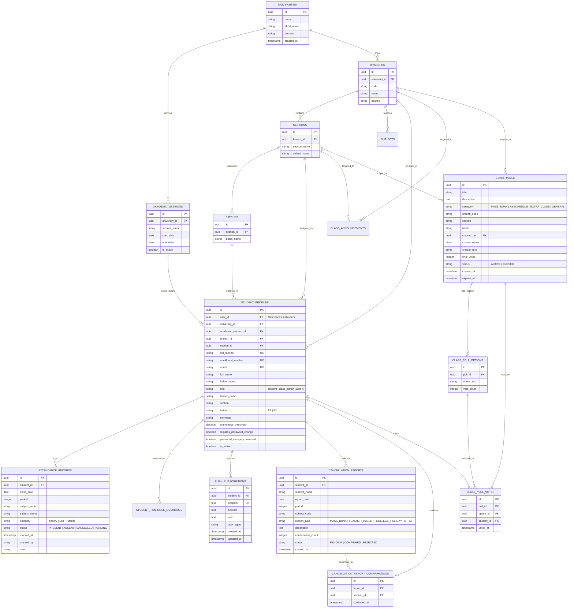

# PART 4 — CONNECTIONS: THE MOST IMPORTANT SECTION

> [!IMPORTANT]
> **VIVA PREPARATION FOCUS:**  
> University project evaluators specifically probe **system connectivity**: how the frontend calls the backend, how the backend queries the database, how tokens travel, and how external services interact. This chapter provides the exact, file-by-file blueprints of every connection in AttendX.

---

## 4.1 Frontend-to-Backend Connections

The frontend and backend in AttendX communicate via asynchronous HTTP REST requests utilizing the standard browser `fetch` API. All requests to protected endpoints supply an authoritative bearer session token in the `Authorization` header.

```
+-----------------------------------------------------------------------------------------+
|                              FRONTEND-TO-BACKEND WIRE PROTOCOL                          |
+-----------------------------------------------------------------------------------------+
|                                                                                         |
|   Frontend Client Component                               Serverless Route Handler      |
|   (e.g., src/app/login/page.tsx)                          (e.g., src/app/api/auth/login)|
|                                                                                         |
|      1. User triggers action                                                            |
|      2. Formulates JSON body                                                            |
|      3. Calls fetch('/api/...')       HTTP POST /api/auth/login                         |
|         ------------------------------------------------------>  1. Receives NextRequest|
|                                     Headers: Content-Type,       2. Parses JSON body    |
|                                     Authorization: Bearer <tok>  3. Verifies Auth Guard |
|                                                                  4. Executes DB query   |
|                                                                  5. Formulates response |
|                                       HTTP 200 OK / 401 / 403                           |
|      4. Awaits res.json()           <--------------------------                         |
|      5. Hydrates state / Storage    Body: { success, user, ...}                         |
|                                                                                         |
+-----------------------------------------------------------------------------------------+
```

### Complete API Connection Catalog

| Endpoint Route | HTTP Verb | Caller File & Function | Request Payload | Response Data | Purpose & Role |
| :--- | :--- | :--- | :--- | :--- | :--- |
| `/api/auth/login` | `POST` | `src/lib/auth.ts`<br/>`loginUser()` | `{ identifier, password }` | `{ success, user, sessionToken, requiresPasswordChange }` | Student login via Roll No or Enrollment No. |
| `/api/auth/rotate-password` | `POST` | `src/lib/auth.ts`<br/>`rotatePassword()` | `{ identifier, newPassword, isStudentSelfService }` | `{ success, sessionToken, message }` | Mandatory one-time student password change. |
| `/api/admin/auth/login` | `POST` | `src/app/admin/login/page.tsx`<br/>`handleAdminLogin()` | `{ email, password }` | `{ success, user, sessionToken, requiresPasswordChange }` | Dedicated administrator authentication endpoint. |
| `/api/admin/auth/verify` | `GET` | `src/app/admin/page.tsx`<br/>`verifyAdminSession()` | *Headers only (`Authorization: Bearer`)* | `{ success, user, role }` | Validates admin session on dashboard load. |
| `/api/admin/auth/setup-status` | `GET` | `src/app/admin/login/page.tsx`<br/>`checkSetupStatus()` | *None* | `{ success, setupCompleted }` | Detects if First-Time Admin Setup is pending. |
| `/api/admin/auth/setup` | `POST` | `src/app/admin/login/page.tsx`<br/>`handleInitialSetup()` | `{ email, newPassword, setupKey }` | `{ success, message, sessionToken }` | One-time initial setup for the primary admin. |
| `/api/admin/students` | `GET`, `POST` | `src/app/admin/page.tsx`<br/>`fetchStudents()`, `createStudent()` | Query params: `page`, `limit`, `search`, `branchCode` | `{ success, students: [], total, page, totalPages }` | Administrative student directory search & pagination. |
| `/api/admin/cr` | `GET`, `POST` | `src/app/admin/page.tsx`<br/>`fetchCRs()`, `assignCR()` | `{ studentId, branchCode, section, batch }` | `{ success, message, crList }` | Assigns or revokes Class CR privileges. |
| `/api/admin/reset-password` | `POST` | `src/app/admin/page.tsx`<br/>`handleAdminResetPassword()` | `{ studentId, temporaryPassword }` | `{ success, message }` | Administrator resets forgotten student password. |
| `/api/admin/stats` | `GET` | `src/app/admin/page.tsx`<br/>`loadAdminStats()` | *Headers only* | `{ success, totalStudents, totalCRs, branchBreakdown }` | Aggregates institution-wide student stats. |
| `/api/polls` | `GET` | `src/app/polls/page.tsx`<br/>`fetchPolls()` | *Headers only (`Authorization`)* | `{ success, polls: [] }` | Retrieves class polls scoped to student's class. |
| `/api/polls` | `POST` | `src/app/polls/page.tsx`<br/>`handleCreatePoll()` | `{ title, description, category, options, branchCode, section }` | `{ success, poll }` | Class CR or Admin creates a new class poll. |
| `/api/polls` | `PATCH` | `src/app/polls/page.tsx`<br/>`handleVote()`, `handleClose()` | `{ action: "vote" \| "close", pollId, optionId }` | `{ success, poll }` | Student votes in poll or CR closes the poll. |
| `/api/announcements` | `GET` | `src/components/StudentAnnouncements.tsx` | *Headers only* | `{ success, announcements: [] }` | Fetches announcements for student's branch/section. |
| `/api/announcements` | `POST` | `src/components/CRAnnouncementModal.tsx` | `{ title, message, type, targetBranchCode, targetSection }` | `{ success, announcement }` | CR or Admin broadcasts an official notice. |
| `/api/cancellations` | `GET` | `src/app/cancellations/page.tsx`<br/>`fetchReports()` | *Headers only* | `{ success, reports: [] }` | Retrieves class cancellation reports. |
| `/api/cancellations` | `POST` | `src/app/cancellations/page.tsx`<br/>`handleSubmitReport()` | `{ date, period, subjectCode, reasonType, description }` | `{ success, report }` | CR submits an official class cancellation report. |
| `/api/cancellations/confirm` | `POST` | `src/app/cancellations/page.tsx`<br/>`handleConfirm()` | `{ reportId }` | `{ success, report }` | CR or Admin atomically confirms a cancellation. |
| `/api/notifications/subscribe` | `POST` | `src/app/notifications/page.tsx`<br/>`handleSubscribe()` | `{ studentId, subscription, userAgent }` | `{ success, subscription }` | Persists browser push subscription to Supabase. |
| `/api/notifications/test-push` | `POST` | `src/app/notifications/page.tsx`<br/>`handleSendTestPush()` | `{ studentId, payload }` | `{ success, message }` | Triggers immediate test Web Push notification. |
| `/api/cron/check-classes` | `GET`, `POST` | Triggered by Vercel Cron or Admin test | Header: `Authorization: Bearer <CRON_SECRET>` | `{ success, message, notified, istTime }` | Evaluates current IST period & dispatches push. |
| `/api/cron/auto-absence` | `GET`, `POST` | Triggered by Vercel Cron at 18:00 UTC | Header: `Authorization: Bearer <CRON_SECRET>` | `{ success, processedCount }` | Auto-marks unverified pending classes as absent. |

---

## 4.2 Application-to-Database Connections

AttendX connects to **Supabase Cloud PostgreSQL** using the official `@supabase/supabase-js` SDK. Database connections are initialized server-side inside Next.js serverless functions.

### A. Database Client Initialization Locations
1. **Authoritative Session Verification:** [`src/lib/serverAuthGuard.ts`](file:///d:/AttendX/src/lib/serverAuthGuard.ts#L70-L75)
2. **Credential Authentication & Roll Number Lookup:** [`src/lib/serverAuth.ts`](file:///d:/AttendX/src/lib/serverAuth.ts#L208-L212)
3. **Administrator Student Management:** [`src/lib/serverAdmin.ts`](file:///d:/AttendX/src/lib/serverAdmin.ts#L45-L50)
4. **Push Subscription Persistence:** [`src/lib/subscriptionStore.ts`](file:///d:/AttendX/src/lib/subscriptionStore.ts#L37-L41)
5. **Class Polls & Voting Operations:** [`src/lib/serverPolls.ts`](file:///d:/AttendX/src/lib/serverPolls.ts#L35-L40)
6. **Class Cancellations & Confirmations:** [`src/lib/serverCancellations.ts`](file:///d:/AttendX/src/lib/serverCancellations.ts#L30-L35)

### B. Environment Variables Used for DB Connection
```ini
# Supabase Cloud Project URL (Publicly accessible)
NEXT_PUBLIC_SUPABASE_URL="https://iczjocbishkvkkkfvalz.supabase.co"

# Supabase Anonymous Client Key (Safe for browser, respects RLS)
NEXT_PUBLIC_SUPABASE_ANON_KEY="eyJhbGciOiJIUzI1NiIsInR5cCI6IkpXVCJ9..."

# Supabase Service Role Key (STRICTLY SERVER-SIDE ONLY - Bypasses RLS)
SUPABASE_SERVICE_ROLE_KEY="eyJhbGciOiJIUzI1NiIsInR5cCI6IkpXVCJ9..."
```

### C. Connection Execution Pattern
```ts
// Standard Server-Side Database Initialization Pattern in AttendX
import { createClient } from "@supabase/supabase-js";

const supabase = createClient(
  process.env.NEXT_PUBLIC_SUPABASE_URL!,
  process.env.SUPABASE_SERVICE_ROLE_KEY! // Server-side admin client
);

// Executing queries with relational joins:
const { data, error } = await supabase
  .from("student_profiles")
  .select(`
    *,
    branches:branch_id (code, name, degree),
    sections:section_id (section_name, default_room)
  `)
  .eq("roll_number", "2026041133")
  .maybeSingle();
```

---

## 4.3 Authentication Connections

### Step-by-Step Connection Lifecycle:
1. **User Identifier Input:**  
   The user enters either their **Roll Number** (e.g. `2026041133`) or **Enrollment Number** (e.g. `2026ECD1044`) and password on the login screen.
2. **Server-Side Identity Resolution:**  
   The client issues `POST /api/auth/login`. In [`src/lib/serverAuth.ts`](file:///d:/AttendX/src/lib/serverAuth.ts#L223-L241), the server queries `student_profiles`:
   ```sql
   SELECT * FROM student_profiles 
   WHERE roll_number = '2026041133' 
      OR enrollment_number ILIKE '2026ECD1044'
   LIMIT 1;
   ```
3. **Internal Alias Resolution:**  
   To preserve the security of Supabase GoTrue Auth (which expects an email identifier), the server transparently converts the student identifier to an internal alias:
   $$\text{targetEmail} = \text{student.2026041133@attendx.mmmut.ac.in}$$
   *The student never sees or inputs this internal alias in the UI.*
4. **Supabase Auth Verification:**  
   The server calls:
   ```ts
   const { data: authResult, error } = await supabase.auth.signInWithPassword({
     email: targetEmail,
     password: pass,
   });
   ```
5. **Session Hydration & Token Return:**  
   Supabase Auth verifies the password hash via `bcrypt` and returns a 3-part JWT access token. The route handler attaches the user profile object and returns it to the client.
6. **Client Storage:**  
   The client stores the token in `localStorage.setItem('attendx_session_token', token)` and the user profile in `localStorage.setItem('attendx_current_user', JSON.stringify(user))`.

---

## 4.4 Authorization Connections & Role Enforcement

AttendX enforces strict Role-Based Access Control (RBAC) across three distinct tiers:

```
+-----------------------------------------------------------------------------------+
|                           ROLE-BASED AUTHORIZATION HIERARCHY                      |
+-----------------------------------------------------------------------------------+
|   ROLE             |   DATABASE CLAIM           |   PERMITTED OPERATIONS          |
|   student          |   app_metadata.role        |   View personal logs, vote,     |
|                    |   = "student"              |   view class announcements.     |
|   -----------------+----------------------------+---------------------------------|
|   class_admin (CR) |   app_metadata.role        |   All student operations +      |
|                    |   = "class_admin"          |   class timetable, submit canc.,|
|                    |                            |   create & close class polls.   |
|   -----------------+----------------------------+---------------------------------|
|   admin            |   app_metadata.role        |   Institution-wide management,  |
|                    |   = "admin"                |   student reset, CR assignments |
+-----------------------------------------------------------------------------------+
```

### Server-Side Guard Function: `requireRole()`
Located in [`src/lib/serverAuthGuard.ts`](file:///d:/AttendX/src/lib/serverAuthGuard.ts#L360-L400):
```ts
export async function requireRole(
  req: NextRequest,
  allowedRoles: UserRole[]
): Promise<{ user: UserAccount; errorResponse?: NextResponse }> {
  const session = await verifyServerSession(req);
  if (!session.authenticated || !session.user) {
    return {
      user: null as any,
      errorResponse: NextResponse.json(
        { success: false, error: session.error || "Authentication required." },
        { status: session.statusCode || 401 }
      ),
    };
  }

  if (!allowedRoles.includes(session.user.role)) {
    return {
      user: null as any,
      errorResponse: NextResponse.json(
        { success: false, error: `Access Denied: Requires role [${allowedRoles.join(", ")}].` },
        { status: 403 }
      ),
    };
  }

  return { user: session.user };
}
```

---

## 4.5 Database Relationships & Master Entity-Relationship (ER) Diagram

Below is the complete, verified Entity-Relationship diagram representing the active PostgreSQL relational database on Supabase:



---

## 4.6 External Service Connections

AttendX interfaces with three principal external cloud services:

```
+-----------------------------------------------------------------------------------------+
|                                EXTERNAL SERVICE INTEGRATIONS                            |
+-----------------------------------------------------------------------------------------+
|   SERVICE                |   EXCHANGED DATA             |   PROTOCOL / TRANSPORT        |
|   Supabase Cloud         |   Relational queries, auth   |   HTTPS / PostgREST, WebSockets|
|   (iczjocbishkvkkkfvalz) |   tokens, bcrypt hashes      |   WSS for Realtime Subscriptions|
|   -----------------------+------------------------------+-------------------------------|
|   Web Push Gateways      |   VAPID signed JSON payloads |   HTTPS Web Push Protocol     |
|   (Google FCM / Mozilla) |   with class reminders       |   RFC 8291 / RFC 8292          |
|   -----------------------+------------------------------+-------------------------------|
|   Vercel Edge Cron       |   Automated CRON_SECRET      |   HTTPS Triggered REST call   |
|   (Scheduled daemon)     |   execution signals          |   Header Authorization Bearer  |
+-----------------------------------------------------------------------------------------+
```

---

## 4.7 Deployment Connections: GitHub $\rightarrow$ Vercel $\rightarrow$ Production

AttendX implements an automated Continuous Integration and Continuous Deployment (CI/CD) pipeline connecting GitHub directly to the Vercel Production Environment:

```mermaid
flowchart LR
    DEV["Developer Workstation<br/>(Local Machine)"]
    GIT["Git Repository<br/>(git commit & push)"]
    GH["GitHub Remote<br/>(github.com/.../AttendX)"]
    
    subgraph VERCEL_PIPELINE["Vercel Cloud CI/CD Engine"]
        WEBHOOK["GitHub Webhook<br/>(Trigger on main push)"]
        ENV_INJECT["Inject Production Secrets<br/>(NEXT_PUBLIC_SUPABASE_URL,<br/>SUPABASE_SERVICE_ROLE_KEY,<br/>VAPID_PRIVATE_KEY, etc.)"]
        BUILD_STEP["Turbopack Build & TypeScript Check<br/>(npm run build)"]
        STATIC_ANALYSIS["Page Optimization & SSG<br/>(36 Routes Compiled)"]
        EDGE_DEPLOY["Deploy to Edge Nodes<br/>(Global Serverless CDN)"]
    end
    
    PROD["Live Production URL<br/>(attend-x.vercel.app)"]
    
    DEV -->|1. git push origin main| GIT
    GIT -->|2. Sync commits| GH
    GH -->|3. Trigger Webhook| WEBHOOK
    WEBHOOK --> ENV_INJECT
    ENV_INJECT --> BUILD_STEP
    BUILD_STEP --> STATIC_ANALYSIS
    STATIC_ANALYSIS --> EDGE_DEPLOY
    EDGE_DEPLOY -->|4. Live Serving| PROD
```



### Critical Differences Between Local & Production:
1. **Credentials:** Locally loaded from `.env.local`; in production, securely injected via Vercel Encrypted Environment Variables.
2. **Build Optimizer:** Turbopack generates minified, tree-shaken static HTML and optimized serverless route handlers.
3. **Execution Context:** Locally runs on Node.js; in production, routes execute as isolated serverless micro-lambdas distributed at global edge locations.
