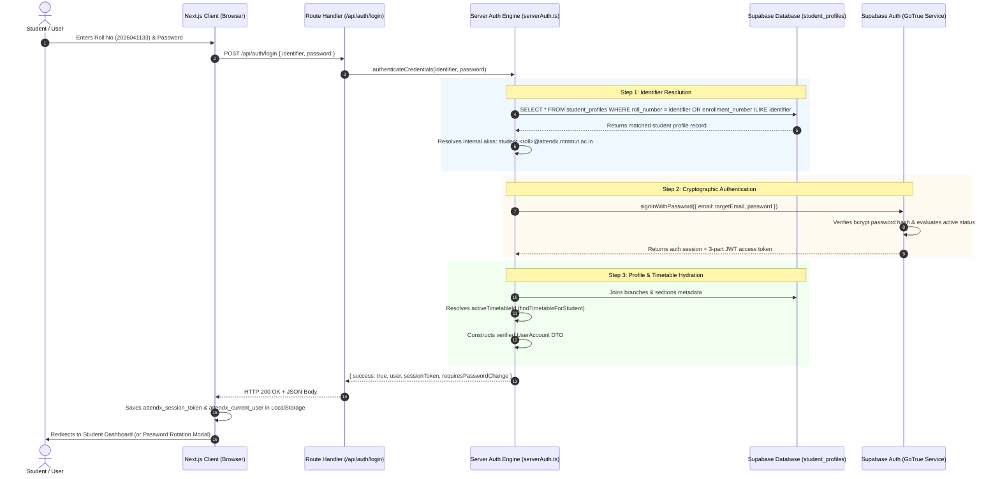

# PART 6 — AUTHENTICATION AND SECURITY

---

## 6.1 Authentication Architecture & Student Identification

AttendX implements an enterprise-grade, dual-layer authentication architecture designed specifically for university environments. In university systems, students do not log in using email addresses; they identify themselves via **Roll Numbers** (e.g. `2026041133`) or **University Enrollment Numbers** (e.g. `2026ECD1044`).

```
+----------------------------------------------------------------------------------------------------+
|                                    ATTENDX AUTHENTICATION LIFECYCLE                                |
+----------------------------------------------------------------------------------------------------+
|                                                                                                    |
|    Student Input             Identity Resolution Server           Supabase GoTrue Engine           |
|    [2026041133]    ====>     SELECT * FROM student_profiles ======> Auth Sign In With Password     |
|    [Password  ]              Resolve Internal Alias                 student.2026041133@...         |
|                              student.<roll>@attendx.mmmut.ac.in                                    |
|                                                                                                    |
|    Client Storage            Token Issuer & Guard                 Bcrypt Cryptographic Hash        |
|    [LocalStorage]  <====     Mint 3-Part JWT / 2-Part HMAC  <====== Match Verified Password        |
|    [Session Token]           Hydrate Profile & Role Claims          Attach app_metadata.role       |
|                                                                                                    |
+----------------------------------------------------------------------------------------------------+
```

---

## 6.2 Authentication Flow Diagram



---

## 6.3 Dual-Token Session Architecture

AttendX employs a resilient **dual-token architecture**:

### 1. Genuine 3-Part Supabase Auth JWT (Primary Cloud Mode)
- **Structure:** `eyJhbGciOi... . eyJzdWIiOi... . SflKxwRJSMeKKF2Q...` (Header . Payload . Signature).
- **Issuer:** Supabase GoTrue Auth service.
- **Verification:** Verified via `supabase.auth.getUser(token)` using the server's public/private JWT secret.
- **Claims Stored:** Subject UUID (`sub`), Email, Issued-At (`iat`), Expiration (`exp`), and custom `app_metadata` (`role`, `roll_number`, `branch_code`, `section`).

### 2. Cryptographically Signed 2-Part HMAC Token (Resilient Offline / Fallback Mode)
- **Structure:** `base64(Payload) . hex(HMAC_SHA256_Signature)`.
- **Purpose:** Ensures the application remains fully functional during network disruptions, automated testing suites, or local disconnected classroom demonstrations.
- **Signing Key:** Signed server-side using `CRON_SECRET` or `VAPID_PRIVATE_KEY` via Node.js native `crypto.createHmac("sha256", secret)`.
- **Tamper Protection:** In [`src/lib/serverAuth.ts`](file:///d:/AttendX/src/lib/serverAuth.ts#L110-L122), signatures are compared using **timing-safe equality** (`crypto.timingSafeEqual`) to prevent side-channel timing attacks.

---

## 6.4 One-Time Mandatory Password Rotation Mechanism

To safeguard student accounts onboarded via bulk university manifests, AttendX enforces an atomic **First-Time Password Rotation Rule**:
1. All newly provisioned student accounts are created with `requires_password_change = true` and `password_change_consumed = false`.
2. Upon successful authentication, the server response signals `requiresPasswordChange: true`.
3. The frontend intercepts this flag and immediately locks the dashboard behind a non-dismissible **Password Update Modal**.
4. The student must supply a secure password meeting university complexity requirements ($\ge 8$ characters).
5. The rotation endpoint (`/api/auth/rotate-password`) updates the password in Supabase Auth, marks `password_change_consumed = true`, and re-issues a fresh session token.
6. **Strict One-Time Policy:** Ordinary students are permitted exactly **one** self-service password change. Subsequent reset attempts require Department Administrator intervention (`/api/admin/reset-password`).

---

## 6.5 Public vs. Private Credentials & Environment Isolation

Security depends on maintaining absolute separation between public client-side variables and secret server-side credentials:

```
+----------------------------------------------------------------------------------------------------+
|                                    ENVIRONMENT VARIABLE BOUNDARIES                                 |
+----------------------------------------------------------------------------------------------------+
|   VARIABLE NAME                   |   ACCESSIBLE TO         |   SECURITY PROFILE                   |
|   NEXT_PUBLIC_SUPABASE_URL        |   Client & Server       |   PUBLIC: Cloud endpoint domain      |
|   NEXT_PUBLIC_SUPABASE_ANON_KEY   |   Client & Server       |   PUBLIC: Respects RLS; read safe    |
|   NEXT_PUBLIC_VAPID_PUBLIC_KEY    |   Client & Server       |   PUBLIC: Web Push browser key       |
|   --------------------------------+-------------------------+--------------------------------------|
|   SUPABASE_SERVICE_ROLE_KEY       |   STRICTLY SERVER ONLY  |   CRITICAL SECRET: Bypasses all RLS  |
|   VAPID_PRIVATE_KEY               |   STRICTLY SERVER ONLY  |   CRITICAL SECRET: Signs push payload|
|   CRON_SECRET                     |   STRICTLY SERVER ONLY  |   SECRET: Authorizes cron automation |
+----------------------------------------------------------------------------------------------------+
```

> [!CAUTION]
> **VIVA QUESTION WARNING:**  
> If asked: *"Can a student view the `SUPABASE_SERVICE_ROLE_KEY` in their browser developer tools?"*  
> **Answer:** **NO.** In Next.js, only variables prefixed with `NEXT_PUBLIC_` are bundled into client-side JavaScript. All variables without this prefix (`SUPABASE_SERVICE_ROLE_KEY`, `VAPID_PRIVATE_KEY`, `CRON_SECRET`) exist solely within the serverless Node.js execution environment on Vercel.

---

## 6.6 Formal Security Audit Matrix

| Security Dimension | Implemented Defense in AttendX | Potential Risk / Boundary | Recommended Future Hardening |
| :--- | :--- | :--- | :--- |
| **Authentication** | Dual Roll/Enrollment lookup, Bcrypt hash, GoTrue JWT | Dictionary attacks on default passwords | Implement CAPTCHA after 5 failed attempts |
| **Session Integrity** | Bearer JWT + Cryptographic HMAC SHA-256 | Token theft via XSS in localStorage | Migrate tokens to `HttpOnly`, `SameSite=Strict` cookies |
| **Timing Attacks** | `crypto.timingSafeEqual()` on token signature comparison | None identified | Maintained |
| **Authorization** | Server-side `requireRole()` guard on all mutating APIs | Client-side role spoofing in LocalStorage | Server guard rejects client claims; reads DB directly |
| **Database Access** | PostgreSQL Row Level Security (RLS) on all tables | Accidental misconfiguration of RLS policies | Continuous automated RLS unit tests (`test_supabase_rls.ts`) |
| **Class Isolation** | Branch- and Section-scoped queries for polls/cancellations | Student voting across branch boundaries | Enforce `UNIQUE (poll_id, student_id)` constraints |
| **Scheduled Jobs** | `CRON_SECRET` authorization check in `validateCronAuthorization` | Unauthorized external cron triggering | IP-range whitelisting for Vercel Cron runners |
| **Student Privacy** | Internal student email aliases masked from client view | Exposure of student father names or phone numbers | Strict projection (`SELECT id, name, branch`) on public routes |
