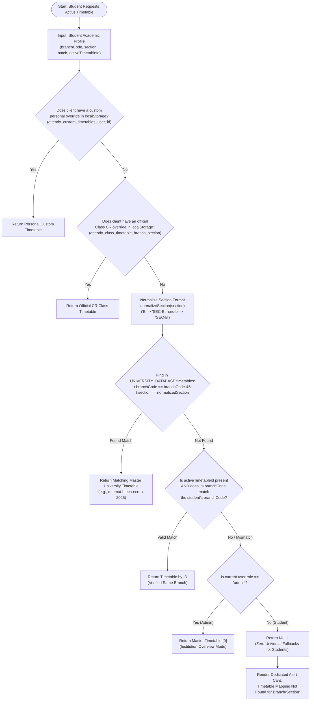

# PART 9 — TIMETABLE SYSTEM

---

## 9.1 The University Master Timetable Database

At technical universities like **MMMUT**, master academic schedules are published as complex multi-page PDF documents. In the official MMMUT Odd Semester Master Schedule, schedules are split across **21 distinct sheets**, covering 7 engineering branches, multiple sections, and split practical laboratory batches.

AttendX ingests and structures these schedules into [`src/data/extractedTimetables.ts`](file:///d:/AttendX/src/data/extractedTimetables.ts), providing **100% fidelity** to official university deanery allocations while making every slot, period, classroom, and faculty member computationally accessible.

```
+----------------------------------------------------------------------------------------------------+
|                                    MMMUT MASTER TIMETABLE INDEX                                    |
+----------------------------------------------------------------------------------------------------+
|   BRANCH & SECTION        |   OFFICIAL ROOM     |   TIMETABLE ID                   |   WEEKLY SLOTS|
|   ECE Section A           |   TL-207            |   mmmut-btech-ece-a-2025         |   31 slots    |
|   ECE Section B (Nitin K) |   TL-207            |   mmmut-btech-ece-b-2025         |   31 slots    |
|   ECE Section C           |   TL-204            |   mmmut-btech-ece-c-2025         |   31 slots    |
|   ECE (IoT) Section A     |   TL-204            |   mmmut-btech-ece-iot-a-2024     |   31 slots    |
|   IT Section A            |   TL-203            |   mmmut-btech-it-a-2025          |   32 slots    |
|   IT Section B            |   TL-203            |   mmmut-btech-it-b-2025          |   32 slots    |
|   CSE Section A & B       |   TL-109            |   mmmut-btech-cse-a/b-2025       |   34 slots    |
|   CSE Section C & D       |   TL-201            |   mmmut-btech-cse-c/d-2025       |   34 slots    |
|   CE Section A & B        |   TL-206            |   mmmut-btech-ce-a/b-2025        |   34 slots    |
|   ME Section A & B        |   TL-205            |   mmmut-btech-me-a/b-2025        |   33 slots    |
|   EE Section A & B        |   TL-202            |   mmmut-btech-ee-a/b-2025        |   33 slots    |
|   CHE Section A           |   TL-110            |   mmmut-btech-che-a-2025         |   30 slots    |
+----------------------------------------------------------------------------------------------------+
```

---

## 9.2 Timetable Selection Flowchart

The following flowchart illustrates the exact decision tree implemented in [`findTimetableForStudent`](file:///d:/AttendX/src/data/extractedTimetables.ts#L8192) and consumed across the application:



---

## 9.3 Practical Batch Discrepancy Filtering (Batch P1 vs. P2)

Every engineering section at MMMUT is divided into practical laboratory groups: **Batch P1** and **Batch P2**.
- While both batches attend common **Theory** lectures together in their designated Lecture Theater (e.g. `TL-207`), their **Lab** practicals are scheduled at opposing times in specialized computer, electronics, or mechanical laboratories.
- A student assigned to **Batch P1** must **never** see or be notified for Batch P2 laboratory slots.

### The Filtering Logic:
Implemented in [`src/app/page.tsx`](file:///d:/AttendX/src/app/page.tsx#L90), [`src/app/mark-attendance/page.tsx`](file:///d:/AttendX/src/app/mark-attendance/page.tsx#L74), and [`src/app/api/cron/check-classes/route.ts`](file:///d:/AttendX/src/app/api/cron/check-classes/route.ts#L137):

```ts
// Practical Batch Filtering Algorithm
const studentBatch = profile.batch; // "P1" or "P2"

const applicableSlots = timetable.slots.filter((slot) => {
  // 1. Common lectures apply to all students
  if (slot.batch === "ALL") return true;
  
  // 2. Practical labs only apply if matching the student's assigned batch
  return slot.batch === studentBatch;
});
```

### Empirical Verification:
- **NITIN KUMAR (ECE SEC-B P1):**
  - Total Weekly Master Slots: $31$ slots.
  - Assigned Batch P1 Slots: **23 slots**.
  - Opposite Batch P2 Slots: **21 slots**.
  - **Result:** Exactly zero Batch P2 slots appear on Nitin's dashboard or notification queue.

---

## 9.4 The Root Cause & Resolution of the Branch-Wise Bug

During early development, a critical bug caused students from non-IT branches to receive the **IT Section-B** timetable (`TL-203`).

### The Three Intersecting Root Causes Discovered:
1. **Database Column Mismatch in `serverAuth.ts`:**  
   In `student_profiles`, the column was `branch_code`, not `branch`. `profile?.branch || "Information Technology"` defaulted to `"Information Technology"` for every student.
2. **Malformed Regex ID Generation in `serverAuthGuard.ts`:**  
   The guard attempted to synthesize timetable IDs:
   ```ts
   `mmmut-btech-${branch.toLowerCase()}-${section.toLowerCase().replace(/[^a-z0-9]/g, "")}-2025`
   ```
   For `SEC-B`, this generated `"mmmut-btech-ece-secb-2025"`, whereas the real ID was `"mmmut-btech-ece-b-2025"`. The ID lookup failed.
3. **Universal Fallback in `storage.ts`:**  
   When the ID lookup failed, `storage.ts` had a universal fallback: `return found || UNIVERSITY_DATABASE.timetables[0]` (which was IT Section-B, `TL-203`).
4. **Why Dashboard and Modal Differed:**  
   The Profile Modal dynamically filtered `UNIVERSITY_DATABASE.timetables.find(t => t.branchCode === branchCode)` (finding `TL-207`), whereas the Dashboard called `getActiveTimetable()` (falling back to `TL-203`).

### The Architectural Fix Implemented:
- Replaced static string generation with the centralized lookup function [`findTimetableForStudent()`](file:///d:/AttendX/src/data/extractedTimetables.ts#L8192).
- Added automatic **Self-Healing** inside [`getStoredProfile()`](file:///d:/AttendX/src/lib/storage.ts#L33) to repair stale localStorage records on first boot.
- Completely removed the universal IT fallback: if a student's branch/section cannot be matched, the system returns `null` and renders an explicit, helpful configuration alert.
