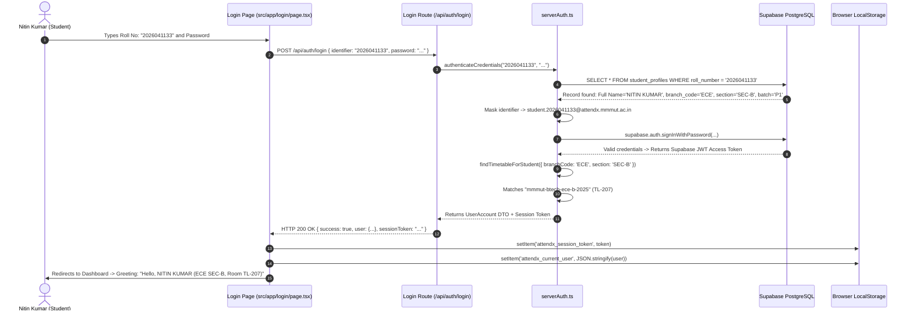
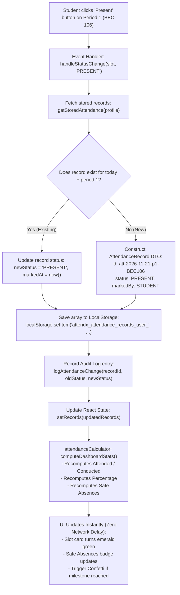
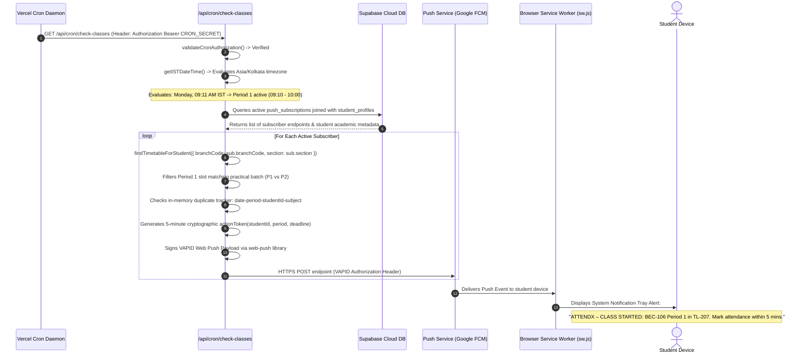

# PART 11 — HOW DATA FLOWS THROUGH ATTENDX

---

## 11.1 Master Data Lifecycle Walkthrough

To explain AttendX during a technical demonstration, you must be able to trace how data originates, transforms, travels across the network, and persists. This chapter breaks down **7 critical end-to-end data flow scenarios**.

---

### Scenario 1: Student Login & Identity Resolution
*What Happens When Nitin Kumar Logs In:*



---

### Scenario 2: Student Marks Attendance for a Lecture
*What Happens When Nitin Clicks "Present" on Period 1 Electronic Devices:*



---

### Scenario 3: Student Opens the Dashboard Screen
*How Profile, Timetable, Attendance, and Metrics are Hydrated:*

```
1. Client initiates mount in src/app/page.tsx (useEffect)
   ↓
2. Reads LocalStorage: getStoredProfile()
   - Inspects cached UserAccount.
   - Executes self-healing check: confirms branchCode matches canonical branch name.
   - If stale, heals profile in LocalStorage immediately.
   ↓
3. Resolves Active Timetable: getActiveTimetable(profile)
   - Checks for personal custom timetable override.
   - Checks for Class CR section override.
   - Matches official schedule: findTimetableForStudent({ branchCode: "ECE", section: "SEC-B" }).
   - Resolves Timetable: "mmmut-btech-ece-b-2025" (Room: TL-207).
   ↓
4. Retrieves Attendance History: getStoredAttendance(profile)
   - Loads all stored attendance records for this student UUID.
   ↓
5. Mathematical Metrics Computation: computeDashboardStats(records, timetable.subjects)
   - Filters Theory vs. Lab.
   - Computes aggregate percentage ($A/C \times 100$).
   - Calculates Safe Absences and Recovery Classes.
   ↓
6. React State Updates:
   - setProfile(prof), setTimetable(tt), setRecords(att).
   ↓
7. UI Render:
   - Header Greeting displays verified branch and room.
   - Metric cards display Safe Absences, Conducted, Attended, and Shortage status.
   - Today's slots render filtered by student's batch (P1 vs P2).
```

---

### Scenario 4: Student Customizes Their Personal Schedule
*How Isolated Timetable Overrides Work Without Affecting Peers:*

```
1. Student opens Timetable Management Page (/timetable)
   ↓
2. Student drags a slot from Monday Period 2 to Tuesday Period 4 (or clicks Edit Slot)
   ↓
3. Student customizes subject, time, or classroom for their personal tracking
   ↓
4. Client invokes saveCustomTimetable(timetableId, customTimetable, studentId)
   ↓
5. LocalStorage isolates the modification under user-specific key:
   localStorage.setItem(`attendx_custom_timetables_user_${studentId}`, JSON.stringify(customMap))
   ↓
6. Downstream impact:
   - Student's dashboard loads their personal override schedule.
   - Peers in the same section are completely unaffected (peer devices read their own keys).
   ↓
7. Restoration:
   - Student clicks "Reset to University Official Schedule".
   - System deletes custom key; schedule instantly reverts to master university database.
```

---

### Scenario 5: Class CR Publishes an Official Timetable Update
*How a Class Representative Updates the Schedule for the Entire Section:*

```
1. Class CR navigates to Timetable Center (/timetable)
   ↓
2. CR edits a class slot (e.g. shifts Math Lecture from TL-207 to Computer Center)
   ↓
3. CR clicks "Publish to Entire Section (Official Class Timetable)"
   ↓
4. Security Check: saveOfficialClassTimetable(timetable, authorName, callerProfile)
   - Checks: Is caller.role == "class_admin" or "admin"?
   - Checks: Does caller.managedBranchCode == timetable.branchCode?
   - Checks: Does caller.managedSection == timetable.section?
   - If any check fails: Throws "Access Denied: Unauthorized cross-branch modification"
   ↓
5. Storage Persistence:
   - Saves sectional timetable under: attendx_class_timetable_${branchCode}_${section}
   ↓
6. Broadcast:
   - Automatically posts a Class Announcement:
     "Official Timetable Updated for ECE SEC-B by Class CR AARYAN"
   ↓
7. All students in ECE Section-B inherit the updated official class schedule.
```

---

### Scenario 6: Administrator Resets a Student's Forgotten Password
*How the Administrator Portal Coordinates with Supabase Auth:*

```
1. Administrator logs into /admin using primary credentials (admin@attendx.ac.in)
   ↓
2. Navigates to Student Directory tab; searches for Roll Number "2026041133"
   ↓
3. Clicks "Reset Password" and supplies temporary university password
   ↓
4. Client issues POST /api/admin/reset-password with Bearer Token
   ↓
5. Server Auth Guard:
   - verifyServerSession(req) -> confirms role == 'admin'
   - Rejects non-admin attempts with HTTP 403 Forbidden
   ↓
6. Server Admin Service (serverAdmin.ts):
   - Initializes Supabase Admin Client using SUPABASE_SERVICE_ROLE_KEY
   - Executes auth admin update: supabaseAdmin.auth.admin.updateUserById(userId, { password })
   - Resets student_profiles flags: requires_password_change = true, password_change_consumed = false
   ↓
7. HTTP 200 Response returned to Admin UI: "Password successfully reset"
   ↓
8. When student logs in with the temporary password, they are forced to rotate it on first boot.
```

---

### Scenario 7: Background Scheduled Class Check & Web Push Dispatch
*How Push Alerts Arrive 5 Minutes Before Class:*


