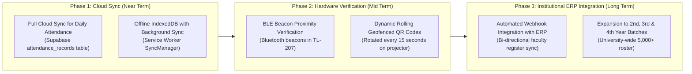

# PART 16 — LIMITATIONS AND FUTURE SCOPE

---

## 16.1 Honest Evaluation of Current Boundaries

Academic evaluation requires engineering maturity and technical honesty. AttendX is an advanced, production-deployed system, but like all software engineering projects, it operates within defined architectural boundaries.

```
+----------------------------------------------------------------------------------------------------+
|                                    CURRENT SYSTEM BOUNDARIES                                       |
+----------------------------------------------------------------------------------------------------+
|   DIMENSION             |   CURRENT IMPLEMENTATION REALITY    |   EVALUATION IMPACT                |
|   Attendance Capture    |   Student manual logging & CR poll  |   Subject to human self-reporting  |
|   Hardware Integration  |   Zero physical IoT/Biometric links |   Cannot physically verify presence|
|   Attendance Storage    |   Client LocalStorage primary cache |   Browser cache clearing loses logs|
|   Cohort Coverage       |   First-Year B.Tech (2026-27 Intake)|   Upperclassmen rosters pending    |
|   Faculty Portal        |   None; Admin & Student/CR only     |   Instructors do not log directly  |
+----------------------------------------------------------------------------------------------------+
```

---

## 16.2 Technical Limitations Deep Dive

### 1. Manual Attendance Entry & Absence of Physical Verification
- **Current Reality:** Attendance status (`PRESENT`, `ABSENT`) is toggled manually by the student in the browser UI or verified collectively via CR cancellation reports.
- **Limitation:** The application cannot physically prove that a student was sitting in Lecture Hall `TL-207` during Period 1. If a student marks "Present" while off campus, AttendX will record it as present in their local cockpit.
- **Mitigation & Rationale:** AttendX is fundamentally designed as a **student intelligence and decision-support tool**, not a police monitoring system. A student who falsely marks themselves present only corrupts their own personal forecast, defeating their goal of preventing debarment.

### 2. Client-Side Attendance Persistence vs. Centralized Cloud Sync
- **Current Reality:** While authentication, student directory (1,189 students), class polls, announcements, cancellations, and push subscriptions are persisted in Supabase PostgreSQL, daily marked period records reside in the browser's `localStorage` (`attendx_attendance_records_user_<id>`).
- **Limitation:** If a student clears their browser cache or switches from their mobile browser to a campus computer, their past daily attendance ticks do not automatically download unless they have exported a backup.
- **Architectural Trade-off:** LocalStorage was intentionally chosen to ensure zero-latency offline marking in concrete university lecture halls where cell coverage is notoriously weak.

### 3. Single-University Focus & Master Timetable Ingestion
- **Current Reality:** The timetable database is specifically extracted from the official master schedule of **MMMUT, Gorakhpur** (Odd Semester 2026–27).
- **Limitation:** Deploying AttendX at another university (e.g. IIT Kanpur or AKTU) requires ingesting and structuring that university's specific timetable sheets and room codes into the engine.

### 4. Push Notification Browser Dependency
- **Current Reality:** Background class reminders rely on browser-level Web Push APIs and Service Worker registration (`sw.js`).
- **Limitation:** Web Push on iOS requires adding the web app to the home screen (iOS PWA requirement since iOS 16.4). If a student denies browser notification permissions, automated push reminders cannot be delivered.

---

## 16.3 Structured Future Scope & Engineering Roadmap

The future development of AttendX is divided into three concrete engineering phases:



### Phase 1: Near-Term Enhancements (1–3 Months)
1. **Automated Cloud Backup for Local Records:**  
   Implement a background sync worker that mirrors `localStorage` attendance records to Supabase's `attendance_records` table whenever network connectivity is established.
2. **IndexedDB Upgrade:**  
   Transition local storage from the 5MB `localStorage` limit to browser `IndexedDB`, enabling multi-year storage of period-by-period attendance logs and audit histories.

### Phase 2: Medium-Term Enhancements (3–6 Months)
1. **Classroom Proximity Verification via Bluetooth Low Energy (BLE):**  
   Equip lecture halls (`TL-207`, `TL-203`) with low-cost BLE beacons. The AttendX mobile client verifies that the student is physically within 15 meters of the beacon before permitting one-click attendance marking.
2. **Dynamic Rolling QR Codes:**  
   Allow instructors or Class CRs to project a dynamic, time-synced QR code on the lecture hall screen that regenerates every 15 seconds, preventing students from forwarding codes to absent peers.

### Phase 3: Long-Term Institutional Integration (6–12 Months)
1. **Bi-Directional Official ERP Connector:**  
   Build an authenticated webhook integration between AttendX and MMMUT's central academic server, enabling faculty marks to automatically sync to AttendX and vice versa.
2. **Expansion Across All Academic Years:**  
   Ingest the remaining 2nd, 3rd, and 4th-year B.Tech, MCA, MBA, and Ph.D. rosters, scaling the platform to over 6,000 active university scholars.
